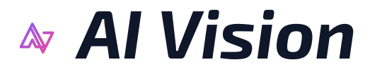

  <picture>
    <source media="(prefers-color-scheme: dark)" srcset="docs/assets/aivision-logo-dark.svg">
    <source media="(prefers-color-scheme: light)" srcset="docs/assets/aivision-logo-light.svg">
    
  </picture>

  <em>エージェントの一手を読み解き、次の改善へ。</em>

  AI Vision は、自分の環境で運用できるオープンソースのエージェント可観測性・診断プラットフォームです。

  
  
  
  
  

  <a href="README.md">English</a> · <a href="README.zh-CN.md">简体中文</a> · 日本語

  <strong><a href="#quick-start">クイックスタート</a></strong> · <a href="#capabilities">主な機能</a> · <a href="#compare-langfuse">Langfuse との比較</a> · <a href="https://aivision.mintlify.site/ja/introduction">ドキュメント</a>

同じタスクを 2 回実行して、どちらも成功した。なのに、片方だけずいぶん時間がかかったのはなぜでしょう。トレースを並べると、どの呼び出しを再試行したか、どこでトークンの消費が増えたかが分かります。修正したら、新しいトレースに同じルールを適用して再発していないか確かめられます。

> Ant Group の可観測性チームと OceanBase が共同で開発しています。

https://github.com/user-attachments/assets/aba911ea-618a-40c9-b784-75f213db9c3f

> [!NOTE]
> **個人向けの導入** · コマンドを実行できる AI アシスタントに、次の一文を送ってください。
>
> `ob-labs/ai-vision-skills` の `aivision-deploy` スキルを使って、この環境に AI Vision All-in-One を導入し、サービスが動作することを確認してください。

**使っているエージェントをつなぐ**

- **自作のエージェント**では、対応する既存の計装をそのまま使うか、LangGraph、OpenAI Agents SDK、Go / Eino の[接続例](https://aivision.mintlify.site/ja/integrations/frameworks)を参考に計装を追加できます。
- **Codex、Claude Code、OpenClaw などのアプリ**は、[対応プラグイン](https://aivision.mintlify.site/ja/integrations/plugins)を入れると、普段のタスクの実行内容を追えます。

## 🧭 見つける、読み解く、改善する

- **[見つける](#see)**：必要なトレースに絞り込み、長い実行の中から該当する処理を探して、使用量と費用を確認します。
- **[読み解く](#understand)**：どのツールを使い、何をメモリから取り出したかを、実行ごとに見比べます。
- **[改善する](#improve)**：ルールを定期実行し、問題のあった処理まで戻って確認します。修正の効果も同じ条件で検証できます。

### 🔎 見つける · 大量の実行から該当する処理にたどり着く

トレースが増えたとき、昨日の遅いタスクや、その原因になった呼び出しをどう探せばよいでしょうか。

- **一覧から探す。** エージェント、日時、所要時間、ステータス、ステップ数、総トークン数で絞り込み、使用量で並べ替えられます。トレース ID で直接探せるほか、データソースによっては収集済みの入出力も検索できます。
- **セッションから探す。** 複数ターンのやり取りを振り返り、気になるターンのトレースを開きます。
- **長いトレースの中で絞り込む。** サブエージェントの分岐に注目し、失敗したツール呼び出しや入力トークンの多いモデル呼び出しを抽出できます。該当ステップまでの親階層は呼び出しツリーに残り、よく使う条件も保存できます。[トレース調査ガイド](https://aivision.mintlify.site/ja/guides/trace-analysis)に操作例があります。

**トークン使用量や費用も変わったら。** ダッシュボードから個々の呼び出しまでたどって、再試行、コンテキストの長さ、キャッシュヒットの変化を確認できます。費用の詳細には、適用した単価と集計対象が表示されます。[モデル単価](https://aivision.mintlify.site/ja/guides/model-pricing)を設定すると、適用開始時点に応じて、過去の実行をやり直さずに再見積もりできます。モデル料金の計算はベータ機能です。

使用量や単価が不明な場合や、サブスクリプションの費用は？

通常入力、キャッシュ済み入力、出力では単価が異なる場合があります。使用量や単価が不明な部分は未確定のまま扱います。サブスクリプションやコーディングプランではモデルの公表単価をもとに参考額を表示できます。実際の支払額は請求書で確認してください。

### 🧩 読み解く · 前後の流れからエージェントの動きをつかむ

デモでは、同じタスクが 2 回とも成功していますが、片方ではストレージポリシーの取得がタイムアウトして再試行されています。[2 本のトレースを並べる](https://aivision.mintlify.site/ja/guides/trace-compare)と、失敗した呼び出しの引数やエラーを確認したり、Skill、メモリ、判断を見比べたりできます。実行ツリーやグラフ、タイムラインを使えば、モデルへの入力、ツールの結果、その後の処理まで追えます。

| 見たいもの | 確認できること |
| --- | --- |
| [実行プロセス](https://aivision.mintlify.site/ja/guides/trace-process) | メッセージ、モデルの出力、ツールとのやり取りを順に確認。元の記録があるステップでは入出力を、ツール定義が収集されていれば当時使えたツールを確認できます。 |
| [MCP](https://aivision.mintlify.site/ja/guides/mcp-observability) | サーバー、ツールごとに呼び出しをまとめ、引数、ステータス、所要時間、エラーを確認できます。 |
| [Skill](https://aivision.mintlify.site/ja/guides/skill-observability) | 読み込まれた Skill を確認し、報告された呼び出しと、実行記録から推定した読み取りを区別できます。 |
| [メモリ](https://aivision.mintlify.site/ja/guides/memory-observability) | 何をどこから取り出したかを確認し、記録があれば、その内容がモデルへの入力に含まれていたかもたどれます。 |
| [判断](https://aivision.mintlify.site/ja/guides/decision-traces) | モデルの振り分けや承認時の選択肢と結果を確認できます。後続のステップは、識別子で関連付けられたものと、前後の記録から推定したものがあります。 |

**入力や成果物もその場で確認。** モデルに渡した画像やエージェントが作ったレポートを、トレースを開いたまま確認できます。収集済みの画像、音声、動画、PDF のほか、形式を認識できる Markdown や静的 HTML を表示できます。[Python でのマルチメディア収集例](ai-vision/agent-plugins/langfuse/README.md#python-多媒体-tracelangchain)も参照できます。

表示できる内容は接続方式と収集データによって異なります。MCP、Skill、メモリの専用ページと判断ビューはベータ機能です。

### 🛠️ 改善する · 繰り返す問題を見つけ、修正の効果を確かめる

ツールが失敗し、再試行されていた。この手の問題が繰り返し起きているかを確かめたいときは、診断を使えます。

1. **ルールを試して定期実行する。** いくつかのトレースで[組み込みルール](https://aivision.mintlify.site/ja/guides/diagnosis)を試し、ツールの失敗や呼び出しの繰り返し、コード変更後の検証漏れを調べます。使うルールを選んだら、チームスペースで[定期診断](https://aivision.mintlify.site/ja/guides/continuous-diagnosis)を設定します。
2. **問題の根拠をたどる。** 品質ダッシュボードで診断バッチごとの変化を見て、検出されたケース（BadCase）から該当するステップに戻ります。実際の成果物と照らし合わせ、問題を確定するか、誤検出または判定不能として記録します。
3. **修正後にもう一度確かめる。** 同じ種類のタスクを実行し、新しいトレースを同じ診断設定で確認します。

合格条件を明文化できるなら、オプションの OpenShell サンドボックスで[拡張 Python ルール](https://aivision.mintlify.site/ja/guides/sandbox)を実行できます。たとえば、収集したコードを `pytest` で検証したり、参照用の明細表から結果を再計算したりできます。回答が問いに沿っているか、説明に根拠があるかは、LLM による診断で確認できます。

診断にはどんなデータが必要ですか？

診断には AI Vision が受信・保存したトレースが必要です。Langfuse SDK 経由で新たに送ったトレースも対象になります。外部 Langfuse のデータソースを参照している場合は、そこで読み取ったトレースに直接診断を実行することはできません。必要なデータが不足していると、判定不能になる場合があります。

## ⚖️ Langfuse との違いは？

AI Vision は、実際の実行から問題を調べ、修正後に似たタスクで効果を確かめる流れに重点を置いています。

- **余分な処理が入った理由を調べたい。** どちらも MCP と Skill のトレースに対応しています。AI Vision の[行動別ビュー](#understand)では、ツールの結果、メモリからの取得、モデルの振り分けを実行の流れの中で確認し、別の実行と比較できます。
- **手元でまず試したい。** Langfuse の公式 Docker Compose 構成は複数のサービスを起動します。AI Vision All-in-One はプラットフォームと組み込みの seekdb を 1 つのコンテナで動かします。軽量化したイメージの圧縮アーカイブは実測で約 200 MiB です。モデルを設定せずにデモを試せます。
- **同じ合格条件で繰り返し検証したい。** どちらもコードで条件を判定できるため、その分の LLM 評価呼び出しを省けます。Langfuse の標準評価環境では言語の標準ライブラリが使えます。AI Vision の[オプションのサンドボックス](https://aivision.mintlify.site/ja/guides/sandbox)には `pytest` などが含まれ、既存のテストや参照ファイルを成果物の検証に使えます。

**Langfuse が充実している部分。** プロンプトや Skill のバージョン管理、同じデータセットを使った実験の実行と比較では、Langfuse の機能がより充実しています。

> [!NOTE]
> **今後の予定。** 観測データのガバナンス機能をオープンソースで提供する予定です。調査に必要なデータを残しながら長期保管の費用を抑えられるよう、用途に応じた収集と保存期間の設定を検討しています。LangSmith SDK との連携も計画中です。

**Langfuse で計装済みなら。** 対応する SDK と既存の計装を使い、新しいトレースを AI Vision に送れます。対応バージョン、収集設定、クエリの対応範囲は[接続ガイド](https://aivision.mintlify.site/ja/integrations/langfuse)にまとめています。過去データの移行は個別にご検討ください。

## 🚀 最初のトレースを見てみる

- **個人で使う。** [All-in-One](https://aivision.mintlify.site/ja/deployment/all-in-one) なら、Linux x86-64 または ARM64 で、AI Vision と組み込みの seekdb を 1 つの Docker コンテナで実行できます。オンライン導入には [AI Vision Skills リポジトリの読み取り権限](skills/README.md)が必要です。利用許可を得たオフライン配布物も使えます。
- **チームで使う。** OceanBase CE と組み合わせてサービスを分けて運用します。スペースのメンバーとロールを使って、観測・診断結果を共有できます。[Docker](https://aivision.mintlify.site/ja/deployment/docker) で導入するか、既存の Kubernetes クラスターで [OB Operator](https://aivision.mintlify.site/ja/deployment/kubernetes) を使います。
- **スキルや CLI で操作する。** `aivision-deploy` は導入と動作確認、`aivision-quickstart` は起動済みの環境で収集と診断を試すためのスキルです。CLI からも[導入](https://aivision.mintlify.site/ja/deployment/overview)や[トレースの検索](https://aivision.mintlify.site/ja/guides/cli)ができます。

> [!TIP]
> **まずはデモから。** ログイン後、個人スペースで **デモサンプル** を開き、「一連の操作を体験」を選んでサンプルデータを作成します。モデルを設定せずに、トレースの比較とルール診断を試せます。チームスペースでは、エージェント接続と診断の権限が必要です。

**実際のタスクをトレースする。** **エージェント接続** から、[自作エージェント](https://aivision.mintlify.site/ja/integrations/frameworks)の SDK やランタイムを設定します。既存のアプリなら、実行環境に[プラグイン](https://aivision.mintlify.site/ja/integrations/plugins)を入れてアプリを再起動します。Codex ではさらに `/hooks` で AI Vision のフックを確認して信頼し、新しいセッションを開きます。モデルとツールを使うタスクを実行したら、**エージェントのトレース** から新しいトレースを開き、ツール呼び出しの引数とステータスを確認します。

対応プラグインの [Privacy 収集モード](https://aivision.mintlify.site/ja/guides/privacy)では、プロンプト、回答、ツールの入出力などを実行環境で除外しつつ、呼び出し構造と使用量は収集できます。

Privacy モードはどのデータに適用されますか？

有効にした後に収集するデータに適用されます。既に保存したデータやエージェント自体が保持する記録は別途扱う必要があります。

## 🤝 コントリビュート

> [!TIP]
> **エージェントの調査で、最近どこで手が止まりましたか？** 何を知りたかったのか、どの手順で困ったのかを [Issue](https://github.com/antgroup/ai-vision/issues) で教えてください。具体的なケースが一つあるだけでも、手がかりになります。エージェントのバージョン、再現手順、機密情報を除いたトレースなどを共有できれば、こちらでも確認しやすくなります。

試したいアイデアがあれば、ぜひご相談ください。[Pull Request](https://github.com/antgroup/ai-vision/pulls) で連携方法、ビュー、診断ルール、ドキュメントを改善する提案も歓迎します。参加の手順は[コントリビューションガイド](CONTRIBUTING.md)、実装の入口は[開発ドキュメント](docs/README.md)、運営方針は[ガバナンスガイド](GOVERNANCE.md)にあります。[コントリビューター](https://github.com/antgroup/ai-vision/graphs/contributors)の皆さん、ありがとうございます。
