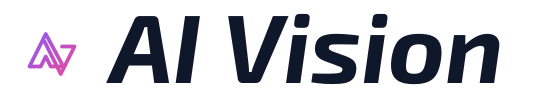

  <picture>
    <source media="(prefers-color-scheme: dark)" srcset="docs/assets/aivision-logo-dark.svg">
    <source media="(prefers-color-scheme: light)" srcset="docs/assets/aivision-logo-light.svg">
    
  </picture>

  <em>读懂每一步，让智能体更进一步</em>

  AI Vision 是一个开源、可自托管的 Agent 观测与诊断平台。

  
  
  
  
  

  <a href="README.md">English</a> · 简体中文 · <a href="README.ja.md">日本語</a>

  <strong><a href="#quick-start">快速上手</a></strong> · <a href="#capabilities">核心能力</a> · <a href="#compare-langfuse">与 Langfuse 对比</a> · <a href="https://aivision.mintlify.site/zh-CN/introduction">用户文档</a>

同一个任务跑了两次，都成功了，为什么这次慢了这么多？筛出两条 Trace（执行轨迹），并排看看哪些调用重试了、哪一步花了更多 Token。改完 Agent，再用规则检查问题有没有复发。

> 由蚂蚁集团可观测团队与 OceanBase 联合研发。

https://github.com/user-attachments/assets/6759491d-092c-467d-bcb9-0171353051d1

> [!NOTE]
> **个人部署** · 把这句话发给能执行命令的 AI 助手。
>
> 请用 `ob-labs/ai-vision-skills` 中的 `aivision-deploy` Skill，在本机部署 AI Vision All-in-One 并确认服务可用。

**接入你的 Agent**

- **自建应用**可以沿用受支持的埋点，或参考 LangGraph、OpenAI Agents SDK 和 Go / Eino 的[接入示例](https://aivision.mintlify.site/zh-CN/integrations/frameworks)添加埋点。
- **现成应用**如 Codex、Claude Code、OpenClaw，可以安装[对应插件](https://aivision.mintlify.site/zh-CN/integrations/plugins)，查看日常运行。

## 🧭 看得清、读得懂、改得好

- **[看得清](#see)**：从大量运行中找到要查的 Trace，在长轨迹里定位步骤，核对用量和费用。
- **[读得懂](#understand)**：看看 Agent 调了什么工具、用了哪些记忆，对照两次运行的差异。
- **[改得好](#improve)**：用规则定时诊断，回到异常步骤复核，改完再验证。

### 🔎 看得清 · 从大量运行中找到关键步骤

Trace 越积越多，怎么找到昨天那次慢任务，再定位到拖慢它的调用？

- **从列表找 Trace。** 按 Agent、时间和耗时筛出慢任务，也可以按状态、节点数或总 Token 筛选，按用量排序。知道 Trace ID 可以直接查找，部分数据源还支持搜索已采集的输入输出。
- **从 Session 找回合。** 回看多轮交互，打开出问题那一轮的 Trace。
- **在长 Trace 里缩小范围。** 只看某个子 Agent 的分支，筛出失败的工具调用或输入 Token 偏高的模型调用。调用树会保留命中步骤的父级路径，常用条件也能保存。参见[轨迹排查指南](https://aivision.mintlify.site/zh-CN/guides/trace-analysis)。

**Token 和费用也变了？** 从看板追到具体调用，看看重试、上下文长度或缓存命中有没有变化。费用详情会列出价格来源和覆盖范围。配置[模型价格](https://aivision.mintlify.site/zh-CN/guides/model-pricing)后，可按生效时间重估已有运行，无需重跑 Agent。模型计价目前为 Beta。

模型计价如何处理缺失数据和订阅费用？

普通输入、缓存命中和输出可能适用不同价格。缺少用量或价格时，未知部分不会算成零。订阅或 Coding Plan 可按模型标价展示参考金额，实际支出以账单为准。

### 🧩 读得懂 · 把 Agent 的行为放回任务中

内置示例里，同一个任务两次都成功，其中一次查询存储策略时超时重试了。[并排对照两条 Trace](https://aivision.mintlify.site/zh-CN/guides/trace-compare)，可以核对失败调用的参数和错误，也能对照 Skill、记忆和决策。再用执行树、关系图或时间线，把模型输入、工具返回和后续动作放在一起看。

| 想了解的行为 | 可以从哪里看起 |
| --- | --- |
| [执行过程](https://aivision.mintlify.site/zh-CN/guides/trace-process) | 顺序查看消息、模型输出和工具交互，回到有来源记录的步骤核对输入输出；上报了工具定义时，也能看到当时的可选工具。 |
| [MCP](https://aivision.mintlify.site/zh-CN/guides/mcp-observability) | 按服务和工具查看调用，核对参数、状态、耗时和错误。 |
| [Skill](https://aivision.mintlify.site/zh-CN/guides/skill-observability) | 看看加载过哪些 Skill，区分上报的调用与从执行记录推断的读取。 |
| [记忆](https://aivision.mintlify.site/zh-CN/guides/memory-observability) | 查看记忆召回及来源，有对应数据时核对召回内容是否进入模型输入。 |
| [决策](https://aivision.mintlify.site/zh-CN/guides/decision-traces) | 查看模型路由或审批的选项与结果，后续步骤可能通过明确标识关联，也可能根据相邻记录推断。 |

**直接看输入和交付。** 想核对模型收到的图片或 Agent 生成的报告，可以在 Trace 里预览已采集的图片、音视频、PDF，以及可识别的 Markdown 和静态 HTML。采集配置参见 [Python 多媒体接入示例](ai-vision/agent-plugins/langfuse/README.md#python-多媒体-tracelangchain)。

可见细节取决于接入方式和上报内容。独立的 MCP、Skill、记忆观测页面和决策视图目前为 Beta。

### 🛠️ 改得好 · 持续发现问题，验证改进

查到一次工具失败或重试后，怎么知道这类问题有没有反复出现？

1. **把检查跑起来。** 拿几条 Trace [试跑内置规则](https://aivision.mintlify.site/zh-CN/guides/diagnosis)，例如查工具失败、重复调用，或改完代码后有没有运行验证。选好规则后，在团队空间设置[定时诊断](https://aivision.mintlify.site/zh-CN/guides/continuous-diagnosis)。
2. **回到轨迹核对异常。** 在质量看板按批次看变化，从异常案例（Badcase）回到有来源记录的步骤，结合实际交付确认问题、标记误报或记下无法判断。
3. **改完再验证。** 用同一套诊断配置检查同类任务的新 Trace，看看问题还会不会出现。

有明确验收标准时，可以用可选的 OpenShell 沙箱运行[增强 Python 规则](https://aivision.mintlify.site/zh-CN/guides/sandbox)，例如用 `pytest` 检查 Trace 中的代码，或用参考明细表重算结果。回答是否切题、解释是否有依据，可以交给 LLM 诊断。

诊断需要哪些数据？

诊断需要 AI Vision 已接收并存储的 Trace，包括通过 Langfuse SDK 上报的新轨迹。只读取外部 Langfuse 数据源时，暂不能直接运行诊断。缺少所需数据时，相应检查可能显示未判定。

## ⚖️ 和 Langfuse 有什么区别？

AI Vision 目前更侧重从实际运行里排查问题，改完再用同类任务验证。

- **想弄清 Agent 为什么多走了一步。** 两者都支持 MCP 和 Skill 追踪。AI Vision 的[行为视图](#understand)能把工具返回、记忆召回和路由选择放回执行过程里看，也能对照两次运行的差异。
- **想先搭一套自己试试。** Langfuse 的官方 Docker Compose 配置包含多个服务。AI Vision All-in-One 用一个容器运行平台和嵌入式 seekdb，精简构建的压缩镜像包实测约 200 MiB。启动后就能看内置示例，无需配置模型。
- **同一类交付要反复验收。** 两者都能用代码做确定性评估，省下相应的 LLM 评审调用。Langfuse 的标准评估环境提供语言标准库。AI Vision 的[可选增强沙箱](https://aivision.mintlify.site/zh-CN/guides/sandbox)预装了 `pytest` 等依赖，可以用已有的测试用例和参考文件验收。

**目前的差距。** 如果你需要管理 Prompt 和 Skill 的版本，或用同一数据集反复跑实验、比较不同方案的结果，Langfuse 的支持更完整。

> [!NOTE]
> **接下来的方向。** 我们计划开源观测数据治理能力，探索按用途设置采集与留存，保留排查所需的数据，控制长期存储成本。LangSmith SDK 接入也在规划中。

**已有 Langfuse 埋点？** 可以沿用受支持的 SDK 和埋点，把新的 Trace 发到 AI Vision。版本、采集配置和查询范围见[接入指南](https://aivision.mintlify.site/zh-CN/integrations/langfuse)。历史数据迁移需要另行评估。

## 🚀 选一种方式，看到第一条 Trace

- **个人部署。** 推荐 [All-in-One](https://aivision.mintlify.site/zh-CN/deployment/all-in-one)，在 Linux x86-64 或 ARM64 上用单个 Docker 容器运行平台和内置 seekdb。在线安装需要 [AI Vision Skills 仓库读取权限](skills/README.md)，也可以使用已获准的离线制品。
- **团队 / 共享部署。** 推荐分服务部署并使用 OceanBase CE，通过空间、成员和角色共享观测与诊断。可以使用 [Docker](https://aivision.mintlify.site/zh-CN/deployment/docker)，或在已有 Kubernetes 集群中通过 [OB Operator 部署](https://aivision.mintlify.site/zh-CN/deployment/kubernetes)。
- **用 Skill 或 CLI 操作。** `aivision-deploy` 用于部署和检查状态，`aivision-quickstart` 用于在已有实例上体验采集与诊断。也可以直接使用 CLI [部署](https://aivision.mintlify.site/zh-CN/deployment/overview)或[查询轨迹](https://aivision.mintlify.site/zh-CN/guides/cli)。

> [!TIP]
> **先用示例看看。** 部署并登录后，在个人空间打开 **演示示例**，选择「完整引导」并创建示例数据。无需配置模型，就能体验 Trace 对比和规则诊断。团队空间使用该入口需要相应的 Agent 接入和诊断权限。

**接入真实运行。** 进入 **Agent 接入**，按向导为[自建 Agent](https://aivision.mintlify.site/zh-CN/integrations/frameworks) 配置 SDK 或运行时，或在现成应用所在机器安装[对应插件](https://aivision.mintlify.site/zh-CN/integrations/plugins)并重启。Codex 还需要在 `/hooks` 中检查并信任 AI Vision hooks，再开启新会话。完成一次带模型和工具调用的任务后，在 **Agent 轨迹** 中打开新 Trace，核对工具调用的参数和状态。

受支持的应用插件提供 [Privacy 采集模式](https://aivision.mintlify.site/zh-CN/guides/privacy)，在本机过滤提示词、回答和工具输入输出等内容，同时保留调用结构与用量。

Privacy 模式对哪些数据生效？

Privacy 模式适用于启用后的采集；已经存储的数据和 Agent 自己保存的记录需要分别处理。

## 🤝 参与贡献

> [!TIP]
> **哪一次 Agent 运行让你查不下去了？** 欢迎在 [Issue](https://github.com/antgroup/ai-vision/issues) 里说说你当时想查什么、卡在哪一步。一个具体场景就够了，我们想和你一起看看怎么查。如果方便，附上 Agent 版本、执行步骤或脱敏后的 Trace，会帮助我们理解和复现。

如果已经有想尝试的思路，也欢迎讨论或提交 [Pull Request](https://github.com/antgroup/ai-vision/pulls)，一起改进接入、视图、诊断规则和文档。[贡献指南](CONTRIBUTING.md)介绍了参与方式，[源码与开发索引](docs/README.md)可以帮助你找到实现入口。感谢每一位[贡献者](https://github.com/antgroup/ai-vision/graphs/contributors)，[项目治理](GOVERNANCE.md)说明了维护方式。
