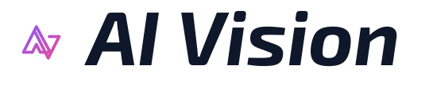

  <picture>
    <source media="(prefers-color-scheme: dark)" srcset="docs/assets/aivision-logo-dark.svg">
    <source media="(prefers-color-scheme: light)" srcset="docs/assets/aivision-logo-light.svg">
    
  </picture>

  <em>讀懂每一步，讓智慧體更進一步</em>

  AI Vision 是開放原始碼、可自行託管的 Agent 可觀測性與診斷平台。

  
  
  
  
  

  <a href="README.md">English</a> · <a href="README.zh-CN.md">简体中文</a> · 繁體中文 · <a href="README.ja.md">日本語</a>

  <strong><a href="#quick-start">快速上手</a></strong> · <a href="#capabilities">核心功能</a> · <a href="#compare-langfuse">與 Langfuse 比較</a> · <a href="https://aivision.mintlify.site/zh-CN/introduction">使用文件（簡中）</a>

同一項任務跑了兩次，結果都成功，為什麼其中一次慢了這麼多？把兩筆 Trace（執行軌跡）並排，就能看出哪些呼叫重試了、哪一步多用了 Token。改完 Agent，再用同一套規則檢查新的 Trace，看看問題有沒有再出現。

> 由螞蟻集團可觀測性團隊與 OceanBase 共同開發。

> [!NOTE]
> **個人部署** · 把這句話傳給能執行指令的 AI 助理。
>
> 請用 `ob-labs/ai-vision-skills` 的 `aivision-deploy` Skill，在本機部署 AI Vision All-in-One 並確認服務正常運作。

**連接你的 Agent**

- **自己開發的應用程式**可以沿用相容的追蹤設定，或參考 LangGraph、OpenAI Agents SDK 和 Go / Eino 的[整合範例](https://aivision.mintlify.site/zh-CN/integrations/frameworks)加入追蹤。
- **現成的應用程式**如 Codex、Claude Code、OpenClaw，安裝[對應的外掛程式](https://aivision.mintlify.site/zh-CN/integrations/plugins)後，就能查看日常任務的執行過程。

## 🧭 看得清、讀得懂、改得好

- **[看得清](#see)**。找出要查的 Trace，在長軌跡中定位步驟，核對用量和費用。
- **[讀得懂](#understand)**。看看 Agent 呼叫了哪些工具、用了哪些記憶，再比對兩次執行的差異。
- **[改得好](#improve)**。用規則定期診斷，回到異常步驟查證，改完再驗證。

### 🔎 看得清 · 從大量執行紀錄中找到關鍵步驟

Trace 越積越多，怎麼找到昨天那次慢得不尋常的任務，再查出是哪個呼叫拖慢了它？

- **從清單找 Trace。** 依 Agent、時間和耗時篩出慢任務，也能依狀態、節點數或 Token 總量篩選，按用量排序。知道 Trace ID 就能直接查找，部分資料來源也支援搜尋已擷取的輸入與輸出。
- **從 Session 找回合。** 回看多輪對話，開啟出問題那一輪的 Trace。
- **在長 Trace 裡縮小範圍。** 只看某個子 Agent 的分支，篩出失敗的工具呼叫或輸入 Token 偏高的模型呼叫。呼叫樹會保留通往符合條件之步驟的上層路徑，常用條件也能儲存。詳見[軌跡排查指南](https://aivision.mintlify.site/zh-CN/guides/trace-analysis)。

**Token 用量和費用也變了？** 從儀表板一路查到個別呼叫，看看重試次數、上下文長度或快取命中有沒有變化。費用明細會列出價格來源與計價範圍。設定[模型價格](https://aivision.mintlify.site/zh-CN/guides/model-pricing)後，可依價格生效時間重新估算既有紀錄，無需重跑 Agent。模型計價目前為 Beta。

缺少資料或使用訂閱方案時，費用怎麼算？

一般輸入、快取命中和輸出可能適用不同費率。缺少用量或價格的部分會保留為未知。訂閱或 Coding Plan 可依模型牌價顯示參考金額，實際支出以帳單為準。

### 🧩 讀得懂 · 把 Agent 的行為放回任務脈絡

內建範例中，同一項任務兩次都成功，但其中一次查詢儲存策略時逾時並重試。[並排比對兩筆 Trace](https://aivision.mintlify.site/zh-CN/guides/trace-compare)，可以核對失敗呼叫的參數與錯誤，也能比對 Skill、記憶和決策。透過執行樹、關聯圖或時間軸，可以把模型輸入、工具傳回的結果和後續動作一起看。

| 想了解的行為 | 可以從哪裡看起 |
| --- | --- |
| [執行過程](https://aivision.mintlify.site/zh-CN/guides/trace-process) | 依序查看訊息、模型輸出與工具互動。有原始紀錄的步驟可核對輸入與輸出，如果有回報工具定義，也能看到當時可用的工具。 |
| [MCP](https://aivision.mintlify.site/zh-CN/guides/mcp-observability) | 依服務與工具查看呼叫，核對參數、狀態、耗時和錯誤。 |
| [Skill](https://aivision.mintlify.site/zh-CN/guides/skill-observability) | 查看載入過哪些 Skill，區分回報的呼叫與從執行紀錄推斷的讀取。 |
| [記憶](https://aivision.mintlify.site/zh-CN/guides/memory-observability) | 查看取用了哪些記憶及其來源，有對應資料時，可核對內容是否進入模型輸入。 |
| [決策](https://aivision.mintlify.site/zh-CN/guides/decision-traces) | 查看模型路由或審核的選項與結果。後續步驟可能透過明確識別碼連結，也可能由前後紀錄推斷。 |

**直接查看輸入和成果。** 想核對模型收到的圖片，或看看 Agent 產生的報告，可以在 Trace 裡預覽已擷取的圖片、音訊、影片、PDF，以及可辨識的 Markdown 和靜態 HTML。擷取設定詳見 [Python 多媒體整合範例](ai-vision/agent-plugins/langfuse/README.md#python-多媒体-tracelangchain)。

能看到的細節取決於整合方式和實際回報的資料。MCP、Skill、記憶的專屬頁面和決策檢視目前為 Beta。

### 🛠️ 改得好 · 找出反覆出現的問題，驗證改進

查到一次工具失敗或重試後，怎麼知道這類問題是不是常常發生？

1. **先試跑規則，再排程。** 用幾筆 Trace [試跑內建規則](https://aivision.mintlify.site/zh-CN/guides/diagnosis)，例如檢查工具失敗、重複呼叫，或修改程式碼後是否執行驗證。選好規則後，在團隊空間設定[定期診斷](https://aivision.mintlify.site/zh-CN/guides/continuous-diagnosis)。
2. **回到軌跡核對異常。** 在品質儀表板查看各批診斷的變化，從異常案例（BadCase）回到有原始紀錄的步驟。比對實際成果，再確認問題、標記誤報，或註記為無法判定。
3. **改完再驗證。** 重跑同類任務，用同一套診斷設定檢查新的 Trace。

驗收標準明確時，可以在選用的 OpenShell 沙箱執行[增強型 Python 規則](https://aivision.mintlify.site/zh-CN/guides/sandbox)，例如用 `pytest` 驗證 Trace 裡的程式碼，或依參考明細表重新計算。要判斷回答是否切題、解釋是否有根據，也可以使用 LLM 診斷。

診斷需要哪些資料？

診斷需要 AI Vision 已接收並儲存的 Trace，包括經由 Langfuse SDK 回報的新軌跡。若只讀取外部 Langfuse 資料來源，目前無法直接執行診斷。缺少必要資料時，該項檢查可能無法判定。

## ⚖️ 和 Langfuse 有什麼差別？

AI Vision 目前著重從實際執行紀錄找問題，改完再用同類任務驗證。

- **想知道 Agent 為什麼多走了一步。** 兩者都支援 MCP 和 Skill 追蹤。AI Vision 的[行為檢視](#understand)把工具傳回的結果、取用的記憶和路由選擇放回執行脈絡，也能比對兩次執行的差異。
- **想先在自己的環境試試。** Langfuse 的官方 Docker Compose 設定包含多個服務。AI Vision All-in-One 在同一個容器裡執行平台和內嵌的 seekdb，精簡版的壓縮映像檔實測約 200 MiB。啟動後，不用設定模型就能試跑內建範例。
- **同類成果要反覆驗收。** 兩者都能用程式碼做確定性評估，省下相應的 LLM 評審呼叫。Langfuse 的標準評估環境提供語言標準函式庫。AI Vision 的[選用沙箱](https://aivision.mintlify.site/zh-CN/guides/sandbox)預先安裝了 `pytest` 等相依套件，可以直接用現有的測試案例和參考檔案驗收。

**Langfuse 的強項。** 如果要做 Prompt 和 Skill 的版本管理，或在同一份資料集上反覆跑實驗、比較不同方案，Langfuse 的支援更完整。

> [!NOTE]
> **接下來的方向。** 我們計畫開放觀測資料治理功能的原始碼，探索如何依用途設定資料的擷取與保留方式，讓團隊留足排查所需的資料，同時控制長期儲存成本。LangSmith SDK 整合也在規劃中。

**已經用 Langfuse 做追蹤？** 可以沿用相容的 SDK 和追蹤設定，把新的 Trace 傳到 AI Vision。[整合指南](https://aivision.mintlify.site/zh-CN/integrations/langfuse)列出版本、資料擷取設定和查詢範圍。既有資料的移轉需另行評估。

## 🚀 選一種部署方式，看到第一筆 Trace

- **個人部署。** 推薦 [All-in-One](https://aivision.mintlify.site/zh-CN/deployment/all-in-one)，在 Linux x86-64 或 ARM64 上用單一 Docker 容器執行平台和內嵌的 seekdb。線上安裝需要 [AI Vision Skills 儲存庫的讀取權限](skills/README.md)，也可使用已獲授權的離線安裝套件。
- **團隊部署。** 建議分開部署各服務並使用 OceanBase CE，透過空間、成員與角色共享觀測和診斷結果。可用 [Docker](https://aivision.mintlify.site/zh-CN/deployment/docker) 部署，或在既有的 Kubernetes 叢集使用 [OB Operator](https://aivision.mintlify.site/zh-CN/deployment/kubernetes)。
- **使用 Skill 或 CLI。** `aivision-deploy` 可部署服務與檢查狀態，`aivision-quickstart` 可在既有環境試用資料擷取與診斷。也可以直接用 CLI [部署](https://aivision.mintlify.site/zh-CN/deployment/overview)或[查詢 Trace](https://aivision.mintlify.site/zh-CN/guides/cli)。

> [!TIP]
> **先試內建範例。** 部署後登入，在個人空間開啟 **演示示例**，選擇「完整引导」並建立範例資料。無需設定模型，就能試用 Trace 比對和規則診斷。在團隊空間使用範例需要對應的 Agent 整合和診斷權限。此處介面名稱以簡中版為例。

**查看實際任務的 Trace。** 開啟 **Agent 接入**，依精靈為[自行開發的 Agent](https://aivision.mintlify.site/zh-CN/integrations/frameworks)設定 SDK 或執行環境。如果使用現成的應用程式，在執行該程式的機器上安裝[對應外掛](https://aivision.mintlify.site/zh-CN/integrations/plugins)後重新啟動。使用 Codex 時，還需要在 `/hooks` 確認並信任 AI Vision 的 hooks，再開新工作階段。跑一項會呼叫模型和工具的任務後，到 **Agent 轨迹** 開啟新的 Trace，核對工具呼叫的參數與狀態。

支援的外掛提供 [Privacy 資料擷取模式](https://aivision.mintlify.site/zh-CN/guides/privacy)，可在本機過濾提示詞、回答與工具的輸入輸出，同時保留呼叫結構與用量。

Privacy 模式適用於哪些資料？

Privacy 模式適用於啟用後擷取的資料。先前已儲存的資料，以及 Agent 自行保留的紀錄，需要另外處理。

## 🤝 參與貢獻

> [!TIP]
> **哪一次 Agent 執行讓你查不下去了？** 歡迎開個 [Issue](https://github.com/antgroup/ai-vision/issues)，說說你當時想查什麼、卡在哪一步。一個具體的情境就夠了。若方便，也可以附上 Agent 版本、重現步驟或已移除敏感資訊的 Trace，讓我們更容易重現。

有想嘗試的做法，歡迎一起討論，或送出 [Pull Request](https://github.com/antgroup/ai-vision/pulls) 改進整合、檢視介面、診斷規則或文件。[貢獻指南](CONTRIBUTING.md)說明參與方式，[原始碼與開發索引](docs/README.md)可協助你找到實作入口，[專案治理](GOVERNANCE.md)則說明維護方式。感謝所有[貢獻者](https://github.com/antgroup/ai-vision/graphs/contributors)。
