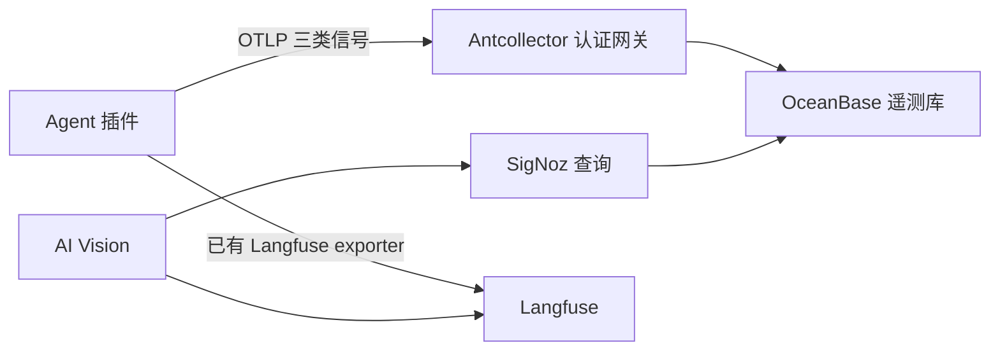
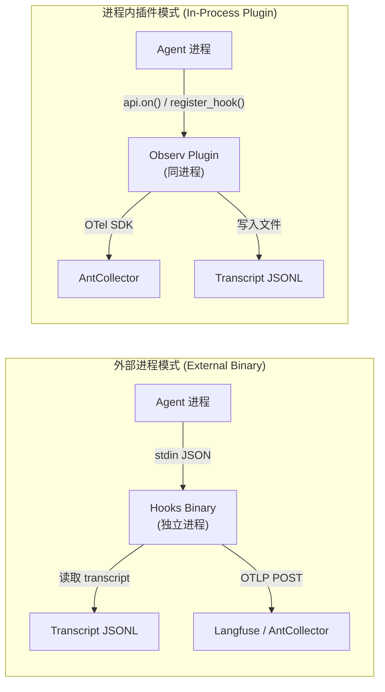
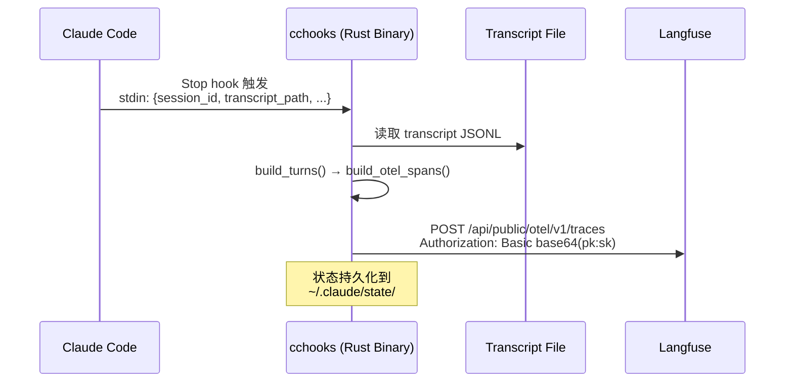
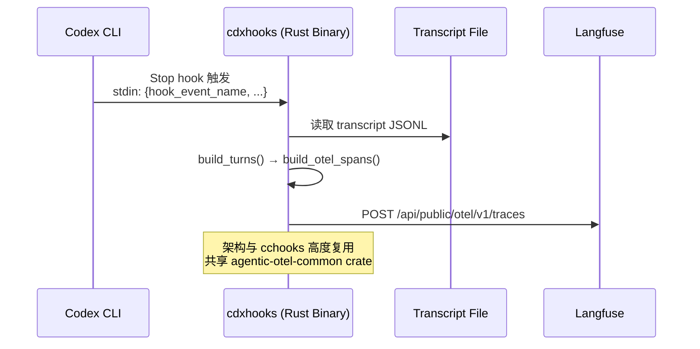
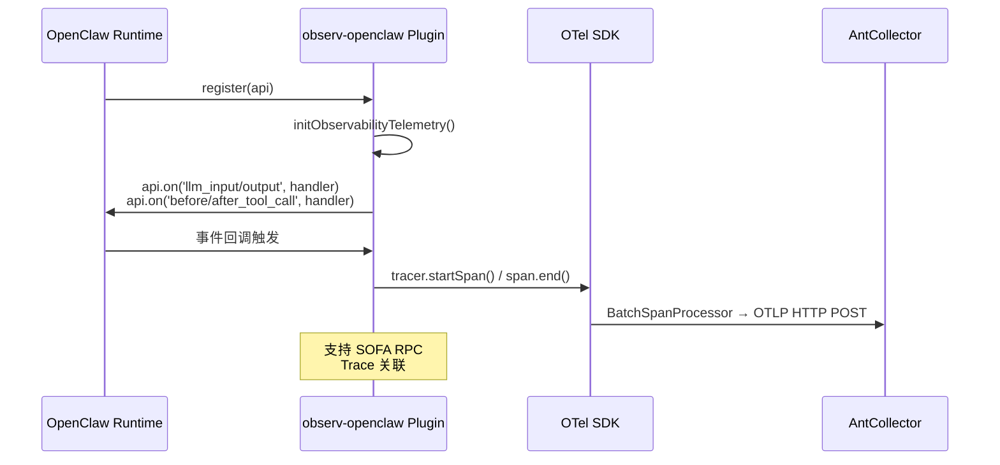
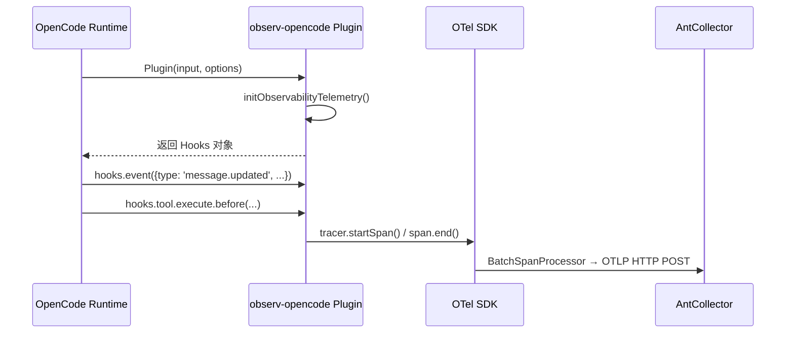
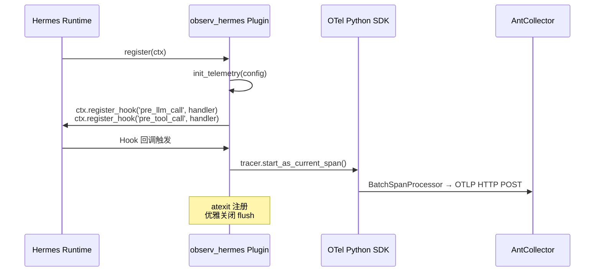
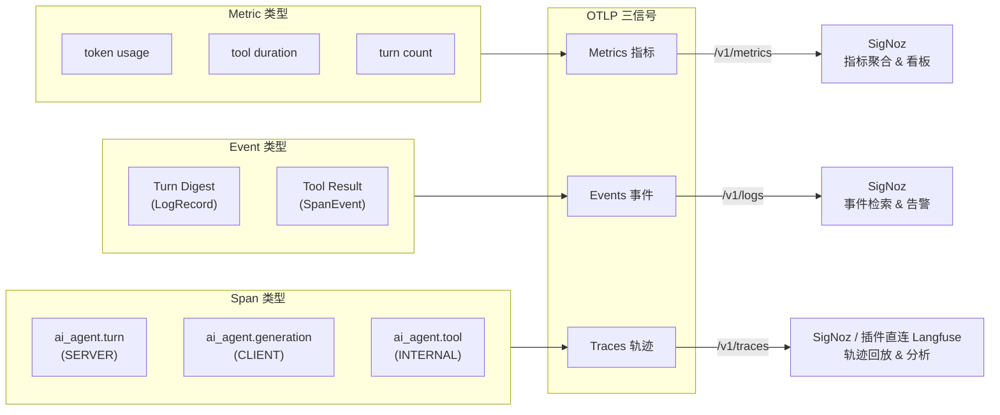
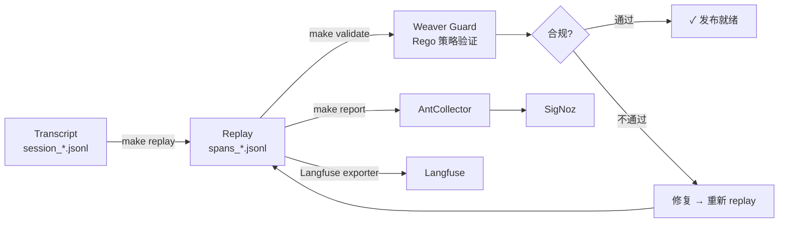

> 当前部署：三类 OTLP 信号经 Antcollector 认证网关写入 SigNoz；插件已有 Langfuse exporter 独立上报，网关不负责 Langfuse 转发。

# AI Agent 可观测性采集架构

## 整体架构

插件采集 Hook、原生 OTel 事件与 Transcript，构建 Trace / Span 或 LogRecord，交给配置的 exporter。SigNoz 网关验证采集 token 并写入可信空间、用户与 Agent 身份；Langfuse 使用原有插件配置和认证。

## 各 Agent 采集模式

### 采集模式对比

### 各 Agent 详情

| 维度 | Claude Code | Codex | OpenClaw | OpenCode | Hermes |
|------|------------|-------|----------|----------|--------|
| **包名** | cchooks | cdxhooks | observ-openclaw | observ-opencode | observ_hermes |
| **语言** | Rust | Rust | TypeScript | TypeScript | Python |
| **采集模式** | 外部进程 | 外部进程 | 进程内插件 | 进程内插件 | 进程内插件 |
| **注册方式** | `~/.claude/settings.json` Stop hook | `~/.codex/hooks.json` Stop hook | `register(api)` + `api.on()` | Plugin returns `Hooks` object | `register(ctx)` + `ctx.register_hook()` |
| **Hook 事件数** | 25 | 7 | 9 | 10 | 7 |
| **环境变量前缀** | `CCHOOKS_*` | `CDXHOOKS_*` | `AGENT_*` / `AIVISION_*` | `AGENT_*` / `AIVISION_*` | `OBSERV_HERMES_*` |
| **Replay 工具** | `cchooks-replay` (Rust) | `cdxhooks-replay` (Rust) | `npx tsx replay.ts` | `npx tsx replay.ts` | `python -m observ_hermes.replay` |
| **OTel 依赖** | `agentic-otel-common` crate | `agentic-otel-common` crate | `@opentelemetry/*` SDK | `@opentelemetry/*` SDK | `opentelemetry` Python SDK |

### 1. Claude Code (cchooks)

**采集机制**: 外部二进制进程，通过 Claude Code 的 `settings.json` 注册为 Stop hook。Agent 在每轮对话结束时调用 `cchooks`，通过 stdin 传入 JSON payload（包含 `hook_event_name`、`session_id`、`transcript_path`）。cchooks 读取完整 transcript 文件，构建 Turn 结构，转换为 OTLP Span 后直接 POST 到 Langfuse。

**支持 25 种 Hook 事件**: `SessionStart`, `Stop`, `PreToolUse`, `PostToolUse`, `Notification`, `SubagentStart`, `SubagentStop`, `TaskCreated`, `TaskCompleted`, `PreCompact`, `PostCompact`, `SessionEnd` 等。

### 2. Codex (cdxhooks)

**采集机制**: 与 cchooks 架构一致的外部二进制进程模式。通过 `~/.codex/hooks.json` 注册为 Stop hook。Codex 在会话结束时调用 `cdxhooks`，stdin 传入 JSON payload。两者共享 `agentic-otel-common` crate，核心 Turn 构建和 OTLP 转换逻辑复用。

**支持 7 种 Hook 事件**: `SessionStart`, `PreToolUse`, `PostToolUse`, `PreCompact`, `PostCompact`, `UserPromptSubmit`, `Stop`。

### 3. OpenClaw (observ-openclaw)

**采集机制**: 进程内插件模式。通过 OpenClaw 的 Plugin API 注册，导出 `register(api)` 函数。在 `register()` 内初始化 OTel TracerProvider / MeterProvider / LoggerProvider（全局单例），然后通过 `api.on()` 注册事件监听器。事件触发时直接在当前进程内创建 OTel Span，通过 BatchSpanProcessor 异步导出。

**支持 9 种事件**: `before_model_resolve`, `before_prompt_build`, `before_agent_start`, `llm_input`, `llm_output`, `before_tool_call`, `after_tool_call`, `tool_result_persist`, `agent_end`。

### 4. OpenCode (observ-opencode)

**采集机制**: 进程内插件模式。通过 OpenCode 的 `@opencode-ai/plugin` API 注册。Plugin 函数返回 `Hooks` 对象，包含 `event` 分发器和 `tool.execute.before/after` 回调。支持独立配置文件 `~/.config/opencode/observ-opencode.json`。

**支持 10 种事件**: `session.created`, `session.idle`, `message.updated`, `message.part.updated`, `command.executed`, `session.error`, `session.compacted`, `tool.execute.before`, `tool.execute.after`, `experimental.session.compacting`。

### 5. Hermes (observ_hermes)

**采集机制**: 进程内插件模式（Python）。通过 Hermes 的 `ctx.register_hook()` API 注册。在 `register(ctx)` 内加载配置（环境变量 + `~/.hermes/observ-hermes.env`），初始化 OTel TracerProvider + MeterProvider + LoggerProvider，注册 7 个 hook 回调。每个 hook 包装了错误捕获和 telemetry 运行时注入。通过 `atexit` 注册 shutdown handler 确保进程退出时 flush 数据。

**支持 7 种 Hook**: `on_session_start`, `on_session_end`, `pre_llm_call`, `post_llm_call`, `pre_tool_call`, `post_tool_call`, `subagent_stop`。

## OTLP 信号映射

## OTLP 网关与 Langfuse 上报

本部署的网关使用 `/v1/traces`、`/v1/logs`、`/v1/metrics`，请求携带 `Authorization: Bearer <ingest token>`。安装器保存 Agent 专属凭据并续期短期 token。没有 namespace/task 路由。

Langfuse exporter 保留原有独立 endpoint 与 Basic 认证；具体配置按各插件文档，不经本部署的 OceanBase exporter 转发。

## Replay & 验证流水线

## 版本信息 (Edition) 体系

每个 Agent 通过 Edition 机制支持多部署环境：

| Agent | 可用 Edition | 配置方式 |
|-------|-------------|----------|
| Claude Code | `aivision`, `common`, `common-eval` | Cargo feature flag, 编译时绑定密钥 |
| Codex | `aivision`, `common` | Cargo feature flag |
| OpenClaw | `aivision`, `common` | `configs/*.config.json` |
| OpenCode | `aivision`, `cowork`, `common` | `configs/*.config.json` |
| Hermes | 动态配置 | `OBSERV_HERMES_EDITION` 环境变量 + JSON 配置 |
