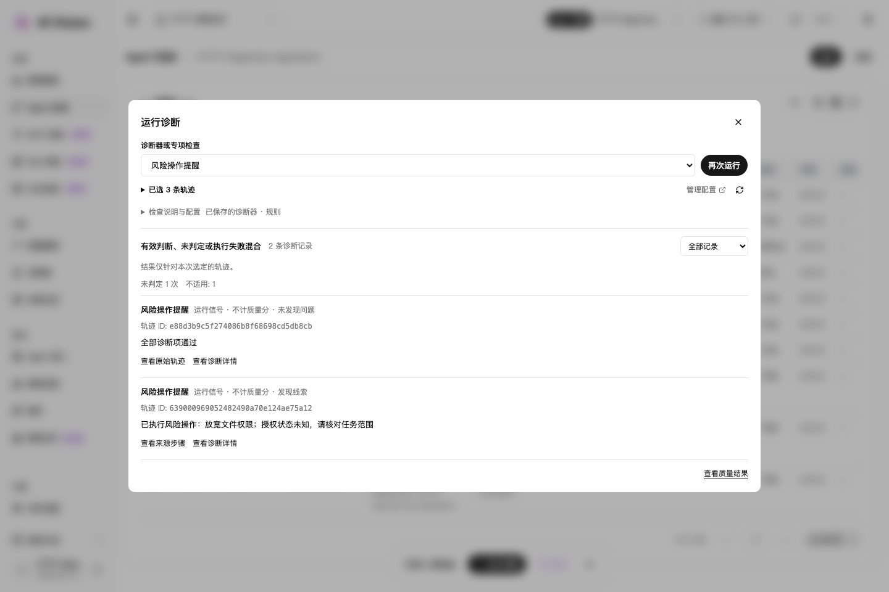
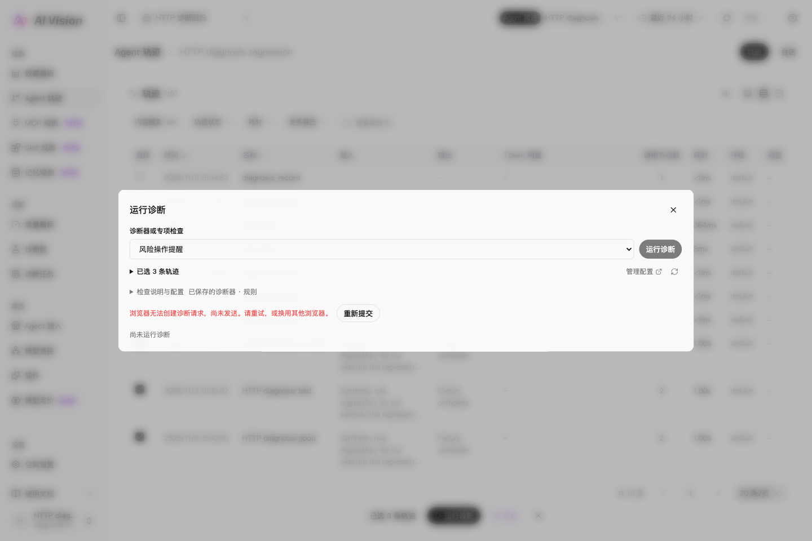
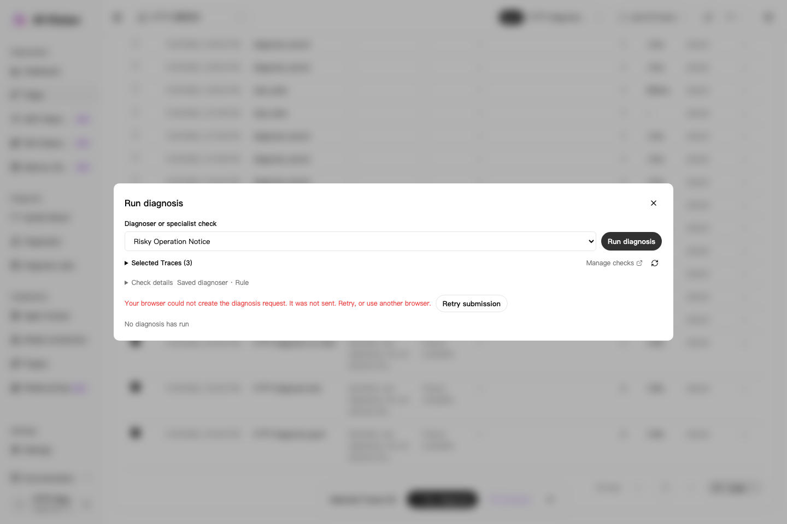
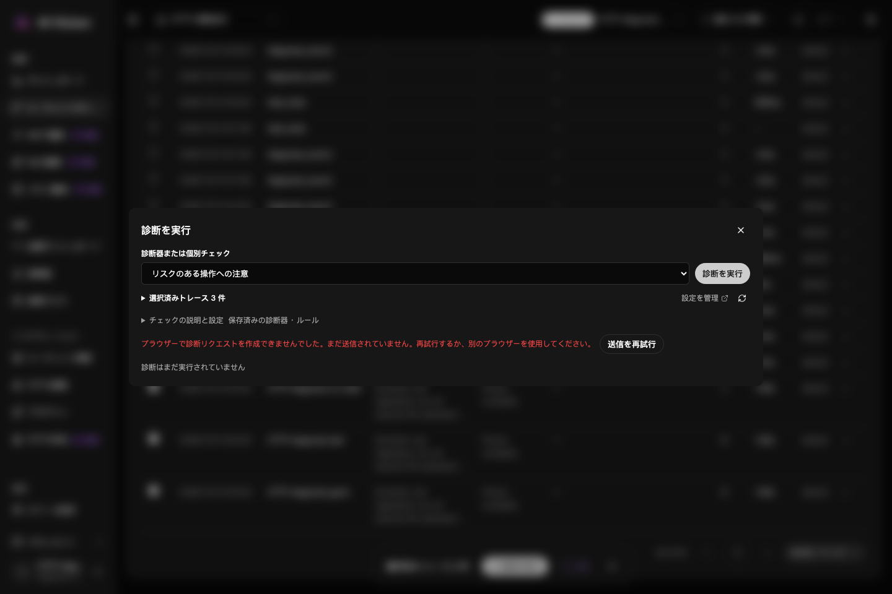
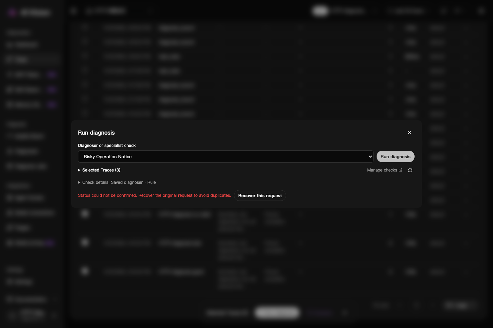
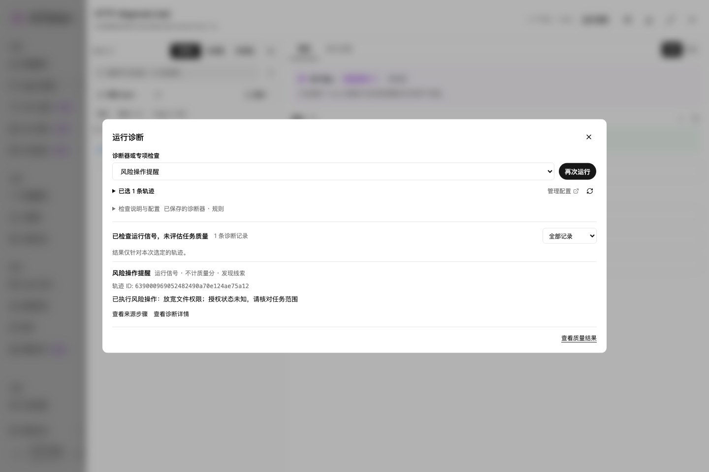

# Diagnosis submission and recovery on HTTP

Verified on 2026-11-09 against baseline `historical-source-revision-redacted` plus the frontend patch identified by file hashes in the [machine-readable receipt](diagnosis-http-recovery-2026-11-09.json).

## Problem and behavior

An ordinary HTTP origin can expose `crypto.getRandomValues()` while omitting `crypto.randomUUID()`. The previous request-ID generation threw before sending the diagnosis request, but the panel showed an uncertain server outcome and offered original-request recovery. Its partially updated intent then prevented the same selection from being submitted again.

The fix generates a cryptographic UUID v4 through `getRandomValues()` when needed. Normal HTTP submission takes one click. A failure to prepare a request is reported as **not sent**, with a safe submission retry. A request whose server outcome is uncertain retains its original body and request ID for recovery. The panel no longer simultaneously calls an uncertain or running request “not run.” Unclassified HTTP 5xx responses preserve the original request identity; explicit rejection semantics remain intact. Chinese, English, and Japanese copy is synchronized.

## Automated regression

Run from `ai-vision/vfe/`:

```sh
npx eslint src/components/diagnose/quickDiagnosis.ts src/components/diagnose/TraceDiagnosisPanel.tsx tests/quickDiagnosis.test.ts tests/quickDiagnosisDom.test.ts
npm run typecheck
npm run build
npm run test:quick-diagnosis
npm run test:i18n
npm test
```

Modified-file lint, typecheck, production build, formatting, and `git diff --check` passed. The build retains its existing large-chunk warning. Diagnosis regression passed **96/96**, locale regression **11/11**, and the full frontend suite **1,681/1,681**, with no failures or skips. New request-ID, preparation-retry, and generic JSON 500 cases were observed failing before their fixes. Existing lost-response tests were strengthened to reject the contradictory “not run” state.

An independent review of the source, caller/provider error contracts, and regression tests found no blocking issue. Its exact patch hash is retained in the receipt.

## Real frontend/backend integration

The browser used `http://0.0.0.0:18317`, with `isSecureContext=false`, `crypto.randomUUID` absent, and `crypto.getRandomValues` available. This exercises the HTTP fallback directly. The built-in browser connection timed out; dev-browser headless Chromium was used, with a 1440 × 960 viewport.

Current Django and AgentLens sources were mounted read-only into prepared Python dependency images. The run used real local seekdb, SigNoz, and collector services, with dedicated platform/AgentLens schemas and one synthetic Space. Exact source trees, image IDs, dependency versions, and request/task IDs are in the receipt. No model connections were configured.

Three synthetic source Traces represented a benign Shell action, a risky permissions change, and no Shell action. These were telemetry strings; no represented command was executed. The builtin `high_risk_command` rule returned **good=1, bad=1, skipped=1 (not_applicable), failed=0**, with complete source coverage.

| Scenario | Observed behavior |
| --- | --- |
| Normal HTTP, trace list, three selected Traces | One click, one accepted request, two records plus one not-applicable result |
| One-time local entropy failure, zh-CN / en-US / ja-JP | No POST; localized “not sent” message and safe retry; retry then completed a real rule task |
| Backend accepted, response deliberately replaced by HTTP 503 | Uncertain-outcome message without “not run”; recovery sent the identical body/request ID and returned the original Task/Job/Dataset |
| Trace detail entry, one risky Trace | One click, one POST containing only the detail Trace, one bad signal record |
| LLM check without a model | Disabled in options; direct API rejected with 422 `QUICK_MODEL_UNAVAILABLE` |
| Foreign Trace, invalid request ID, changed intent under the same ID | 422 / 422 / 409; no new receipts |

Fresh database readback confirmed all six browser-created runs succeeded and each owned exactly one Dataset, Job, and Task. Model connections remained zero, and no model request ledger was enabled. The original five synthetic source Spans retained the same SHA-256 before cleanup.

The response fault was injected by a private local proxy **after receiving a real accepted response**. The local entropy fault was also deliberate. These faults do not turn the successful backend executions or storage readbacks into mocked services.

## Screenshots

Normal HTTP submission and complete rule results:



Explicit local preparation failure, before any request was sent:





Uncertain outcome after the accepted response was withheld:



One-click execution from Trace detail:



## Compatibility and limits

This change does not alter backend APIs, schemas, dependencies, model configuration, or rule execution. The prior setup attempt used an unsupported fixture runtime and produced projection-unavailable results; the isolated Agent was corrected to the registered `langchain` projector before all reported acceptance runs. This was a fixture correction, not a product change.

The evidence establishes prepared local current-source integration on macOS/arm64 with linux/arm64 service containers. It does not qualify released images, a cold install, the original reported environment, other browser engines, or Windows. Generic JSON 500 and explicit non-retryable errors have component/API regression coverage; only the typed 503 response fault was injected in the real stack. No Python source changed, and full Python unit suites were not run.

Task-owned browser pages were closed and the two test service containers were stopped after final readback. Automatic approval rejected irreversible removal of the test containers, schemas, and synthetic Space data because direct user authorization for deletion had not been established. No deletion was executed or retried; test data and private credentials remain local. Existing database, SigNoz, and collector services were preserved. The cleanup receipt records this boundary.

## Follow-up entrypoint review before merge

The user subsequently chose to retain the test data, schemas, and stopped containers. The retained environment was restarted for this review and stopped again afterward; no deletion was attempted.

The two direct execution entries are the Trace list selection bar and the current Trace detail header. Both use the same dialog, panel, and request owner. Session lists, Langfuse views, quality-record transcript drawers, overview drawers, and public share views do not add another execution path. Rule/LLM Trial, specialist Trial, and manual Job execution use separate APIs and do not directly call `randomUUID()`.

The wider review reproduced an existing generic LLM Trial ownership bug: a late response for Trace A could appear under Trace B after selection changed. The actual parent-page path could also retain results across Space/Agent changes. The follow-up binds pending work and results to the current identity, Trace material, model, and execution specification. Changed or closed contexts invalidate old success, error, toast, and completion callbacks; synchronous duplicate invocation is locked. An unavailable requested Trace cannot silently fall back to a different recent Trace. Model availability and other execution preconditions remain separate, so authorization/loading states do not produce a misleading missing-model tooltip. No new locale text or layout was introduced.

Actual React DOM and `TraceIdInput` regressions were observed failing before the repair. The final LLM suite passed **28/28**, model-connection suite **62/62**, and complete frontend suite **1,697/1,697**, with no failures or skips. Modified-file lint, typecheck, production build, formatting, and diff checks passed. An independent review of the follow-up found no remaining blocking issue.

Three additional real HTTP runs verified that a list double-click produces one exact-selection request; a detail run for B ignores an unrelated list selection A; and recovery of a withheld accepted detail response uses the original ID and resources. Database readback confirmed one Dataset/Job/Task for each request and zero configured models. The real Session list had no bulk Trace diagnosis controls, and returning to Trace view cleared the old selection. The real LLM form rendered its authenticated context correctly and disabled Trial without a model.

The delayed LLM-response tests used controlled API responses; no external model was called. The [follow-up receipt](diagnosis-entrypoint-review-2026-11-09.json) records exact file hashes, request/task IDs, source checks, and retained-resource state. The original receipt above remains evidence for the first HTTP validation rather than being rewritten as a later run.
