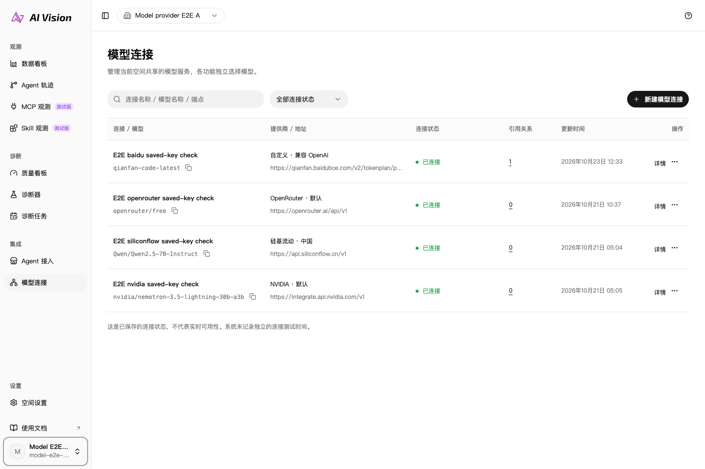

# Model connections under Integrations: local acceptance

Date: 2026-10-23. Baseline: `historical-source-revision-redacted`. The tested sources were the dirty worktree on `codex/model-connections-integration`; the tested-source aggregate SHA-256 is `1f084474b74fa7e546bd4500507d718d0586d0a215382a6aad66f3f8da630c7d`. [Manifest](model-connections-integration-receipts/tested-source.json) identifies the changed source files, including new files, independently of the baseline commit.

## Delivered behavior

Model connections are Space-scoped shared resources under **Integrations → Model connections**. The inventory and full detail page reuse one provider catalog, form, API client and connection store. Each consumer independently selects its connection UUID and retains its own prompt and runtime parameters. This change adds no global default and no observation-model consumer.

`/settings?tab=models&spaceId=…` redirects with replacement to the matching inventory. Other settings tabs remain available. The integration header contains Space and help controls. Existing diagnostic consumers keep an inline manager; the manager cannot navigate away through inventory links. Creating a connection selects the returned UUID without saving the diagnoser. Detail references open the actual referenced diagnoser with Space and Agent context.

Connectivity and diagnostic validation remain independent. Only the current diagnostic report is stored. The connectivity timestamp is **Not recorded**, because there is no dedicated persisted probe timestamp. Modified time is not presented as a probe timestamp. An in-flight connectivity test releases its SQL transaction before provider I/O and compares the tested configuration atomically before writing its result. A stale edit, ABA change or deletion produces safe HTTP 409 `configuration_changed`.

## Environment and evidence boundaries

- macOS local worktree; real Vite `127.0.0.1:5175` → Django `8015` → AgentLens `8815` → seekdb `28815`.
- Existing isolated Django SQLite account database and seekdb database `aiv_model_e2e_b015`; this is a prepared development stack, not a cold-start, container, Linux or deployment test.
- Codex built-in browser was tried first and executed the real Baidu connection/validation flow. dev-browser headless supplemented reliable UI automation and screenshots.
- A built-in-browser sign-in interruption was observed. Its cause was not established. Three independent backend Sessions remained valid through 130 seconds and refresh; separate headless browser Sessions completed the acceptance. No speculative authentication change was made.
- Test inputs are synthetic traces persisted in the real local telemetry store. Provider inference is real; these results do not represent production customer traffic or a model-quality benchmark.
- No provider mocks were used for the browser inference checks. The separate SQL concurrency test explicitly replaces the provider with a stub.

## Real frontend, backend and model checks

| Scenario | Observed result |
| --- | --- |
| New inventory and detail | Original four connection UUIDs/configurations retained; provider/region inferred from exact endpoint; no key value returned |
| Baidu custom saved connection | Real `/test` succeeded from the new detail page |
| Baidu canonical basic diagnostic validation | Real `/validate`: positive GOOD and negative BAD, both passed with valid output; 2 requests, 1,236 input tokens, 261 output tokens, 1,497 total tokens |
| Actual custom diagnoser trial, positive persisted Trace | `5d92153872745a7b899e58f5b91f9c02`, answer `RESULT: 4`, verdict GOOD |
| Same custom diagnoser draft, negative persisted Trace | `52a77219e43f5de09aed54019d83e5b0`, answer `RESULT: 5`, verdict BAD with mismatch reason |
| Inline manager and real create | Prompt/name/Trace retained; no detail-navigation anchors; newly created UUID auto-selected; no diagnoser saved |
| SiliconFlow China default | Real form selected `https://api.siliconflow.cn/v1`; inert invalid-key connection saved through the actual API |
| Actual invalid-key probe | Platform HTTP 200 with unavailable / authentication_failed; actionable error displayed in zh-CN, en-US and ja-JP from the same result, without repeating the probe for translation |
| Old models links | Space A and Space B URLs both redirected to their own inventories; B showed no A connections |
| Other settings link | `tab=members` remained the member-management tab; model tab removed |
| Invalid explicit Space | URL preserved, explicit Space-not-found page rendered, no foreign connection link shown |
| Reference open/close | Opened `dg-5z71n6pa` detail; closing removed only diagnoser parameter and preserved Space/Agent |
| Existing reference deletion protection | Loaded the referenced diagnoser; showed cannot-delete dialog with no executable Delete action; canceled |
| Member UI | Inventory/detail readable; create, edit, connectivity and diagnostic actions disabled |
| Responsive/locales | All three inventory/report locales rendered; 390×844 mobile inventories had no document horizontal overflow; zh-CN light/dark report checked |
| Cleanup | All owned disposable connections removed and absence read back; original four remain; diagnostic drafts canceled |

The actual Trace trial was repeated once per verdict to capture its result visibly in the scroll area. These repetitions are separate real model requests. The final visible results also have [positive](model-connections-integration-receipts/real-trial-good.txt) and [negative](model-connections-integration-receipts/real-trial-bad.txt) browser-text receipts. NVIDIA, OpenRouter and SiliconFlow's valid saved-key inference were not rerun in this change; their saved status and prior reports are not new availability claims.

## Real authorization and SQL concurrency

[Role/Space receipt](model-connections-integration-receipts/real-role-space-receipt.json): 75 HTTP events. Admin/developer read/create/rename succeeded. Member reads succeeded and all six management operations returned 403. Cross-Space and unknown-resource detail/references/update/delete/test/validate each returned 404. Malformed fake credentials returned invalid_request before the client-construction guard. The latter is a live response plus source-path assertion, not packet-level dispatch measurement. All three Sessions passed repeated auth/me checks through 130 seconds and refresh. Temporary objects were deleted and read back as absent.

[Seekdb concurrency receipt](model-connections-integration-receipts/real-seekdb-probe-concurrency-receipt.json): production route/table with a stub provider and two distinct physical seekdb connections, both autocommit=0. Unchanged configuration returned 200 and persisted available. Model/endpoint/key edits, ABA and deletion returned 409; current configuration/status remained intact. All six probes had no SQL transaction before provider callback; all stub clients closed once. All six disposable rows were removed. This is real storage/concurrency evidence, not real vendor inference.

[UI cleanup receipt](model-connections-integration-receipts/ui-disposable-cleanup.json) confirms the UI-created invalid-key connection was deleted and only the original four connections remained.

## Local automated verification

| Working directory | Command/check | Result |
| --- | --- | --- |
| `ai-vision/vfe` | `npm test` on final frozen source | 785 passed; 0 failed, 0 skipped |
| `ai-vision/vfe` | Changed-file ESLint, Prettier; `npm run typecheck`; `npm run build` | Passed; existing output-directory and chunk-size notices remain |
| `agentlens` | `PYTHONPATH=src .venv/bin/python -m pytest tests/unit -q -o addopts=''` | 2,509 passed, 317 skipped; skips retain explicit environment requirements |
| `agentlens` | Ruff check and format check for changed Python files | Passed |
| `agentlens` | `.venv/bin/python scripts/adr.py index` and `check` | Passed |
| `ai-vision/aivision-py-be` | `.venv/bin/python manage.py test apps.core.tests.test_agentlens_proxy_scope --verbosity 0` | 41 passed |
| Repository | `git diff --check` | Passed |

New behavior tests were observed failing before their fixes: stale status writes, transaction retention, malformed-key client construction, safe proxy conflict, HTTP409 parsing, incomplete reference responses, rejected deletion envelopes and tab-before-Back scroll restoration. Inline navigation that could abandon a draft was found during review, removed and checked with the shared manager and actual CreateLlm form. The deterministic DOM draft test waits for the real permission-dependent create action to become enabled. Independent review and a focused re-review found all issues closed; its router/DOM/API cases are fixtures and are not substituted for the real-service checks above.

## Screenshots

All images below are unmodified screenshots of the actual local application, not the approved design prototype. New screenshots in `assets/model-connections-integration/` use 1440×960 for desktop and 390×844 for mobile. Synthetic test-account names and data are intentional.

Model setup previously lived in Settings. The inventory and detail are new pages under Integrations.

| View | Simplified Chinese | English | Japanese |
| --- | --- | --- | --- |
| Inventory | [Screenshot](assets/model-connections-integration/list-zh.png) | [Screenshot](assets/model-connections-integration/list-en.png) | [Screenshot](assets/model-connections-integration/list-ja.png) |
| Saved real diagnostic report | [Screenshot](assets/model-connections-integration/validation-zh.png) | [Screenshot](assets/model-connections-integration/validation-en.png) | [Screenshot](assets/model-connections-integration/validation-ja.png) |
| Mobile inventory | [Screenshot](assets/model-connections-integration/mobile-zh.png) | [Screenshot](assets/model-connections-integration/mobile-en.png) | [Screenshot](assets/model-connections-integration/mobile-ja.png) |
| Actual invalid-key failure | [Screenshot](assets/model-connections-integration/invalid-key-zh.png) | [Screenshot](assets/model-connections-integration/invalid-key-en.png) | [Screenshot](assets/model-connections-integration/invalid-key-ja.png) |

Additional interactions: [draft retained](assets/model-connections-integration/draft-retained-zh.png), [actual positive Trace trial](assets/model-connections-integration/trial-good-zh.png), [actual negative Trace trial](assets/model-connections-integration/trial-bad-zh.png), [member read-only](assets/model-connections-integration/member-readonly-zh.png), [referenced deletion blocked](assets/model-connections-integration/reference-delete-zh.png), [invalid Space](assets/model-connections-integration/invalid-space-zh.png), [dark report](assets/model-connections-integration/validation-dark-zh.png).

## Compatibility and unverified scope

Existing connection IDs, saved keys, consumer bindings, API paths and database schema remain intact. The safe stale-probe HTTP409 is additive; all three frontend locales handle it. There is no credential export, new global default, persisted test history or observation-model feature. Full platform/SDK/provider catalog matrices, deployment upgrades, production documentation publishing and Linux were not run here. Local checks do not establish hosted CI success.
