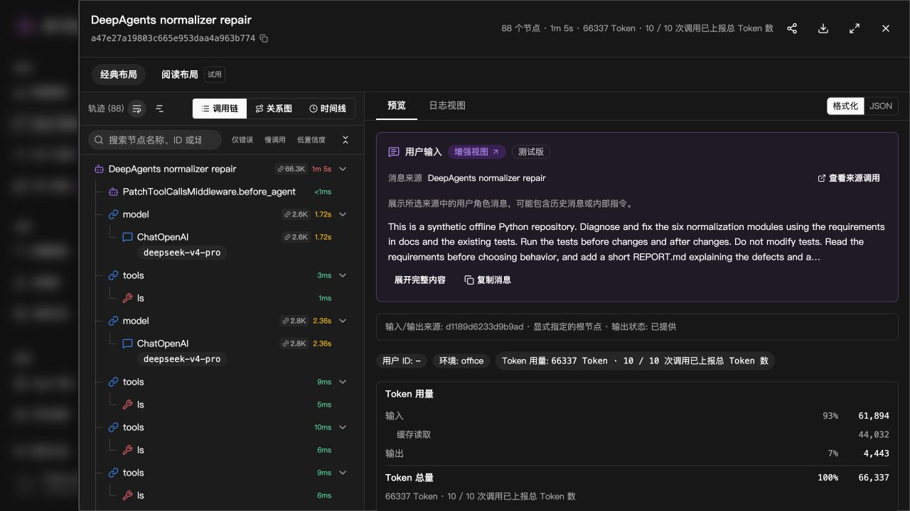
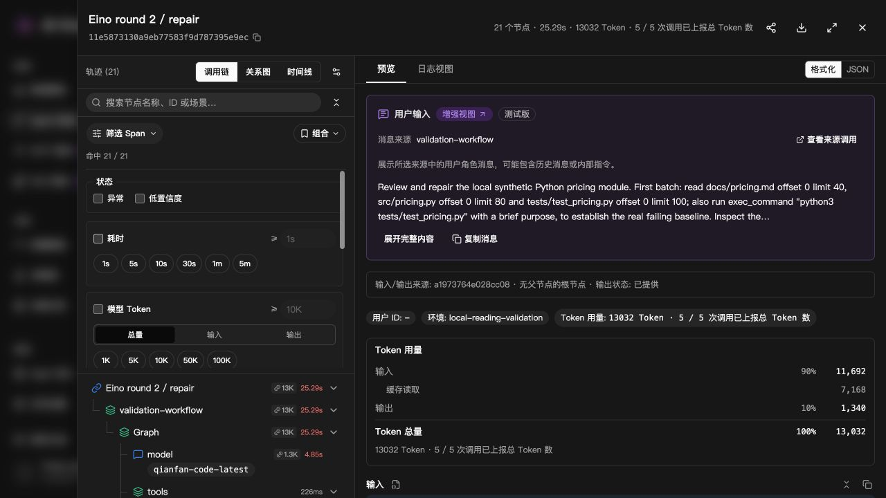
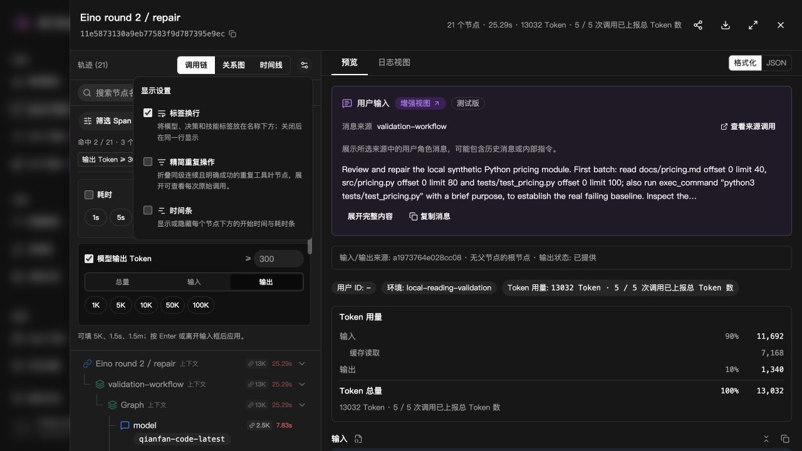
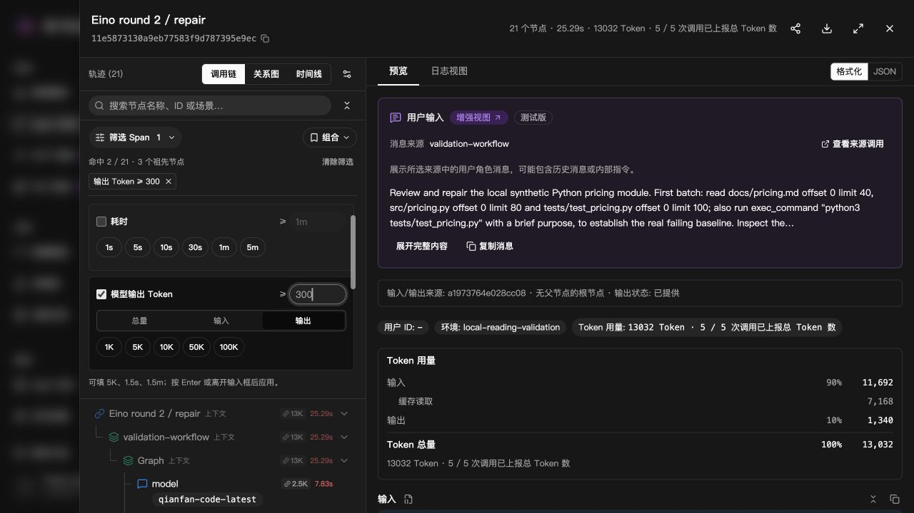

# Trace Span filters: local validation evidence

This record preserves runtime UI evidence for the grouped Span filters and display settings. The selected JPEGs are original, byte-for-byte copies, visually reviewed for sensitive content. They show synthetic offline repository exercises whose saved executions used real model calls. No new model call, upload, or replay was made for this capture round.

The later execution-process implementation replaces the log tab visible in these historical screenshots. Current execution-process behavior, four-framework runtime captures, and its separate source revision are recorded in [Single-Trace execution process: validation evidence](../../../../docs/testing/trace-process-validation.md). The screenshots and checks below retain their original revision and are not relabeled as evidence for that later UI.

## Revision and environment

- Capture round: October 24, 2026 (Asia/Shanghai), Codex in-app browser, local frontend and authenticated task-owned backend. Browser checks used 1280 × 720 and 970 × 600 viewports, Chinese/English/Japanese, and dark/light themes.
- Capture revision: dirty `feat/trace-filters-content` worktree based on `historical-source-revision-redacted`. The base commit alone does not identify the tested UI; the source snapshot below does.
- These captures precede the later rebase onto updated `main` and semantic review fixes. Layout component hashes still matched the capture snapshot when this record was prepared. Historical browser results are not relabeled as checks of the final commit.
- Code revision after rebase and review fixes: `39ae8fdbbe462df609a5d28dda7cf4f50d2ae422`, based on `historical-source-revision-redacted`. All final automated checks below use an unchanged source inventory matching this code commit. A later evidence-only commit may add this record.
- Scope: local source UI with previously saved real-model traces. Hosted CI, release artifacts, deployed environments, new model executions, and untested platforms are unverified by this record.

## Selected runtime screenshots

All four images are 1280 × 720, Chinese, dark theme. No credentials or local absolute working-directory paths are visible. The prompt snippets concern synthetic exercise repositories. Raw trace exports, authentication configuration, and full logs are excluded.

**Historical layout reference.** This earlier classic layout predates the current filter approach. It shows a different DeepAgents repair Trace with 88 spans; it is not a comparable before/after capture of the Eino Trace below. Its exact source revision was not recorded with this image.

**Grouped conditions.** Eino repair Trace, no active filters: 21 / 21 spans. The view switcher stays on one row; status, duration, and model Token conditions have separate groups. Duration includes 1m and 5m presets; Total/Input/Output are directly selectable.

**Display settings.** The popup exposes label wrapping, repeated-operation compaction, and time bars. Output Tokens ≥ 300 remains active in the underlying filter panel.

**Active Output Token filter.** Output Tokens ≥ 300 matches 2 / 21 spans and retains 3 ancestor spans as context. The original Trace total remains 13,032 Tokens. Tree row Token labels retain call totals.

## Recorded interactions and corpus checks

The capture-round browser receipt records these manual runtime assertions: toolbar remains on one row; 1m/5m presets resolve to 60,000/300,000 ms; `1.5min` resolves to 90,000 ms and displays `1.5m`; Escape in search and numeric input keeps the Trace open; Escape closes the popup and restores trigger focus; switching Token metric keeps focus. At 970 × 600, five filters plus search leave a 129 px scrollable controls area and a 160 px tree viewport, and produce no pane overflow. Screenshots alone do not prove those interactions.

| Saved execution | Active condition | Matched / total | Ancestors retained |
| --- | --- | --- | --- |
| Eino repair | Output Tokens ≥ 300 | 2 / 21 | 3 |
| DSH repair | Output Tokens ≥ 500 | 3 / 25 | 1 |
| DSH repair | Duration ≥ 60,000 ms | 1 / 25 | Not recorded |
| DeepAgents subagents | Total Tokens ≥ 5,000 | 1 / 96 | 2 |
| Codex recovery | Duration ≥ 1,000 ms AND Total Tokens ≥ 10,000 | 4 / 11 | 1 |
| Codex recovery | Duration ≥ 60,000 ms | 0 / 11 | Empty state |

Fresh authenticated, read-only GETs during the capture round also returned HTTP 200 / application code 0 for all eight saved traces: Codex readonly/recovery (16/11 spans), Eino recovery/repair (17/21), DeepAgents repair/subagents (58/96), and DSH code-audit/repair (27/25). Each response was complete, preserved every Span ID and original Span object, reported no changed fields, and preserved the input/export source. These read-backs verify the preserved data; they are not hashes of every browser request or proof of a new execution.

## Post-review automated verification

On macOS, from `ai-vision/vfe`: modified TypeScript-file `npx eslint ... --max-warnings 0`, `npm run typecheck`, `npm run build`, and `npm test` all passed in order. The full command passed 883 Node test-runner tests across 25 suites, including 91 filter/content/preset tests, plus the custom-script checks. These are local results; hosted CI is reported separately on the PR.

Review found and fixed two edge cases: content-view classification now reuses existing explicit-operation/original-SDK/provenance precedence, and repetition compaction excludes structured result failures even when the enclosing span reports OK. Regression tests were first run failing, then passing. Both reviewers rechecked their repaired scope with no remaining required fixes.

The saved-corpus validation was rerun after these semantic fixes: 22 stored traces / 764 spans, 551 applicable content views, 198 filter queries, and Native detail integration assertions on eight traces / 271 spans passed. These scripts use the component test harness over saved real execution responses; they do not establish a new browser session or model run. Original IO, span identity and exports remain unchanged.

Non-blocking baseline behavior: Timeline keeps manually collapsed branches when filters change; matching descendants may require manual expansion. This also existed with the old quick filters. Chain reveals filtered paths. The new `span-content` user guide and localized screenshots are prepared in the separate documentation worktree and must be published before releasing its documentation link.

## Reproducibility identifiers

Private capture-round receipts remain outside the repository. Their file hashes identify the inputs summarized above:

| Receipt | SHA-256 |
| --- | --- |
| `browser-validation.json` | `28dfa5b2edc81a4f6040916622576bbf9003c2f580a95c8268a2ab7bfdf015a5` |
| `fresh-readback.json` | `e3c5e920fd5a952a9dc28eb886b44083f7496a66576e75a4516c05ecce94779c` |

| Included JPEG | Bytes | SHA-256 |
| --- | ---: | --- |
| `00-historical-classic.jpg` | 96,491 | `1efb870aea49dd4cf8883178cf847cf87415bf58f6559a5bbb2d2ec073636ca2` |
| `01-eino-filter-groups-zh.jpg` | 92,799 | `6ede4038445fb922627213eac66df84491f074e0f5966d35b99db21095516503` |
| `02-display-settings-zh.jpg` | 98,676 | `abf55b380c8b2c8cead8308a06972caa01766f53720fcd6ff57b32aa74c166b1` |
| `03-eino-output-active-zh.jpg` | 94,218 | `9eb29f2f4b5211cce5b1f727b50495218e1480bc876d2d235b15d1d3d244404e` |

Source hashes were recorded after the capture round at `2026-10-23T16:34:05.484476Z`. Paths below are relative to `ai-vision/vfe/src/`. These describe the captured dirty worktree, not the final PR head.

| Captured source file | SHA-256 |
| --- | --- |
| `components/traces-otel/NativeTraceDetail.tsx` | `dce7fb2f2f1d37bcd7a01100498e4446fa81c793a0536c7c31f85356e6ade169` |
| `components/traces-otel/SpanFilterBar.tsx` | `a90602908da302af18ceb17961d57017f256946c3f8bb306cdb338005513f81f` |
| `components/traces-otel/SpanFilterPresetMenu.tsx` | `2e8cfa5269b559b8ca5eee7adbaebc697395559d0764595ae77eb4896c5f3198` |
| `components/traces-otel/SpanThresholdInput.tsx` | `05da0128af13211ae123694e1abd70bab594b04f888028bf43bc73c83c18c302` |
| `components/traces-otel/spanFilterPresets.ts` | `242910db2c86d99ec389682f0e9b85b800d6008eaaeed6d88e7fb19e8c5c695d` |
| `components/traces-otel/spanThresholds.ts` | `85a25ffafd4a24b8591e4a63d135535273ed95575b221f408e3f2ec70d4fd724` |
| `components/traces-otel/spanFilters.ts` | `e635dc493534d6da760ab259b24ce15c7f5d6f9fea52f87273c5f760b24f30d1` |
| `components/traces-otel/spanUsage.ts` | `6943ac2c013851c4186839338a1ae6968ceef18b50ea3580eb4553353de38a2c` |
| `i18n/locales/zh-CN.json` | `ed38edaecfeb8fc942d431f2239e0427e45f55e64f2a2c386b516630a454905e` |
| `i18n/locales/en-US.json` | `f163f1f83151e4ff765811596cd6996736ec2f18aeb4936f3e3d6e4aca1135d0` |
| `i18n/locales/ja-JP.json` | `0ac096bf3d7171f9af53022dee74c5db385ab82300c82c094bb0e380435222d2` |

The three current Eino images share this capture round. The historical classic image is identified only by its file hash and observed state. No crops, resizing, repainting, or image transformations were applied to any included image.
