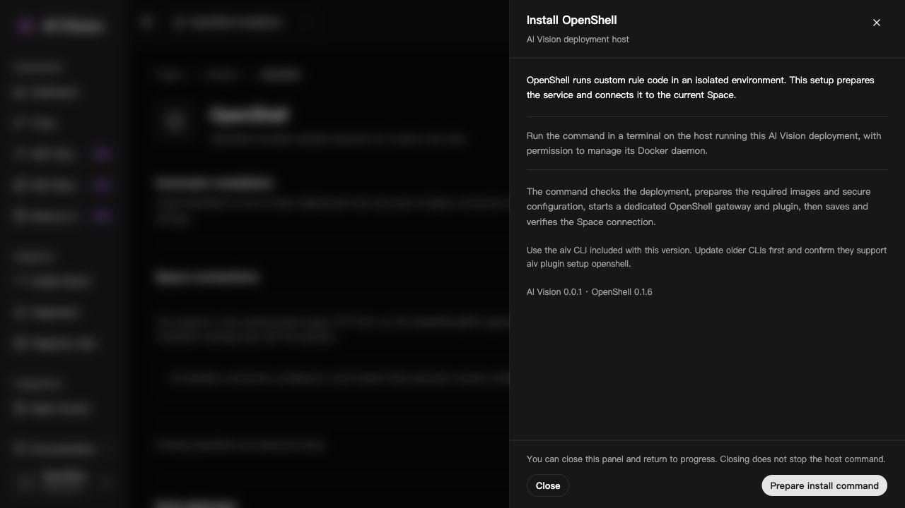
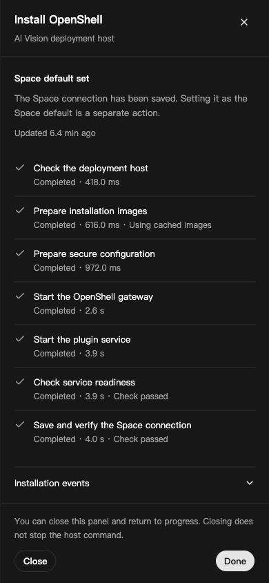

# Optional OpenShell Sandbox plugin

Sandbox is an optional execution backend for Custom Rule diagnosers. AgentLens
continues to support local execution without a provider. LLM Judge uses model
connections and does not use this sandbox.

## Enhanced Python rules

The optional `python-eval-v1` worker adds a fixed, independently versioned Python
environment containing pytest, NumPy, pandas, Pydantic, jsonschema and openpyxl.
The plugin advertises this capability only after checking the actual worker image
digest and runtime manifest. The rule editor reads that inventory; an installed
plugin without the capability continues to support compatible legacy rules.

Enhanced rules may import those libraries, use JSON/CSV/XLSX reference files, and
run generated Python code against reference pytest tests. Materials and the
runtime manifest are frozen with each Task. `context.run_python_tests` requires
completed, non-skipped tests for a successful result; candidate errors are BAD,
while incomplete or invalid test execution is FAILED. This supports correctness
checks, not tamper-proof grading of an adversarial candidate.

New automatic installations use 1 CPU, 1 GiB memory and a 30-second connection
execution limit. The effective limit is the lower of that connection limit and
AgentLens's configured enhanced execution limit; the editor displays it. Existing
connections and rules are not silently upgraded. A manager can explicitly apply
and verify the recommended connection limits. Enhanced execution never falls
back to the local evaluator or installs packages at runtime.

The library environment belongs to a separate optional worker image; it is not
added to the default application images or service Python environments. The
source release workflow builds and qualifies that worker separately from the
plugin, then records both immutable digests in the optional catalog. The native
manual build below does not by itself qualify this new runtime; private delivery
requires its own producer and artifact acceptance.

## Recommended: install on the AI Vision deployment host

Use the zero-input setup flow when this deployment includes an OpenShell artifact
catalog and a matching CLI. It prepares a dedicated gateway and plugin, then
registers and tests the connection for the current Space. You do not enter image
names, gateway addresses, host paths, endpoints or service tokens in this flow.

1. Open **Integrations → Plugins → Sandbox → OpenShell → Install OpenShell**.
2. Read the target and prerequisites, then choose **Copy install command** to
   prepare and copy it in one action.
3. Paste and run the command in a terminal on the **host running this
   AI Vision deployment**, with permission to manage that host's local Docker
   daemon. Copying the command does not run it. If clipboard access is denied,
   retry **Copy command** on the same page; this reuses the prepared session.
4. Follow the reported stages. Wait for **Space connection saved**. Provider
   readiness alone does not confirm registration.
5. Choose **Set as Space default** only if this connection should become the
   current Space's default. The server tests the connection again and confirms
   the binding. This action preserves the existing `require_sandbox` setting.

Use the CLI included with this version. Check its actual capability before copying
a setup command; update an older CLI first:

```sh
aiv plugin setup openshell --help
```

The browser command contains three separate short-lived capabilities for fetching
the pinned plan, reporting progress and enrolling the connection. They are shown
only when the command is created. Uppercase preview placeholders are replaced
automatically when copied; users do not fill them in. Ordinary command words,
options and paths are unquoted; unsafe or empty arguments retain shell quoting.
Capabilities are never returned by inventory/detail reads or stored in browser storage. The generated plugin HTTP
key remains on the host and is sent only to the enrollment endpoint; it is not one
of those three command capabilities. Do not publish a copied command or its tokens.

These natural screenshots show local source QA with prepared official-image caches, using the English interface. The new-Space preparation capture was not executed; the narrow outcome capture reads the accepted installation. They do not establish released-artifact availability or qualification of another host/architecture. The user still executes the host command in a terminal.





Current UI regression captures use synthetic progress events and do not establish
a new cold-install acceptance: [one-action command copy](../assets/openshell-install-copy.zh-CN.fixture.png),
[visible download and stage progress](../assets/openshell-install-progress.zh-CN.fixture.png),
and [English narrow command preview](../assets/openshell-install-copy.en.fixture.png).
The [verification manifest](../assets/openshell-install-simplification-manifest.json) records source hashes and validation scope.

### Environment checks and actionable failures

Before image acquisition or private installation state, setup checks the local Docker Engine
(minimum 28.0) and isolation capabilities it can verify. OpenShell 0.1.6 requires enabled
Landlock ABI 3 or newer ([pinned support matrix](https://github.com/NVIDIA/OpenShell/blob/v0.1.6/docs/about/support-matrix.mdx)), normally available from upstream Linux 6.2; active probes are
authoritative for distribution backports. Changing a container image does not change its
execution kernel. A macOS client or an unconfirmed different Docker kernel explicitly defers
the kernel check to the authenticated plugin's actual execution environment.

The drawer retains the failed stage and shows allowlisted reasons, available detected values,
and a corresponding next action:

| Failure | Next action |
| --- | --- |
| Docker version or access | Ask the administrator to upgrade/grant access, or use a compatible execution host. |
| Landlock unavailable or ABI too old | Ask the administrator to check the kernel and isolation configuration. |
| Environment cannot be verified | Confirm matching CLI/plugin versions and Docker configuration before rechecking. |
| Image download | Restore network/registry access, then prepare a new command that reuses owned state and cache. |
| Gateway or plugin startup | Check that stage's host logs, configuration and ports before continuing. |
| Service started but not ready | Verify the execution environment; service startup is not proof of sandbox execution. |
| Connection registration | Retain the installed services, restore platform access/authorization, then register again. |

Known environment incompatibility does not offer generic retry as the primary action.
After an administrator fixes the host, expand the repair/recheck action to explicitly create
and copy a new host command. Failed history remains available. Legacy events without typed
reasons keep their stage fallback; arbitrary terminal errors and credentials are never shown.
Readiness and environment checks do not replace actual diagnosis and verified-cleanup acceptance.

Screenshots distinguish the [synthetic missing-Landlock state](../assets/openshell-install-environment.zh-CN.fixture.png),
[actual VM cancellation](../assets/openshell-install-canceled.zh-CN.vm.png), and
[actual VM installation with prepared exact-digest image cache](../assets/openshell-install-ready.zh-CN.vm.png).
The prepared-cache result does not qualify an unprepared GHCR cold install.
The [verification manifest](../assets/openshell-install-diagnostics-manifest.json) records source hashes,
actual Task/Record results, mTLS rejection and independent cleanup checks.

The compact fixed action bar places Close beside the primary action and shows only Done
after default binding is confirmed. End-reporting and host-repair controls stay in the scrollable
body. See the actual VM [action bar](../assets/openshell-install-footer.zh-CN.vm.png) and
[confirmed-default state](../assets/openshell-install-footer-bound.zh-CN.vm.png).

### What the setup command does

| Reported stage | Responsibility |
| --- | --- |
| Host | Verify the current local Unix Docker daemon owns the matching running backend and diagnosis containers and their shared deployment network. Remote TCP/SSH Docker contexts and ambiguous targets are refused. |
| Images | Acquire the catalog's pinned plugin, worker, gateway, runtime and supervisor references for the daemon's Linux architecture; duplicate references are reused. |
| Configuration | Create or reuse owned private configuration, service credentials, fixed nonroot/no-egress policy and durable state. |
| Gateway | Prepare and start a dedicated OpenShell gateway with its owned mTLS/JWT configuration. |
| Plugin | Start or verify the owned plugin service on the deployment network. |
| Readiness | Check authenticated service and provider readiness. |
| Registration | Save and test the fixed connection in the current Space. The page reports saved only after a confirmed connection UUID exists. |

The drawer shows confirmed completed stages, cumulative installation time, and
the active image layer’s reported download/extraction state and byte counts.
Byte counts describe that layer, not the entire installation. Detailed events
remain expandable. All values come from host reports. Closing,
reopening or refreshing the drawer only resumes reads. A delayed update or a
failed browser request does not establish a host failure.

After a refresh, previously generated credentials cannot be recovered. If you
already ran the command, keep waiting. Otherwise choose **Regenerate install
command** explicitly. A fresh record is created; the old record is retained and
its host command is not canceled. The CLI checks its deployment lock and exact
owned plan before reusing host state. A changed plan, daemon or resource owner is
not silently adopted. Ending reporting revokes session capabilities, not host
execution.

### Artifact availability and delivery boundary

The deployment administrator supplies the optional `plugins.openshell` artifact
catalog in `AIVISION_RELEASE_MANIFEST_BASE64`, or through
`AIVISION_SANDBOX_BOOTSTRAP_CATALOG`. It contains platform-specific immutable
`@sha256` references and OpenShell `0.1.6` compatibility metadata. The server pins
that catalog and the deployment target in an immutable installation plan. A later
catalog update does not change an existing plan.

If the catalog is missing/invalid or the deployment target cannot be identified,
the drawer explains why automatic setup is unavailable. An administrator must
provide a compatible version/package or repair the deployment identity. The UI
does not replace that condition with a form requiring invented image names.

Optional OpenShell components remain outside the default five-service bundle,
private Daily package and offline bundle unless a separately reviewed delivery
explicitly adds them. Source builds and a local/source QA catalog are not proof
of published artifact availability, native-private source-content compliance or
qualification of another architecture/host. Record those results separately.

Automatic setup prints `Owned state: ...`; failures retain and report existing state. Later operator `status/logs/remove` commands use its `installation` subdirectory as `--state-dir`. Safe plugin removal still retains the dedicated gateway and private files. An operator handles the gateway separately after confirming no leases remain; this is not a complete automatic uninstaller or a shortcut to force-clear state.

## Advanced: existing gateway and manual installation

Use the remaining instructions only when an operator already manages an OpenShell
gateway and explicitly supplies compatible plugin/workload images. The manual
`aiv plugin install openshell` command starts only the separate plugin HTTP
service; it does not provision or change that existing gateway. Its image has no
assumed published default tag. Django and the browser never receive a Docker
socket or execute host commands.

The ordinary AgentLens image and Python environment remain OpenShell-SDK-free.

The optional [plugin Dockerfile](../../../agentlens/docker/Dockerfile.sandbox-plugin)
extends an explicitly supplied native AgentLens image. That base must already
contain the compiled plugin modules from the
[central native producer](../../../deploy/native-packaging/build-artifacts.md).
Use the [artifact-only image assembly and audit](../../../deploy/native-packaging/build-images.md)
for the base; an older published base is not assumed compatible. From `agentlens/`:

```sh
docker build -f docker/Dockerfile.sandbox-plugin \
  --build-arg AGENTLENS_NATIVE_IMAGE=YOUR_QUALIFIED_NATIVE_IMAGE \
  -t YOUR_EXPLICIT_PLUGIN_IMAGE .
```

Replace both image placeholders with actual references. This builds an optional
image locally; it does not publish it or qualify rule execution, cleanup, platform
support or the private distribution source-content boundary. Provider package
versions are pinned in the Dockerfile's requirements file. Native compiler output,
all image layers and actual runtime behavior need their own verification.

## Workspace ownership requirement

Reserve one OpenShell workspace exclusively for this plugin's durable journal. Do not let other
SDK/CLI clients delete or recreate plugin-owned sandbox/template names. Use `--workspace` to select
that workspace; the default workspace is appropriate only on a gateway dedicated to the plugin.

OpenShell 0.1.6 deletes by canonical name and exposes no atomic expected-ID/version precondition.
The plugin detects an identity mismatch it observes and verifies cleanup, but cannot prevent a
concurrent gateway administrator from replacing a name between those requests. Gateway admins are
trusted operators, not isolated tenants. Namespace exclusivity is an operating requirement, not an
access restriction this SDK can enforce. The ownership clarification is proposed for maintainer review
in the [lifecycle ADR](../../../agentlens/docs/adr/sandbox-execution/lifecycle.md).

## Prepare operator configuration

The plugin HTTP token and OpenShell gateway credentials are separate. Store
tokens and TLS private keys in owner-only files (`0600`), keep configuration and
journal directories private (`0700`), and retain the journal across restarts and
reinstallation. Exactly one plugin process may own a journal.

The managed container runs as the token file's numeric owner UID/GID, drops all
Linux capabilities and adds a supplementary group for socket access. By default
the group is derived from the host socket's ownership. The journal must have
that same owner; the policy and optional gateway files must be readable by it.
It does not rely on root bypassing `0600`/`0700`
permissions or add a discretionary-access-override capability.

The cleanup socket must point to the **same Docker daemon used by the gateway**.
The plugin mounts it read-only and uses bounded read-only API calls for independent
cleanup verification. A read-only Unix socket mount alone does not restrict the
Docker API; this is a trusted operator service, never a workload mount. A missing
or incorrect daemon prevents cleanup verification and leaves leases pending.
Use a dedicated executor host or Docker daemon for these workloads.

Some Docker VM environments, including macOS, expose different socket ownership
inside a container. If the host group cannot access the mounted socket, inspect
the socket's numeric group **inside a container on the selected daemon** using
a trusted image, then add `--docker-socket-gid N` to the install command. The
supported range is `0..2147483647`; `--docker-socket-gid 0` is valid when the
mounted socket is group-owned by `0`. It adds that supplementary group while
keeping the token owner's process UID/GID. Only use a trusted plugin image:
the service already has Docker daemon access. The CLI does not launch a probe
image, switch the plugin to root, or relax socket permissions. Host `stat`
output alone does not establish the container-side group.

For a trusted plugin image built from the canonical native base, the operator
can run this metadata-only check on the same daemon:

```sh
docker run --rm --network none \
  --mount type=bind,source=/absolute/path/to/gateway-docker.sock,target=/run/docker-readback.sock,readonly \
  --entrypoint /usr/bin/stat YOUR_EXPLICIT_PLUGIN_IMAGE \
  -c '%u:%g %a' /run/docker-readback.sock
```

Replace the socket and image placeholders. The output is numeric `UID:GID` and
permissions; `0:0 660`, for example, identifies group `0`. This command replaces
the image entrypoint with `stat` and does not start the plugin. It verifies only
mounted metadata, not gateway identity, readiness or cleanup behavior.

For example, prepare a private token and a fixed deny-network policy:

```sh
umask 077
AIV_SANDBOX_CONFIG="$HOME/.aivision/openshell-config"
mkdir -p "$AIV_SANDBOX_CONFIG" "$AIV_SANDBOX_CONFIG/journal"
chmod 700 "$AIV_SANDBOX_CONFIG" "$AIV_SANDBOX_CONFIG/journal"
openssl rand -hex 32 > "$AIV_SANDBOX_CONFIG/plugin-token"
chmod 600 "$AIV_SANDBOX_CONFIG/plugin-token"
cat > "$AIV_SANDBOX_CONFIG/policy.yaml" <<'YAML'
version: 1
process:
  run_as_user: "1000"
  run_as_group: "1000"
landlock:
  compatibility: hard_requirement
filesystem_policy:
  include_workdir: true
  read_only: ["/usr", "/lib", "/lib64", "/etc", "/app"]
  read_write: ["/tmp", "/work"]
network_policies: {}
YAML
```

Check the filesystem paths against your actual workload image. The first provider
requires a non-root process, Landlock enforcement and no network access. HTTP
callers cannot replace the gateway, worker command, policy or image allowlist.

## Install the optional service

Supply every required operator input explicitly:

```sh
aiv plugin install openshell --help
aiv plugin install openshell \
  --image YOUR_EXPLICIT_PLUGIN_IMAGE \
  --gateway-endpoint gateway.example:30051 \
  --workload-image YOUR_APPROVED_WORKLOAD_IMAGE \
  --token-file "$AIV_SANDBOX_CONFIG/plugin-token" \
  --policy-file "$AIV_SANDBOX_CONFIG/policy.yaml" \
  --docker-socket /absolute/path/to/gateway-docker.sock \
  --journal-dir "$AIV_SANDBOX_CONFIG/journal" \
  --state-dir "$AIV_SANDBOX_CONFIG/installation" \
  --port 8092
```

Replace the images, gateway and socket with actual deployment values. The gateway
address must be reachable **from the plugin container**, not only from the host.
An absent explicit plugin image is pulled by its given reference. The CLI does
not infer a registry or tag. It does not replace an existing installation.

Installation reports six phases on **stderr**, leaving status output on stdout:

| Phase | What it establishes |
| --- | --- |
| Configuration | Required inputs, file access and permissions; policy contents are checked by the plugin at startup. |
| Docker | The daemon can be inspected and the installation does not conflict with an existing container or journal owner. |
| Image | The explicit plugin image is cached, or its download has completed. The gateway and workload image are not downloaded. |
| State | Private installation state and journal ownership have been saved. |
| Container | Docker has started the plugin and its container identity has been saved. |
| Readiness | The authenticated plugin API responds; provider readiness is reported separately. |

Each phase reports its elapsed time. A long-running phase reports that it is
still waiting every five seconds. Docker layer progress is shown when available;
unknown output is filtered, and no overall percentage is estimated. Installation
has a **15-minute total budget**, including image download; add `--timeout 30m`
to allow more time on a slow connection. This does not extend the separate
initialization window after container startup.

If installation fails, use the reported phase and the printed status/logs
commands with the original `--state-dir`. Retain pending state and the journal;
do not delete them to bypass ownership checks. `Running: true` with `Readiness:
false` means the container started but the provider is not ready, even when the
install command exits successfully. Resolve that state before using a connection.

Optional flags are `--docker-socket-gid`, `--gateway-token-file`, `--gateway-ca-file`,
`--gateway-cert-file`, `--gateway-key-file` and `--workspace`. Client certificate
and key must be supplied together. Tokens are read from mounted files, never
passed as Docker argument values or copied into saved state. File paths and
non-secret operator configuration are saved privately in `installation.json`
with mode `0600` under `--state-dir` (default `~/.aivision/plugins/openshell`, or
under `AIVISION_CONFIG_DIR` when set). Preserve this directory for every command.
An explicit socket-group override is saved too, including `0`. Pending installs
must resume with the original operator options; an override does not bypass
that check or replace an existing installation. Drain/remove an installed
service safely before reinstalling with a different group.

The host endpoint defaults to `http://127.0.0.1:8092`; container port is `8091`.
For a remote AgentLens deployment, provide an authenticated private network/TLS
route through your existing reverse proxy or tunnel. The CLI deliberately binds
only loopback. `127.0.0.1` inside an AgentLens container refers to that container,
so it is not automatically the plugin service's reachable address.

## Configure and verify a Space connection

Open **Integrations > Plugins > Sandbox > OpenShell** and add a connection using the plugin's
reachable **HTTP API endpoint**, its HTTP access token and the allowlisted workload
image. Do not enter the OpenShell gRPC gateway address in this field.

Installation, saved configuration, authenticated readiness and the Space default
binding are separate states. **Check readiness** checks plugin/provider readiness;
it does not execute a rule or validate workload cleanup. When that connection is the intended execution destination, return to **Sandbox**
and save the default connection or requirement under **Space execution policy**.

Readiness establishes connectivity, not the identity of the workload's Docker
daemon. Run an actual Custom Rule Trial with approved synthetic input to verify
the workload and cleanup path separately. During execution the plugin records
the observed daemon identity and container ownership; cleanup against a different
responsive daemon cannot release the lease's capacity.

Custom Rule offers `inherit`, `required` and `local` modes. New tasks inherit the
Space default when omitted. Historical frozen tasks keep their recorded route.
A selected unavailable connection fails; it never silently falls back to local
execution. A Space `require_sandbox` policy refuses local execution, including an
explicit `local` selector. Existing task snapshots do not change after rebinding.

The synchronous Trial proxy uses a fixed 600-second HTTP phase budget for bounded
creation, execution and cleanup operations. The bundled frontend nginx allows
630 seconds on `/api/v1/spaces/{spaceId}/diagnose/diagnosers/rule/trial`, including
forwarding overhead. Configure any additional application server, reverse proxy
or load balancer to allow at least 630 seconds for this route. This is a
transport budget, not a per-rule execution allowance: Custom Rule's
global execution limit and the connection/plugin limits are enforced separately.

## Input limits and plugin compatibility

New installations default to an 8 MiB (8,388,608 byte) complete input budget, with a
16 MiB hard ceiling. Code, the full Trace (original `payload` and flattened attributes),
materials, expected JSON and protocol overhead share the budget. Both the serialized
request and normalized worker input must fit before a lease is reserved. No Trace
fields are removed to make a request fit.

Operators may set `SANDBOX_MAX_INPUT_BYTES` on AgentLens and
`AGENTLENS_SANDBOX_PLUGIN_MAX_INPUT_BYTES` on the plugin (1,024–16,777,216 bytes).
The effective budget is the smallest of both settings and the selected worker limit.
Larger inputs require an updated immutable worker image carrying the qualified
`io.aivision.sandbox.max-input-bytes` label. Missing or invalid metadata, mutable
images, and older plugins without per-image limits retain the 2 MiB allowance.
Upgrade AgentLens, plugin and worker together; changing only an environment variable
cannot upgrade an old reader.

Before Run, the editor displays the measured input and effective budget. Expand it
for exact request/worker byte counts and shared-budget details. Changing inputs
invalidates the check; oversized inputs keep Run disabled without creating a sandbox.
Confirm the supported budget with your operator or choose a smaller complete Trace.

OpenShell 0.1.6 accepts at most 1 MiB per decoded gRPC message. The adapter sends
larger input through its bidirectional execution API in 4 KiB frames, within the
same total budget. No gateway or SDK upgrade is required for this transport.

Update the optional plugin together with AgentLens. An older plugin without
`POST /v1/executions/validate` is rejected before resource creation with an upgrade
message; a green connectivity check alone does not establish input preflight support.
Oversize input shows the measured bytes and allowed bytes in Trial and saved results.
Reduce test materials or select a smaller complete Trace, then retry. Do not remove
arbitrary spans or increase the gRPC decoder limit to hide a total-input failure.

Prepared ARM64 source-QA evidence for the complete-input budget:
[full SQL-field hash verification](../assets/sandbox-input-budget-success.png),
[pre-run oversize rejection](../assets/sandbox-input-budget-oversize.png),
[static validation diagnostics](../assets/sandbox-input-budget-validation.png), and
[component identities, boundaries, persisted records and cleanup](../assets/sandbox-input-budget-manifest.json).
These use synthetic 7-span data through actual ingestion, SQL hydration, framework projection and
OpenShell execution; they do not qualify the reporter's private business sample, released artifacts
or other platforms. The earlier [transport manifest](../assets/sandbox-input-transport-manifest.json)
retains its historical 2 MiB budget and separate 1 MiB gRPC qualification.

## Status, logs and safe removal

```sh
aiv plugin status openshell --state-dir "$AIV_SANDBOX_CONFIG/installation"
aiv plugin status openshell --state-dir "$AIV_SANDBOX_CONFIG/installation" --format json
aiv plugin logs openshell --state-dir "$AIV_SANDBOX_CONFIG/installation" -n 100
aiv plugin logs openshell --state-dir "$AIV_SANDBOX_CONFIG/installation" --follow
aiv plugin remove openshell --state-dir "$AIV_SANDBOX_CONFIG/installation"
```

Status and logs verify the exact saved container ID, image and ownership labels.
The CLI refuses to adopt or replace an unrelated container. Status distinguishes
installation/running state, authenticated readiness, draining and the durable
active-lease count, which includes cleanup-pending and orphaned leases.

Removal first authenticates to `/v1/admin/drain`, fencing new lease creation. It
refuses removal while any lease is active or cleanup-pending, or when health,
ownership or admission fencing cannot be verified. A busy service remains
draining so cleanup can continue; retry removal after the count reaches zero.
It then sends SIGTERM to the owned container and requires exit code 0 or Uvicorn's
completed SIGTERM exit 143, with no OOM, before removing it. SIGKILL/exit 137 and
other failures remain rejected. The journal, token/policy files and gateway remain intact. There is
no force or journal-purge option.

The drain result is bound to the container's observed start time and restart
count. If the process restarts during drain or shutdown, the CLI refuses removal
and retains installation state, journal ownership and all lease records. Inspect
the restarted process, let its janitor reconcile pending leases, then retry the
full drain/removal sequence; an earlier empty drain result cannot be reused.

If the service is stopped or unhealthy, inspect its exact owned container and
operator configuration, restart it using its saved configuration, allow the
restart janitor to verify cleanup, then retry. Do not delete pending lease rows,
ownership labels or CLI state to bypass a failed guard. To replace an image,
drain/remove the service safely and reinstall with the retained journal.

To rotate the plugin service token, drain/remove safely, update its private file,
reinstall with the retained journal, then rotate the write-only token in each
Space connection. A saved connection token change alone does not change the
service's operator credential.

Local fake-Docker/HTTP tests verify CLI arguments and lifecycle guards. They do
not establish a real OpenShell deployment, actual sandbox execution, cleanup
acceptance, model quality or production readiness. Record those actual checks
separately with the selected image/platform combination.
