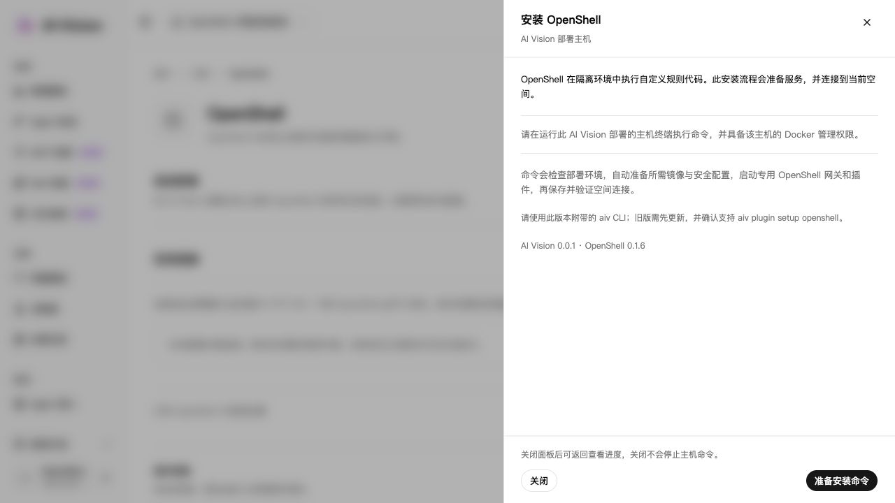
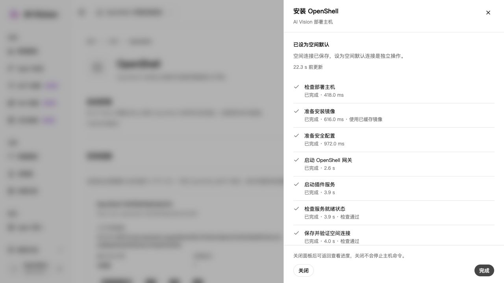

# 可选的 OpenShell Sandbox 插件

Sandbox 为自定义规则诊断器提供可选的隔离执行后端。未配置提供方时，AgentLens
仍支持本地执行。LLM 评估器通过模型连接运行，不使用此沙箱。

## 增强 Python 规则

可选的 `python-eval-v1` 工作负载提供独立版本的固定 Python 环境，预装 pytest、
NumPy、pandas、Pydantic、jsonschema 和 openpyxl。插件核对实际工作负载镜像摘要
与运行环境清单后才声明增强能力，规则编辑器读取该清单。未具备增强能力的插件
仍可运行兼容的旧版规则。

增强规则可以导入预装库，使用 JSON、CSV、XLSX 参考文件，并用参考 pytest 测试
验证生成的 Python 代码。每个 Task 固定材料与运行环境清单。
`context.run_python_tests` 只有在必需测试完整执行且未跳过时才可能成功；候选代码
错误为 BAD，测试执行不完整或无效为 FAILED。这用于正确性验证，不承诺对抗恶意
候选代码篡改测试结果。

新自动安装的连接默认使用 1 CPU、1 GiB 内存和 30 秒执行上限。实际生效时限取连接
上限与 AgentLens 配置的增强规则上限中的较小值，并在编辑器显示。已有连接和规则
不会静默升级，管理者可明确应用并验证推荐的连接配置。增强执行不会回退到本地
评估器，也不会在运行时安装依赖。

预装库属于独立的可选工作负载镜像，不进入默认应用镜像或服务 Python 环境。
源码发布流程分别构建和验证工作负载与插件，再将两者的不可变摘要写入可选安装
清单。下文的原生手工构建本身不代表新增运行环境已验收；私有交付仍需独立的
产物生产与验收流程。

## 推荐：在 AI Vision 部署主机上自动安装

部署包含 OpenShell 安装镜像清单且 CLI 能力匹配时，使用零输入自动安装流程。
它负责准备专用网关和插件，再为当前空间保存并验证连接。普通用户无需填写镜像、
网关、主机路径、插件地址或服务令牌。

1. 打开 **集成 → 插件 → 沙箱 → OpenShell → 安装 OpenShell**。
2. 阅读安装目标与前提，点击 **复制安装命令**，一次完成生成和复制。
3. 将命令粘贴到**运行此 AI Vision 部署的主机**终端执行，并具备该主机的
   Docker 管理权限。仅复制命令不会执行安装。剪贴板权限被拒绝时，在当前页面重试
   **复制命令**，会复用同一安装记录。
4. 查看主机上报的各阶段，等待 **空间连接已保存**。提供方就绪不等于注册完成。
5. 需要将该连接设为当前空间默认时，再点击 **设为空间默认**。服务端重新检查连接，
   确认绑定后才显示成功；原有 `require_sandbox` 设置保持不变。

使用此版本附带的 CLI。复制安装命令前先检查实际能力，旧版应先更新：

```sh
aiv plugin setup openshell --help
```

生成的命令包含获取固定安装计划、上报进度、注册连接三种独立的短期授权凭据。
它们仅在生成时提供，预览以大写占位名称显示，复制时自动带入真实值，无需手动填写。
普通命令词、参数和路径不加引号；空格、单引号等特殊字符仍会安全引用。
列表或详情查询不会回传凭据，浏览器也不持久保存。
自动生成的插件 HTTP 服务密钥留在主机上，仅交给注册接口，不是这三项命令凭据之一。
不要公开复制后的命令或其中的令牌。

以下为本地源码 QA 的实际界面（官方镜像缓存已准备），不代表已发布交付物或其他主机/架构验收。主机命令仍须由用户在终端执行。





本轮界面回归使用合成进度事件验证交互（不作为一次新的冷安装验收）：
[一步复制安装命令](../assets/openshell-install-copy.zh-CN.fixture.png)、
[下载状态与阶段进度](../assets/openshell-install-progress.zh-CN.fixture.png)、
[英文窄屏命令预览](../assets/openshell-install-copy.en.fixture.png)。
[验证清单](../assets/openshell-install-simplification-manifest.json) 记录源码哈希与检查范围。

### 安装前检查与失败提示

自动安装会在下载镜像、创建私有安装状态前检查本机 Docker Engine（至少 28.0）及可核实的隔离能力。
OpenShell 0.1.6 要求启用 Landlock ABI 3 或以上（[对应版本支持矩阵](https://github.com/NVIDIA/OpenShell/blob/v0.1.6/docs/about/support-matrix.mdx)），上游 Linux 通常从 6.2 开始提供；发行版的回移植
以实际探测为准。更换容器镜像不会更换执行内核。CLI 运行在 macOS 或无法确认与 Docker 使用同一
内核时，会明确延后能力检查，再由已认证的插件检查实际执行环境，不会把客户端内核当成执行内核。

侧栏保留失败阶段，并按安全错误类型显示原因、可用的检测值和下一步操作：

| 提示类别 | 下一步 |
| --- | --- |
| Docker 版本不足或无访问权限 | 请部署管理员升级或授权，或选用符合要求的执行主机。 |
| 未提供 Landlock 或 ABI 版本不足 | 请管理员检查内核与隔离配置；普通用户无需填写内核参数。 |
| 无法核实环境 | 检查匹配的 CLI、插件与 Docker 环境后重新核实，不视为兼容通过。 |
| 镜像下载失败 | 修复网络或镜像访问后，准备新命令复用已有安装状态和缓存。 |
| 网关或插件启动失败 | 按对应阶段检查主机日志、配置与端口，再继续已有安装。 |
| 服务已启动但未就绪 | 不把启动成功当作沙箱执行已通过；检查执行环境后再使用。 |
| 连接注册失败 | 保留已安装服务，确认平台可达及授权有效后重新注册。 |

已知环境不兼容时，不把普通重试作为主操作；管理员处理后，可展开修复后的重新检查入口，
明确创建并复制一条新命令，再在主机执行。旧失败记录会保留。旧组件没有结构化原因时仍显示
兼容的阶段提示，不展示任意终端报错或凭据。服务就绪和环境预检都不能代替一次实际诊断及清理验收。

截图分别展示[合成事件的 Landlock 缺失提示](../assets/openshell-install-environment.zh-CN.fixture.png)、
[真实 VM 的取消提示](../assets/openshell-install-canceled.zh-CN.vm.png)，以及
[同摘要镜像缓存准备后的真实 VM 安装完成状态](../assets/openshell-install-ready.zh-CN.vm.png)。
缓存准备后的成功结果不代表未经准备的 GHCR 冷安装已通过。
[验证清单](../assets/openshell-install-diagnostics-manifest.json) 记录源码哈希、真实 Task 与结果、
mTLS 拒绝行为及独立清理检查。

侧栏底部采用紧凑动作栏，关闭与主操作相邻排列，确认默认绑定后只保留“完成”。
结束上报和主机修复入口位于可滚动正文内。
[真实 VM 底栏](../assets/openshell-install-footer.zh-CN.vm.png) 与
[默认绑定完成状态](../assets/openshell-install-footer-bound.zh-CN.vm.png) 展示了实际效果。

### 自动安装命令负责什么

| 上报阶段 | 职责 |
| --- | --- |
| 部署主机 | 核对本地 Unix Docker daemon 中匹配的后端、诊断容器及其共享部署网络；拒绝远程 TCP/SSH Docker context 和有歧义的目标。 |
| 安装镜像 | 按 daemon 的 Linux 架构获取清单固定的插件、worker、网关、runtime、supervisor 引用；相同引用复用。 |
| 安全配置 | 创建或复用所属的私有配置、服务凭据、固定非 root / 无外网策略与持久状态。 |
| 网关 | 准备并启动使用所属 mTLS/JWT 配置的专用 OpenShell 网关。 |
| 插件 | 在部署网络中启动或核对所属插件服务。 |
| 就绪状态 | 检查服务认证与提供方就绪状态。 |
| 空间连接 | 为当前空间保存并检查固定连接，确认连接 UUID 后才显示已保存。 |

侧栏直接显示已完成的阶段数、累计安装用时，以及当前镜像层的下载或解压状态与已上报字节。
这些数值来自主机上报；字节进度仅针对显示的镜像层，不代表整个安装百分比。
详细事件仍可展开查看。
关闭、重新打开或刷新侧栏只会恢复读取。更新延迟或一次浏览器请求失败，不代表主机操作失败。

刷新后无法重新获取已生成的凭据。若已在主机执行命令，请继续等待；否则明确点击
**重新生成安装命令**。系统创建新记录，保留旧记录，也不取消旧命令在主机上的执行。
CLI 先检查部署锁与完全匹配的归属计划，再复用主机状态，不会静默接管改变了计划、
daemon 或归属的资源。结束进度上报只撤销会话凭据，不停止主机命令。

### 安装包可用性与交付边界

部署管理员通过 `AIVISION_RELEASE_MANIFEST_BASE64` 中可选的 `plugins.openshell`
清单，或 `AIVISION_SANDBOX_BOOTSTRAP_CATALOG` 提供安装包信息。清单包含分架构的
不可变 `@sha256` 引用和 OpenShell `0.1.6` 兼容元数据。服务端将清单与部署目标固定
为不可变安装计划，后续清单更新不会修改已有计划。

清单缺失、无效或部署目标无法识别时，侧栏会说明自动安装不可用的原因。部署管理员
需补齐匹配版本/交付包或修复部署标识，页面不会改让用户填写不存在的默认镜像。

OpenShell 可选组件仍不进入默认五服务、私有 Daily 或离线交付包，除非另行审阅的
交付明确包含它们。源码构建和本地源码 QA 清单不证明镜像已经发布，也不证明私有
原生分发源码边界或其他架构/主机已经验收，这些证据应分别记录。

自动安装终端打印 `Owned state: ...`，失败时保留并报告已有状态目录。后续运维的 `status/logs/remove` 以该目录下的 `installation` 子目录作为 `--state-dir`。安全卸载插件仍保留专用网关和私有文件；网关需要运维在确认无租约后另行处理，不提供完整自动卸载或强制清空状态的捷径。

## 高级：已有网关的手工安装

仅在运维已经管理 OpenShell 网关，并明确提供兼容插件/工作负载镜像时使用以下步骤。
手工 `aiv plugin install openshell` 只启动独立插件 HTTP 服务，不创建或修改已有网关。
该命令不假定任何默认镜像标签已经发布。Django 和浏览器始终不接收 Docker socket，
也不执行主机命令。普通 AgentLens 镜像与 Python 环境仍不包含 OpenShell SDK。

可选的 [插件 Dockerfile](../../../agentlens/docker/Dockerfile.sandbox-plugin) 基于显式提供的
原生 AgentLens 镜像构建。该基础镜像必须已包含
[统一原生编译入口](../../../deploy/native-packaging/build-artifacts.md) 产出的插件编译模块。
基础镜像遵循 [仅使用产物的镜像组装与审计流程](../../../deploy/native-packaging/build-images.md)，
不能假定旧版已发布镜像兼容。在 `agentlens/` 目录执行：

```sh
docker build -f docker/Dockerfile.sandbox-plugin \
  --build-arg AGENTLENS_NATIVE_IMAGE=YOUR_QUALIFIED_NATIVE_IMAGE \
  -t YOUR_EXPLICIT_PLUGIN_IMAGE .
```

将两个镜像占位符替换为实际引用。这仅在本地构建可选镜像，不会发布镜像，也不代表
规则执行、清理、平台或私有分发源码边界已经验收。提供方依赖版本固定在 Dockerfile
使用的 requirements 文件中。编译产物、全部镜像层与实际运行行为需分别验证。

## Workspace 所有权要求

为一个持久化插件租约日志独占使用一个 OpenShell workspace。其他 SDK、CLI 客户端不得
删除或重建其中由插件拥有的沙箱和模板名称。通过 `--workspace` 选择该 workspace；
只有整个网关专用于此插件时，才使用默认 workspace。

OpenShell 0.1.6 按名称删除资源，公开 API 不支持不可变 ID 或版本的原子前置条件。
插件会拒绝已观察到的身份变化并核验清理，但无法防止网关管理员在两次请求之间重建
同名资源。网关管理员属于可信运维边界。独占 workspace 是运维前提，当前 SDK 不能
强制阻止管理员绕过它。相关边界已在[生命周期 ADR](../../../agentlens/docs/adr/sandbox-execution/lifecycle.md)
中作为澄清提案提交审阅。

## 准备运维配置

插件 HTTP 令牌与 OpenShell 网关凭据相互独立。令牌和 TLS 私钥放在仅所有者可读写
的文件中（`0600`），配置目录和日志数据库目录使用 `0700`。重启和重装时保留租约
日志数据库，同一个日志数据库只能由一个插件进程使用。

托管容器使用令牌文件所有者的数字 UID/GID 运行，移除全部 Linux capabilities，
追加一个补充组以访问 socket，默认取宿主机 socket 的所属组。日志数据库目录必须属于同一个 UID，
策略和可选网关文件也必须能由该用户读取。不会依赖 root 绕过 `0600`/`0700` 权限，
也不会增加绕过文件访问权限的 capability。

清理核验 socket 必须连接到 **OpenShell 网关实际使用的同一个 Docker daemon**。
插件以只读方式挂载该 socket，通过有界的只读 API 请求独立核验清理结果。Unix socket
的只读挂载本身不限制 Docker API 权限；这是可信运维服务的能力，不能挂载到工作负载。
socket 缺失或连接到错误的 daemon 时，清理无法确认，租约保持待清理状态。
建议为这些工作负载使用独立执行主机或专用 Docker daemon。

部分 Docker 虚拟机环境（包括 macOS）会让 socket 在容器内显示不同的所有权。
宿主机所属组无法访问挂载后的 socket 时，先使用可信镜像，在所选 daemon 的
**容器内部**检查 socket 的数字 GID，再为安装命令添加 `--docker-socket-gid N`。
支持范围为 `0..2147483647`；挂载后的 socket 属于组 `0` 时，可使用
`--docker-socket-gid 0`。该选项只追加补充组，进程仍保持令牌文件所有者的 UID/GID。
插件镜像必须可信，因为该服务已经拥有 Docker daemon 访问能力。CLI 不会启动探测镜像、
改用 root 运行插件或放宽 socket 权限。仅检查宿主机的 `stat` 输出不足以确定容器内的组。

对于基于规范原生基础镜像构建的可信插件镜像，运维人员可在同一个 daemon 上执行
以下仅检查元数据的命令：

```sh
docker run --rm --network none \
  --mount type=bind,source=/absolute/path/to/gateway-docker.sock,target=/run/docker-readback.sock,readonly \
  --entrypoint /usr/bin/stat YOUR_EXPLICIT_PLUGIN_IMAGE \
  -c '%u:%g %a' /run/docker-readback.sock
```

替换 socket 和镜像占位符。输出为数字 `UID:GID` 和权限；例如 `0:0 660` 表示所属组
为 `0`。该命令将镜像入口替换为 `stat`，不会启动插件，只核对挂载后的元数据，
不验证网关身份、就绪状态或清理行为。

例如，先准备私有令牌和固定的禁止网络访问策略：

```sh
umask 077
AIV_SANDBOX_CONFIG="$HOME/.aivision/openshell-config"
mkdir -p "$AIV_SANDBOX_CONFIG" "$AIV_SANDBOX_CONFIG/journal"
chmod 700 "$AIV_SANDBOX_CONFIG" "$AIV_SANDBOX_CONFIG/journal"
openssl rand -hex 32 > "$AIV_SANDBOX_CONFIG/plugin-token"
chmod 600 "$AIV_SANDBOX_CONFIG/plugin-token"
cat > "$AIV_SANDBOX_CONFIG/policy.yaml" <<'YAML'
version: 1
process:
  run_as_user: "1000"
  run_as_group: "1000"
landlock:
  compatibility: hard_requirement
filesystem_policy:
  include_workdir: true
  read_only: ["/usr", "/lib", "/lib64", "/etc", "/app"]
  read_write: ["/tmp", "/work"]
network_policies: {}
YAML
```

请按实际工作负载镜像核对文件系统路径。首个提供方必须使用非 root 进程、强制
Landlock 隔离并禁止网络访问。HTTP 调用方不能替换网关、工作进程命令、策略或镜像白名单。

## 安装可选服务

显式提供全部必需的运维参数：

```sh
aiv plugin install openshell --help
aiv plugin install openshell \
  --image YOUR_EXPLICIT_PLUGIN_IMAGE \
  --gateway-endpoint gateway.example:30051 \
  --workload-image YOUR_APPROVED_WORKLOAD_IMAGE \
  --token-file "$AIV_SANDBOX_CONFIG/plugin-token" \
  --policy-file "$AIV_SANDBOX_CONFIG/policy.yaml" \
  --docker-socket /absolute/path/to/gateway-docker.sock \
  --journal-dir "$AIV_SANDBOX_CONFIG/journal" \
  --state-dir "$AIV_SANDBOX_CONFIG/installation" \
  --port 8092
```

将镜像、网关和 socket 替换为实际部署值。网关必须能从 **插件容器内部** 访问，
仅宿主机可访问并不足够。显式指定的插件镜像在本机不存在时，CLI 会按原引用拉取，
不会推导仓库或标签，也不会覆盖已有安装。

安装过程在 **stderr（标准错误流）** 中报告六个阶段，状态结果仍输出到 stdout：

| 阶段 | 完成表示什么 |
| --- | --- |
| 配置 | 必需参数、文件访问与权限检查通过；策略内容由插件在启动时校验。 |
| Docker | 可以检查 daemon，且已有容器和租约日志归属没有冲突。 |
| 镜像 | 明确指定的插件镜像已缓存或下载完成；不下载网关或工作负载镜像。 |
| 状态 | 私有安装状态与租约日志归属已保存。 |
| 容器 | 插件容器已启动，其容器标识已保存。 |
| 就绪 | 通过认证的插件 API 已响应；提供方是否就绪单独显示。 |

各阶段显示耗时；耗时较长时，每五秒提示仍在等待。Docker 提供镜像分层进度时，
CLI 展示经过过滤的已识别内容，不估算整体完成百分比。安装总预算默认为 **15 分钟**，
包含镜像下载；网络较慢时可增加 `--timeout 30m`。该参数不会延长容器启动后独立的
初始化检查窗口。

失败时根据报告的阶段定位问题，使用打印出的状态、日志命令，并保留原 `--state-dir`。
不要删除待完成安装状态或租约日志来绕过归属检查。`Running: true` 且 `Readiness:
false` 表示容器已启动、提供方尚未就绪；即使命令成功退出，也需要先解决该状态再使用连接。

可选参数包括 `--docker-socket-gid`、`--gateway-token-file`、`--gateway-ca-file`、`--gateway-cert-file`、
`--gateway-key-file` 和 `--workspace`。客户端证书与私钥必须一起提供。令牌通过
挂载文件读取，不作为 Docker 参数值传入，也不复制到安装状态文件。文件路径和
非敏感运维配置保存于 `--state-dir` 下的 `installation.json`，权限为 `0600`。
默认目录为 `~/.aivision/plugins/openshell`；设置了 `AIVISION_CONFIG_DIR` 时位于
该目录下。后续命令必须继续使用原状态目录。
显式指定的 socket 组也会保存，包括 `0`。待完成安装必须使用原运维参数重试；
该选项不会绕过检查或替换已有安装。需要修改已安装服务的组时，先安全排空并卸载，
再使用新参数重新安装。

宿主机默认地址为 `http://127.0.0.1:8092`，容器端口为 `8091`。远程 AgentLens
需要通过已有反向代理或隧道提供经过认证的私有网络/TLS 访问路径；CLI 只绑定回环地址。
AgentLens 容器内的 `127.0.0.1` 指向它自身，不会自动指向插件服务。

## 配置并验证 Space 连接

依次打开 **集成 > 插件 > Sandbox 沙箱 > OpenShell**，添加连接，填写插件可访问的 **HTTP API 地址**、
HTTP 访问令牌和允许使用的工作负载镜像。这里不能填写 OpenShell gRPC 网关地址。

安装服务、保存配置、通过认证就绪检查和绑定 Space 默认连接是独立状态。
**检查就绪状态** 仅检查插件与提供方是否就绪，不执行规则，也不验证工作负载清理。
确认该连接是预期执行目标后，返回 **Sandbox 沙箱** 页面，在 **Space 执行策略** 中保存默认连接或设置必须使用沙箱。

就绪状态仅证明连通性，不证明已核验工作负载实际所在的 Docker daemon。请使用经过
批准的合成输入执行真实自定义规则试运行，分别验证工作负载和清理路径。执行期间，
插件记录实际观察到的 daemon 身份和容器所有权；换到另一个仍可响应的 daemon，
也不能据此释放租约容量。

自定义规则支持 `inherit`、`required` 和 `local`。新任务在省略选择时继承 Space
默认设置，历史冻结任务保留原路由。已选连接不可用时执行失败，不会悄悄回退到本地。
Space 的 `require_sandbox` 策略拒绝所有本地执行，包括显式选择 `local` 的诊断器。
更换绑定不会改变已有任务快照。

同步试运行代理使用固定的 600 秒 HTTP 阶段预算，以覆盖有界的创建、执行和清理操作。
内置前端 nginx 为 `/api/v1/spaces/{spaceId}/diagnose/diagnosers/rule/trial`
允许 630 秒，包含转发开销。额外的应用服务器、反向代理与负载均衡器也应为该路由
允许至少 630 秒。这是传输预算，不是单条规则的执行时长；自定义规则全局执行限制、
连接限制和插件限制分别生效。

## 输入上限与插件兼容性

新安装默认采用 8 MiB（8,388,608 字节）的完整输入预算，硬上限为 16 MiB。
评估代码、完整轨迹（原始 `payload` 和展开属性均保留）、材料、预期 JSON
及协议开销共用预算。序列化请求和规范化后的工作进程输入都必须在预留租约前通过检查，
系统不会为满足大小限制而删除轨迹字段。

运维人员可以设置 AgentLens 的 `SANDBOX_MAX_INPUT_BYTES` 和插件的
`AGENTLENS_SANDBOX_PLUGIN_MAX_INPUT_BYTES`，范围均为 1,024–16,777,216 字节。
实际预算取这两个配置与所选 worker 上限的最小值。较大输入需要更新到带有
`io.aivision.sandbox.max-input-bytes` 能力标签的不可变 worker 镜像；缺少或无效的
镜像元数据、可变镜像，以及不提供逐镜像上限的旧插件，仍按 2 MiB 处理。
应同步更新 AgentLens、插件和 worker；只修改环境变量不会升级旧 reader。

点击运行前，编辑器显示已测量的输入大小和实际预算，展开后可查看请求与工作进程的
精确字节数及共用预算说明。修改输入会使旧检查失效；超限时不能运行，也不会创建沙箱。
可联系运维确认支持的预算，或选择较小的完整轨迹。

OpenShell 0.1.6 的单条 gRPC 消息解码上限为 1 MiB。适配器使用已有的双向流式
执行接口，将较大输入分为 4 KiB 数据帧发送，完整输入仍受同一预算约束。
这项修复不要求升级网关或 SDK。

更新 AgentLens 时需要同步更新可选沙箱插件。旧插件没有
`POST /v1/executions/validate` 接口，会在创建资源前提示更新；连接就绪不代表
具备输入预检能力。输入超限时，试运行和已保存结果会显示实际字节数与上限。
请减少测试材料，或选择较小的完整轨迹后重试。不要任意删除 Span，也不要通过
提高 gRPC 解码上限来掩盖完整输入超限。

已准备好的 ARM64 源码测试环境实测：[完整 SQL 字段哈希验算](../assets/sandbox-input-budget-success.png)、
[运行前拦截超限输入](../assets/sandbox-input-budget-oversize.png)、
[语法错误与行号提示](../assets/sandbox-input-budget-validation.png)，以及
[组件身份、边界测试、持久化记录与清理证据](../assets/sandbox-input-budget-manifest.json)。
合成的 7 个 Span 走真实采集、SQL 读回、框架投影和 OpenShell 执行链路；不代表评论者的私有业务样本、
已发布产物或其他平台已通过验证。此前的 [传输验证记录](../assets/sandbox-input-transport-manifest.json)
保留当时 2 MiB 预算和独立的 1 MiB gRPC 边界证据。

## 状态、日志与安全卸载

```sh
aiv plugin status openshell --state-dir "$AIV_SANDBOX_CONFIG/installation"
aiv plugin status openshell --state-dir "$AIV_SANDBOX_CONFIG/installation" --format json
aiv plugin logs openshell --state-dir "$AIV_SANDBOX_CONFIG/installation" -n 100
aiv plugin logs openshell --state-dir "$AIV_SANDBOX_CONFIG/installation" --follow
aiv plugin remove openshell --state-dir "$AIV_SANDBOX_CONFIG/installation"
```

状态与日志操作会核对已保存的精确容器 ID、镜像和所有权标签，拒绝接管或替换无关
容器。状态分别展示已安装/运行、认证就绪、排空状态和持久租约计数。计数包括仍在
执行、待清理及孤儿租约。

卸载先认证调用 `/v1/admin/drain`，阻止新租约进入。只要存在活动或待清理租约，或者
无法验证健康、所有权及准入关闭状态，就拒绝卸载。忙碌的服务保持排空状态，让清理
继续进行；计数归零后重试。随后 CLI 向所属容器发送 SIGTERM，只有退出码为 0 或
Uvicorn 完成 SIGTERM 关闭后的 143，且未发生 OOM，才会删除容器。SIGKILL/退出码
137 及其他异常仍被拒绝。租约日志数据库、令牌、策略文件和网关均保留，不提供强制删除或清空
日志数据库的选项。

排空结果同时绑定容器当时的启动时间和重启计数。进程在排空或关闭期间重启时，CLI
拒绝删除，保留安装状态、日志数据库所有权与全部租约记录。请检查重启后的进程，
等待清理任务核对待处理租约，再重新执行完整排空和卸载；此前计数为零的结果不能复用。

服务已停止或不健康时，检查原容器和运维配置，按已保存配置重启，让重启清理任务
确认租约清理后再重试。不要删除待清理记录、所有权标签或 CLI 状态来绕过检查。
替换镜像时，先完成安全排空和卸载，再使用保留的日志数据库重新安装。

轮换插件服务令牌时，先安全排空并卸载，更新私有令牌文件，使用保留的日志数据库
重新安装，再通过各 Space 连接的只写字段更换令牌。仅修改连接中保存的令牌，不会
改变插件服务的运维凭据。

本地模拟 Docker/HTTP 测试只能证明 CLI 参数和生命周期保护逻辑，不代表真实
OpenShell 部署、沙箱执行、清理验收、模型质量或生产可用性。请单独记录实际镜像与
平台组合的验证结果。
