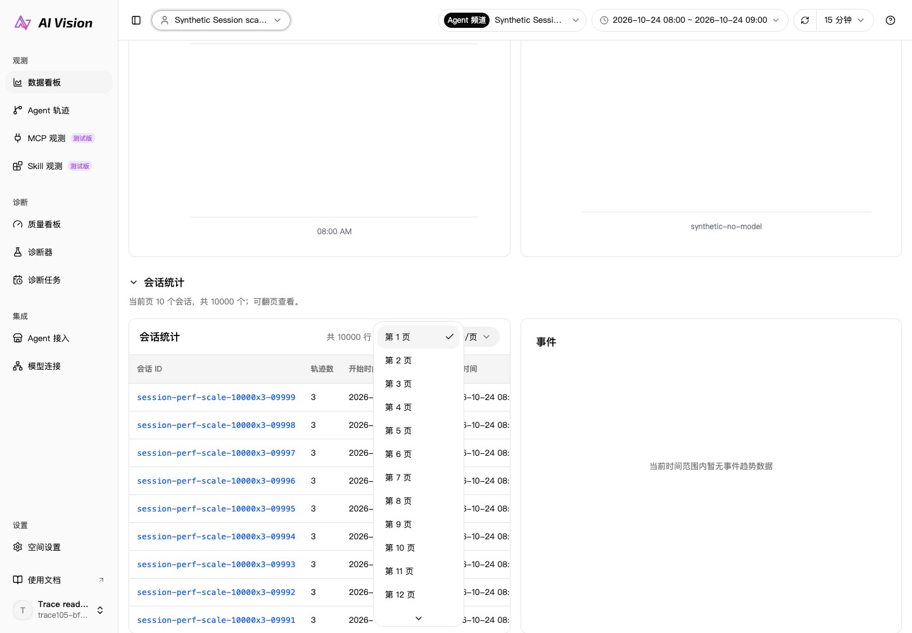
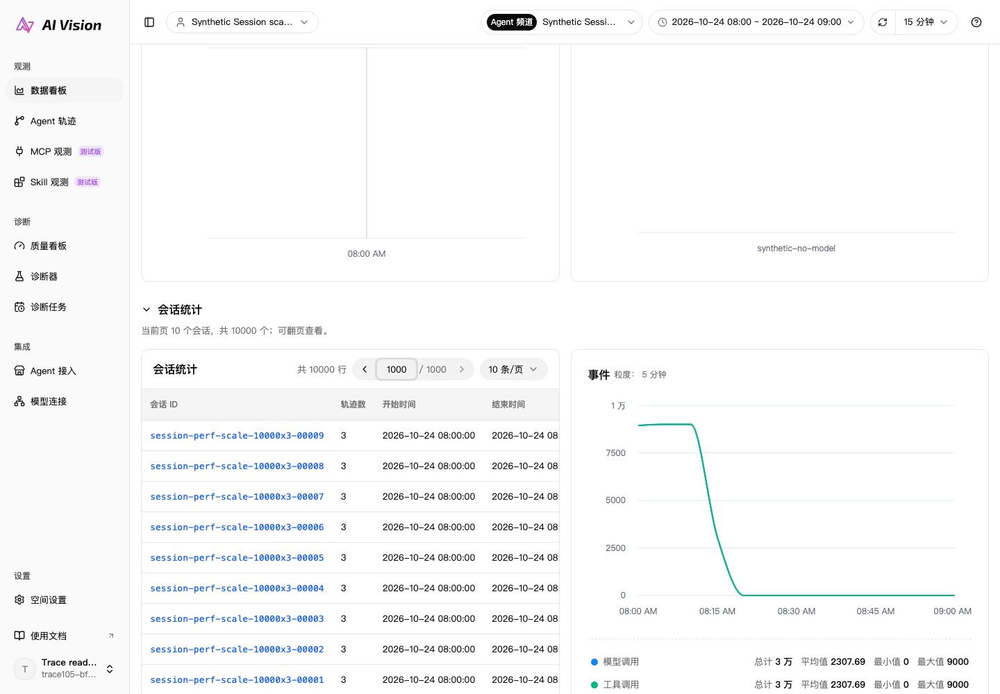
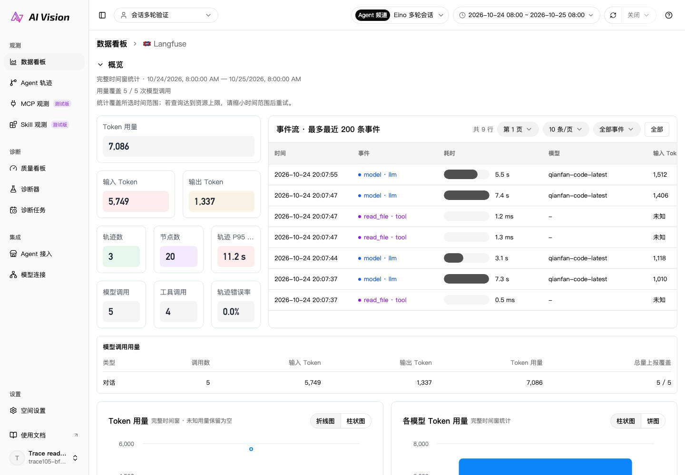

# Dashboard cumulative PR verification — 2026-10-26

The cumulative product, data-plane and evidence reviews found one required fix: when the service started with projection maintenance durably suspended, a missing optional statistics schema could be mistaken for completed initialization. A later transient schema error during explicit resume then had no automatic retry. Provider commit `c09caf048445e29c47781387d53fea6ce3b58690` fixes that completion state. The independent scoped re-review found no remaining material issue.

## Pricing-compatible integration — 2026-10-27

The subsequent merge with product main `historical-source-revision-redacted` retains Space-owned prices and complete canonical `costCoverage`. The `statistics-v1` SQL accumulator does not carry pricing-source counts, unknown reasons, subscription evidence or list-price equivalents. General metrics therefore validate that response and use the complete compact observation window. Typed operation counts still serve `framework.events.timeseries`; recent-operation pages retain bounded revision-checked hydration. Compact facts keep the full normalized cost evidence, and the new query paths share the request-local Space price snapshot and projection context.

All measurements below and in the linked aggregation reports remain bound to their recorded source. In particular, earlier pure typed-metrics Mac/VM timings are not performance measurements of this integration. The integration's own source, test and read-only serving receipts are recorded separately in the PR validation and local `outputs/daily26-20261027/product-merge/` evidence.

## Source and execution boundary

- Product runtime: `6cf3ab413ff98969173ee84028531c19860d866d`, including current main `historical-source-revision-redacted`. The subsequent submission delta contains this note, portable evidence and retained images only.
- Data plane: `c09caf048445e29c47781387d53fea6ce3b58690`, based on main `d6d5d94cdbfc70885f7218254464d9043ea6f326`.
- Exact clean committed sources were archived and hashed before compiling the final Go handler. The current production frontend bundle was also bound to its successful build receipt.
- Final serving verification used current Django, actual Go handlers and retained OceanBase CE 4.4.2.1 `ap26` data through a GET-only test transport with a fixed organization claim. It ran no ingestion, migration, projector or account/grant operations. This does not establish the full production authentication chain.

## Fresh checks

| Check | Result |
|---|---|
| Selected Django behavior suites, `manage.py test` | 198 passed |
| Frontend `npm test` in `ai-vision/vfe` | 1,040 counted tests passed; zero failures or skips |
| Frontend `npm run build` | Typecheck and production build passed |
| Provider lifecycle regression before fix | Three expected behavior failures reproduced |
| Provider lifecycle and existing retry tests after fix | Eight passed |
| `go test -json -mod=readonly ./pkg/ingest ./pkg/modules/aivision ./pkg/telemetrystore/oceanbasetelemetrystore -count=1` | 204 top-level passes; 503 pass events including nested cases; nine SQL-environment skips |
| Final real CE serving smoke | 15/15 HTTP 200 / API success and complete business-hash matches |

The final smoke covers statistics, event streams and trends for Eino, DeepAgents, DSH, Codex and the same synthetic 10k-Session / 30k-Trace scope. Expected hashes come from the retained immutable CE final-generation receipts. This is a one-pass correctness check, separate from the earlier three-sample performance runs. The Go retry tests exercise the actual initializer at a mocked SQL boundary; the serving smoke does not simulate a real DDL outage.

The provider now retains one cancellable worker while supported optional storage remains pending: errors retry after five seconds; error-free pending states idle for one minute. Verified readiness, unsupported engines and successfully applied configuration-OFF terminate recovery. Durable OFF permits the existing idempotent base control-table ensure but performs no optional schema DDL. Closing the provider cancels waiting and active initialization. No new configuration switch was added.

Both original engines retain 109,858 raw Spans and 36,612 source/projection rows each, with zero dirty rows. Their frozen fingerprints, maintenance state and the nine protected service identities match before/after checks. The retained `ap26` data also matches SQL count/CRC/byte fingerprints. Only the four task listeners and one task transport were stopped; all tables and source data remain available.

## Retained runtime images and interaction evidence

These are unmodified captures from the earlier compact-window validation, at a 1440 × 1000 viewport. They are actual application images, not new captures of the integrated submission. The current `DashboardEntry.tsx`, `FrameworkDashboard.tsx` and `DataTable.tsx` hashes match that captured source. Current complete frontend tests and the build passed, but the fresh browser pass remained blocked by a saved browser permission policy after explicit authorization and settings retry; no alternate browser surface was used.

The before image shows the earlier development selector with 1,000 options. The after image shows the production build after jumping to page 1,000, with the final ten rows ending in `00009` through `00000`. The runtime/API/browser receipts also record first-page loading, page-size 50 resetting to page 1, retained input focus, hidden stale rows during loading and no observed main-thread long task above 50 ms for that jump. Development and production browser timings are not used for a speedup ratio.

The 10k fixture was mapped to FrameworkDashboard only in an isolated screenshot control database. Physical filtering remained DeepSeekHarness; it does not represent the real DSH dashboard. No business dataset was changed for screenshots. Account aliases and large-scale Session identifiers shown here belong to the local test fixtures.

The Eino capture uses previously collected real model Trace data: three Traces, 20 Spans, five model calls, four tool calls and 7,086 Token. It belongs to the earlier compact-window stage and does not assert current AP browser latency.

## Evidence and remaining limits

The [portable final-review receipt](evidence/dashboard-pr-review-20261026.json) binds source heads, test logs, the fifteen oracle hashes, preservation checks and image hashes. Full private logs and frozen archives remain in local `outputs/dashboard-pr-review-20261026/`; they are not repository artifacts.

The earlier [dashboard baseline](dashboard-query-performance-20261026.md), [OceanBase aggregation](ob-ap-dashboard-aggregation-20261026.md) and [seekdb compatibility](seekdb-dashboard-compatibility-20261026.md) reports retain their original sources, resource limits, ranges, outliers, preparation costs and publication overhead. The final provider lifecycle fix changes no aggregate SQL, migration DDL or publication algorithm, so those measurements were not relabelled or rerun as final-head benchmarks.

Hosted CI, a cold installation, published images, production authorization, Kubernetes/VM deployments, multi-replica behavior and ingestion throughput are not established by these local checks. A fresh integrated browser pass also remains unverified as described above.
