# Modal sizing validation — 2026-11-12

This supplements the [UI reading regression](ui-reading-validation-20261112.md)
for PR #174. The modal round changes layout and focus restoration only; it makes
no new provider calls. Its recorded PowerContext/Baidu Trace replay and API
fixtures are separate from the earlier eight live model calls.

## Scope and policy

All 39 modal content instances in 32 active VFE consumer files now use the shared
wrappers outside `components/ui/`: 29 dialogs and 10 confirmation dialogs.

| Task | Maximum width |
| --- | --- |
| Confirmation, share, single field | 448 px |
| Ordinary form | 576 px |
| Details, pricing settings, onboarding, search | 768 px |
| Imports and multi-pane diagnosis | 1024 px |
| Expanded editor / Trace variables | Viewport minus 32 px |

Each keeps 16 px viewport clearance and a height limit of `100dvh - 32px`.
Pane workspaces can fill up to 832 px; ordinary forms keep their content height.
Non-modal popovers and side sheets retain their separate layout rules. An ESLint
rule prevents application consumers from importing the primitive content directly.

The Trace variable picker now stacks its three panes on narrow screens instead
of cropping a 900 px workspace. Task-detail fields wrap long identifiers and use
one column on phones. Controlled dialogs restore focus to the opener, including
menu triggers; existing explicit focus handlers retain precedence.

## Sources and execution

- Before: `historical-source-revision-redacted`.
- After: the modal changes committed with this record. The
  [manifest](images/modal-sizing-20261112/evidence.json) contains SHA-256 hashes of
  the tested source/test files, screenshots, logs and production build assets.
- Branch fork point: `historical-source-revision-redacted`. During verification
  main advanced to `historical-source-revision-redacted`; that commit changes
  native Python packaging only and does not overlap the frontend changes.
- UI/API fixture runs: actual compiled VFE pages with Playwright route fixtures,
  loopback HTTP, Chromium. No model discovery, diagnosis execution or backend
  writes are claimed by these fixture runs.
- Component replay: actual `RawTraceVariablePicker` and `CodeMirrorEditor` source,
  mounted in a temporary Vite harness against the same recorded backend read-back
  on both revisions. The record is Trace `1043979e327ef4ba3c25a11f6e846077`, 24 spans,
  from the earlier live PowerContext 1.5.0 / Baidu `deepseek-v4-pro-0813` batch.
  The JSON is passed unchanged as the sample; its Trace ID is supplied through
  the existing `samples` prop. No Trace values were synthesized for screenshots.

## Local results

Run from `ai-vision/vfe/`:

| Check | Result |
| --- | --- |
| `npm run lint:ci` | Passed; zero warnings |
| Changed-file Prettier check | Passed |
| `npm run typecheck` | Passed |
| `npm run build` | Passed; existing bundle-size warning remains |
| `npm test` | 1,722 passed; zero failed/skipped/cancelled |
| Selected Playwright suites below | 81 passed |
| Detail-width assertions in the pricing suite | Passed on the production build |
| Before/after page capture | Four desktop/mobile runs passed |
| Recorded Trace / editor component checks | All three candidate viewports passed |
| `git diff --check` | Passed |

```sh
npx playwright test \
  tests/e2e/dialogSizing.spec.ts \
  tests/e2e/labsImportDialogs.spec.ts \
  tests/e2e/mcpImportUx.spec.ts \
  tests/e2e/modelPricing.spec.ts \
  tests/e2e/sandboxConnections.spec.ts \
  tests/e2e/hermesOnboarding.spec.ts
```

The 12 new sizing cases combine Chinese, English and Japanese with
1440 × 1000, 768 × 600, 390 × 844 and 390 × 360 viewports. They assert actual
workspace/form/confirmation dimensions, viewport containment, no horizontal
content overflow, reachable cancel actions, Escape dismissal and focus return.
Pricing tests additionally assert the 768 px detail maximum and narrow-screen
fit. Existing pricing, onboarding, MCP/Skill import and sandbox interactions
remain covered by their suites.

The recorded Trace replay checks desktop, phone and short-phone viewports:

- The original phone picker has a 900 px scroll width inside a 358 px dialog;
  the candidate is 358 px with no horizontal overflow.
- The three panes are reachable by scrolling. Selecting the root output field
  and using **Try value** renders the original `COBALT-23` result visibly inside
  the viewport, including at 390 × 360.
- Expanded code editors fit the available viewport. Restore/Escape returns focus
  to the opening control. Candidate component runs have no uncaught page errors.

## Screenshots

These are direct browser captures, not mockups. Page captures use identical API
fixtures before/after; the Trace picker uses the same real recorded Trace.

| View | Before | After |
| --- | --- | --- |
| MCP import · desktop | 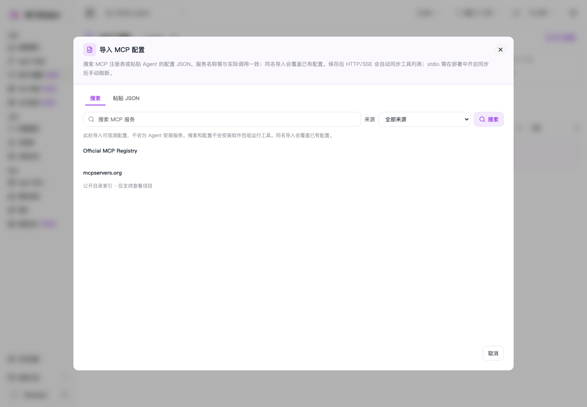 | 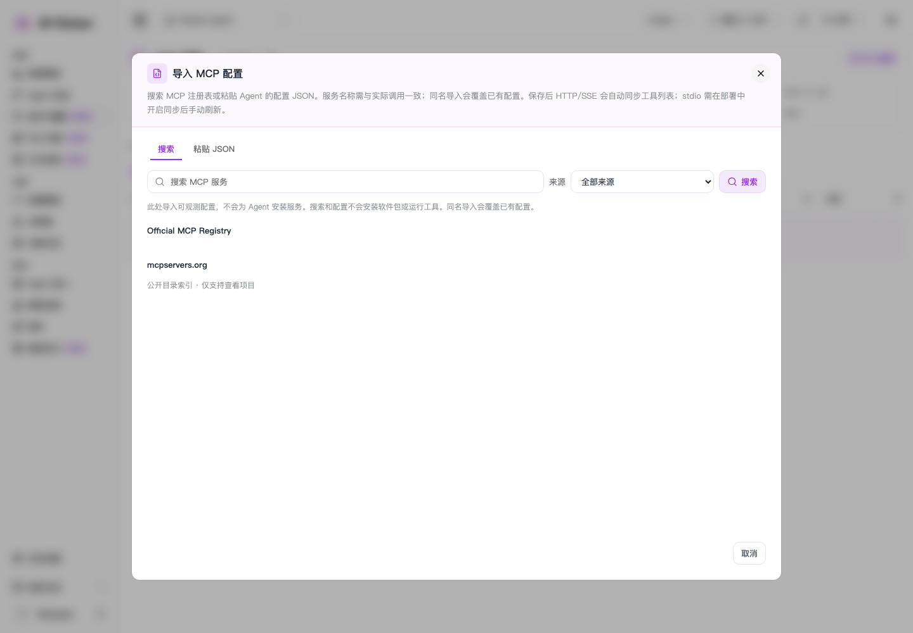 |
| MCP import · phone | 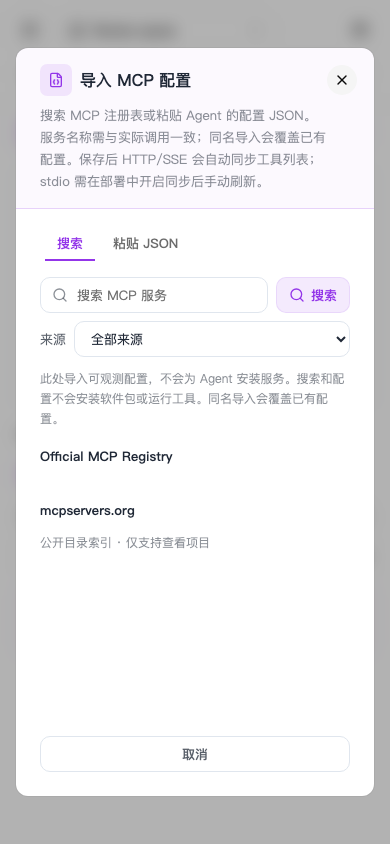 | 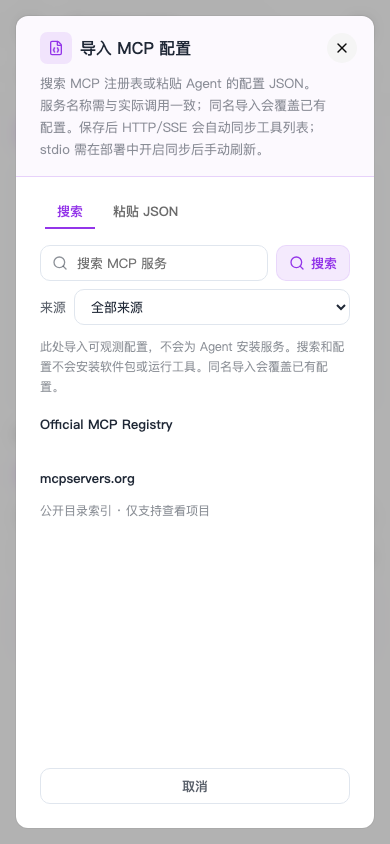 |
| Model form · desktop |  | 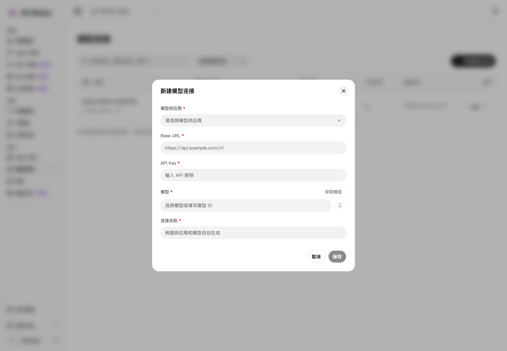 |
| Model form · phone | 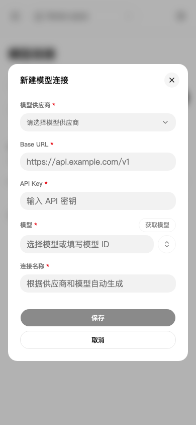 |  |
| Confirmation · phone | 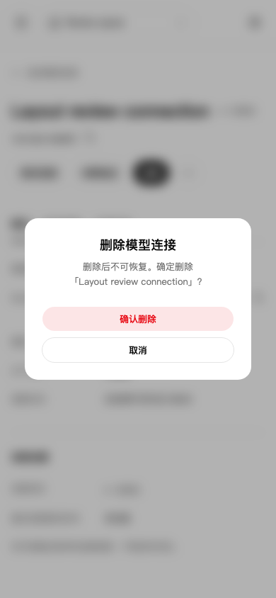 | 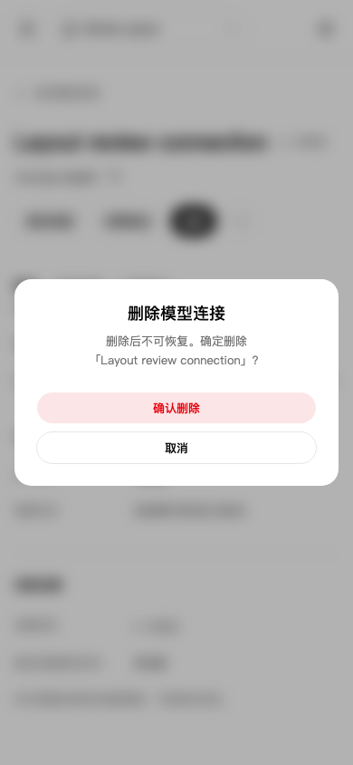 |
| Recorded Trace · desktop | 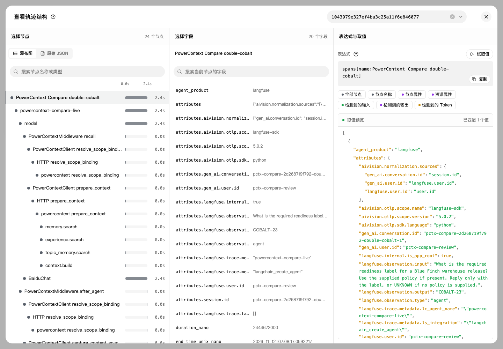 | 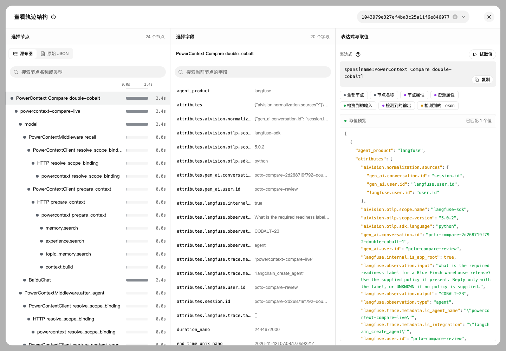 |
| Recorded Trace · phone | 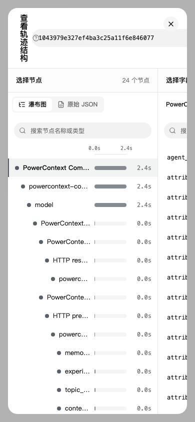 | 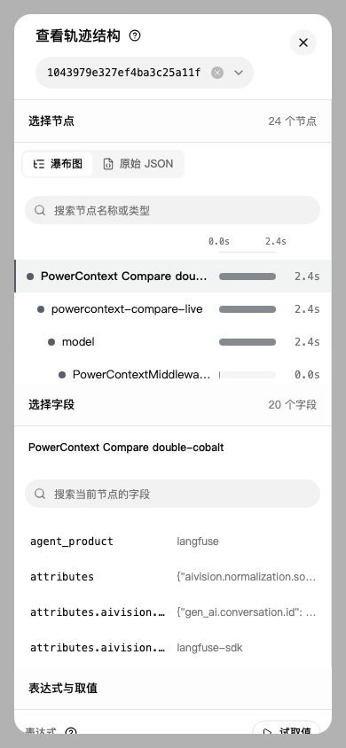 |

The existing model form already matched the chosen form width; its screenshots
show that standardizing the wrapper preserves its ordinary layout.

| Recorded value after scrolling · phone | Recorded value · short phone |
| --- | --- |
| 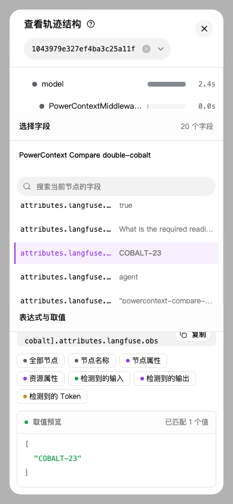 | 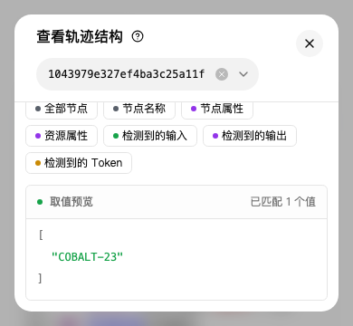 |

## Boundaries

The inventory covers every modal call site, but not every individual dialog was
manually opened; representative dimensions and shared behavior have automated
coverage. Mobile checks use Chromium viewport emulation, not physical devices,
Safari or an operating-system virtual keyboard. The modal round replays one
recorded real Trace and uses fixture APIs elsewhere. It does not repeat the
previous live encryption/ingestion acceptance or claim a new backend/provider
run. Hosted CI status is recorded separately in PR #174; a local pass does not
mean GitHub Actions ran.
