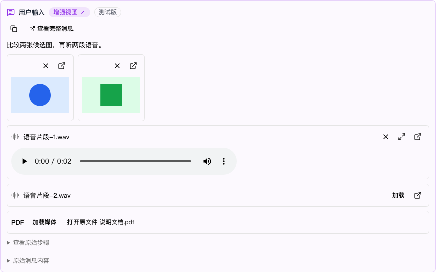
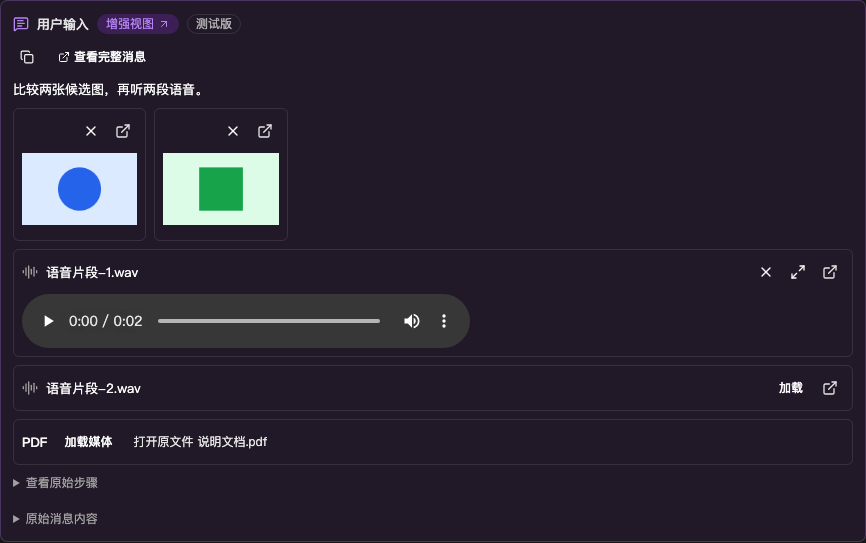

# Trace multimedia review — 2026-11-17

## Source and scope

The reviewed code is `historical-source-revision-redacted`, including main `historical-source-revision-redacted`. The companion data-plane candidate is `ob-labs/signoz` commit `68deece40c0a934480587298030dcf09c1e14202` ([PR #23](https://github.com/ob-labs/signoz/pull/23)). This record distinguishes tests of that code tree from earlier real-provider and full-stack experiments. The subsequent evidence-only commit does not alter executable source.

The fixes cover Viewer filtering before media previews are truncated, local anonymous-share media failures, bounded DSH and Collector exports, Hermes union schemas, Codex tool-content media budgets, PDF document reuse, independently controlled media collections, and bounded Trace-list IO fallback. Native summaries select ordered text parts while preserving original IO and full search bodies. Derived preview context v11 invalidates older unsafe summaries.

## Verification of the final code tree

| Check | Result and boundary |
| --- | --- |
| Backend provider/projection/auth/share regressions | 255 tests: 253 passed, two MySQL-generated-column tests skipped under SQLite. The isolated runner disabled source `.env`, inherited provider credentials and network connections. Source hashes were unchanged before/after. |
| Frontend Node tests | 1,784 tests in 32 reported groups, zero failures. |
| TypeScript and production build | Passed. The existing large-chunk warning remains. A second successful build from the immutable reviewed commit supplies the screenshots below. |
| Chromium media regressions | 17 passed: input/output collections, independent loading and keyboard focus, multiple players/PDF state, PDF source expiry, oversized inline media and anonymous-share denial. Synthetic API/media fixtures, not new SDK/provider execution. |
| Collector | `go test -mod=vendor ./...` passed, including bounded HTTP serialization, split batches and retry behavior. |
| Claude Code common library | Current Rust sources were freshly compiled with rustc 1.100.0 against matching cached dependencies: 465 passed, two existing deprecated Skill tests ignored. Cargo itself could not enter tests because dependency build scripts received SIGKILL on this macOS host; this is not a successful Cargo run. Loopback tests passed after their local listeners were allowed. |
| Companion data plane | `go test ./pkg/ingest ./pkg/modules/aivision -count=1` and a fresh seekdb quota/exact-original integration passed. The reviewed five-file patch hashes were unchanged; temporary DB stopped normally and was removed. |

An independent final review reproduced a common-preview Viewer URL leak for direct typed media objects and content-block arrays with a long caption. The correction filters complete values before serialization/truncation, also covering persisted operation previews. Five regressions first failed, then the targeted 220-test scope passed with two existing SQLite skips. The final 255-test post-main run includes those regressions. A second reviewer found no remaining actionable issue within this scope.

## Earlier real-provider and data-plane evidence

The final SiliconFlow round used two input PNGs with a vision model and generated two short WAV responses with TTS. The first 16-token vision response was truncated; the short constrained retry identified the red circle and blue square. That round used four provider requests in total. Video/PDF bodies, local WAV input and output-image echoes were controlled specimens: they do not establish provider video/PDF understanding or image generation.

Actual Langfuse SDK OTLP, the authenticated gateway, a source-built Collector, source-built companion SigNoz and seekdb exercised both input and output for PNG, WAV, WebM and two-page PDF. Fifteen expected media associations in the final provider round matched source bytes through API readback. Developer/raw IO, Viewer filtering, attachment scope denial, anonymous signed sharing and actual browser preview operations were checked. Exactly 16 MiB and +1-byte input/output boundaries retained captions and gave the expected stored attachment or budget outcome. Earlier real DSH export/Collector tests sent an approximately 89 MB workload as two bounded requests; the companion quota repair retained both Span rows when attachment admission reached quota.

Those provider/full-stack runs preceded the final display-only hardening and latest-main integration. Their unchanged media-capture/render/storage files remain useful evidence; the final backend and frontend checks above cover the later edits. They are not fresh provider runs of the final commit, and they do not qualify every Agent, host version or model family.

## List and query performance experiment

An isolated native HTTP dataset contained 2,147 one-span Traces: matched 48-row text/1 KiB/1 MiB cohorts, three 16 MiB attachments, then 1,000 text and 1,000 1 KiB-media Traces in a separate window. No model was called for this experiment. The active decoded attachment total was 101,736,448 bytes, within the 100 MiB Space quota.

Seven interleaved samples showed normal lists, Input/Output text search, ID/metadata filters and facets did not hydrate media originals. In the final v10 caption phase, the 1 KiB and 1 MiB 20-row responses were identical at 37,383 bytes. Their medians were 35.436/34.197 ms. At 1,000 rows per cohort, 200-row pages were identical at 364,275 bytes and about 76 ms. These local values are historical v10 controlled comparisons, not a v11/production latency guarantee.

Five 1 MiB-media list fallback reads previously returned 13,985,518 bytes; display-only reads fell to 2,368 bytes. One 16 MiB input/output fell from 44,740,182 bytes to 512 bytes. Unflagged original IO retained the exact pre-repair response SHA-256. The compatibility browser test only removed five list previews to simulate an older list contract; its IO route stayed real. Current valid list responses avoided IO fallback entirely.

Any-observation model filtering used the existing complete compact-window scan and took roughly one second for the 2,000-Trace window, similarly for text and media. It is a cardinality/complexity boundary. The display-only IO fallback also retains per-Trace completeness reads. Neither sustained concurrency, larger/dense histories nor external Langfuse capacity is qualified.

## UI evidence

The input/output columns have a 160 px minimum width to keep the cleaned captions readable. Real light/dark and 390 px list checks verified captions, internal table scrolling and no page overflow before the final common-preview-only hardening. The following documentation screenshots were then recaptured from a production build of the immutable reviewed code, using synthetic API/media fixtures. Each shows an image grid, one loaded audio item, a separately unloaded audio item and PDF. Their source/bundle/image hashes are in [the capture manifest](screenshots/trace-multimedia/source-manifest.json).

## Remaining validation

The full backend suite has no clean pass for this repair series; earlier baseline failures are not reclassified as successes. Standard Cargo execution remains blocked as described above. Hosted CI is evaluated separately after push. Production deployment, every Agent/media combination, other browser engines and sustained high-concurrency load were not verified. Attachment quotas cover active decoded bodies, not all retained exact-original Trace storage.
