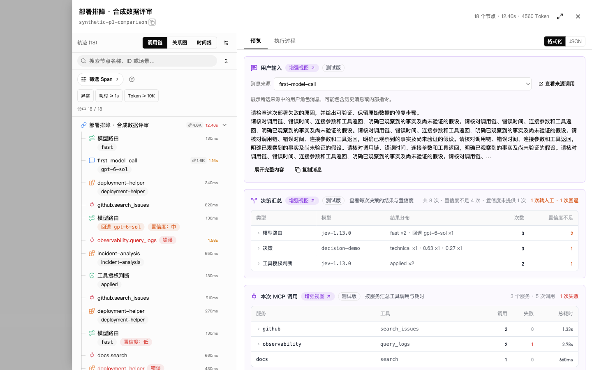
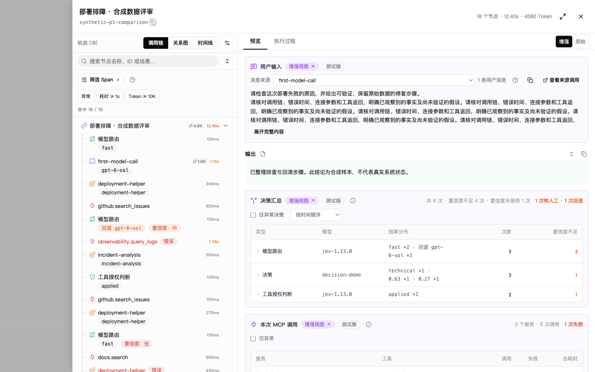
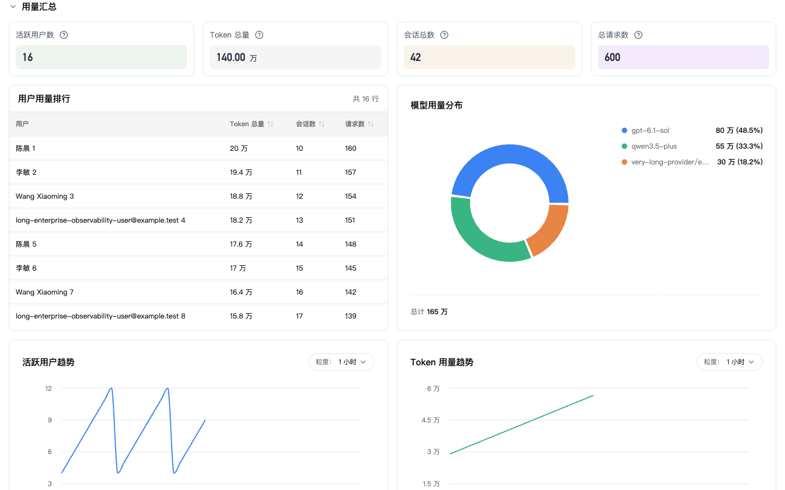
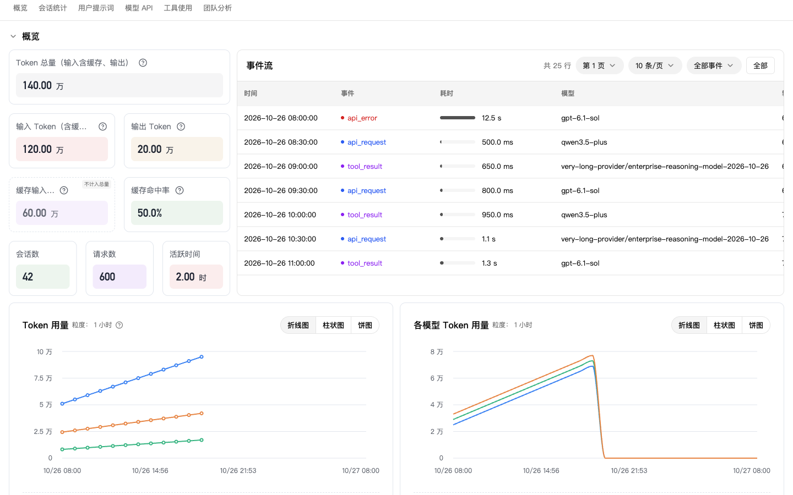
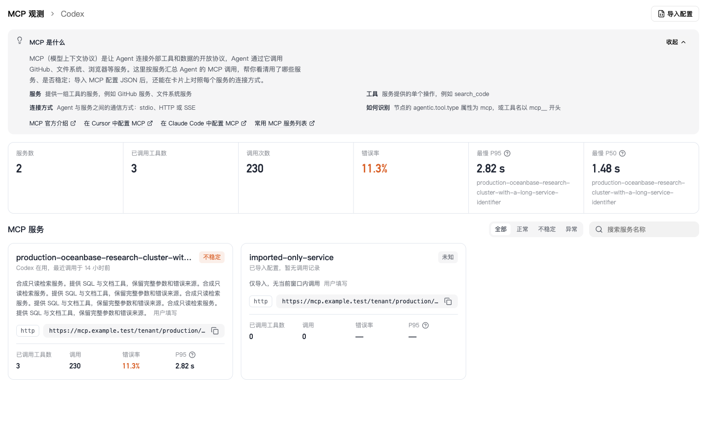
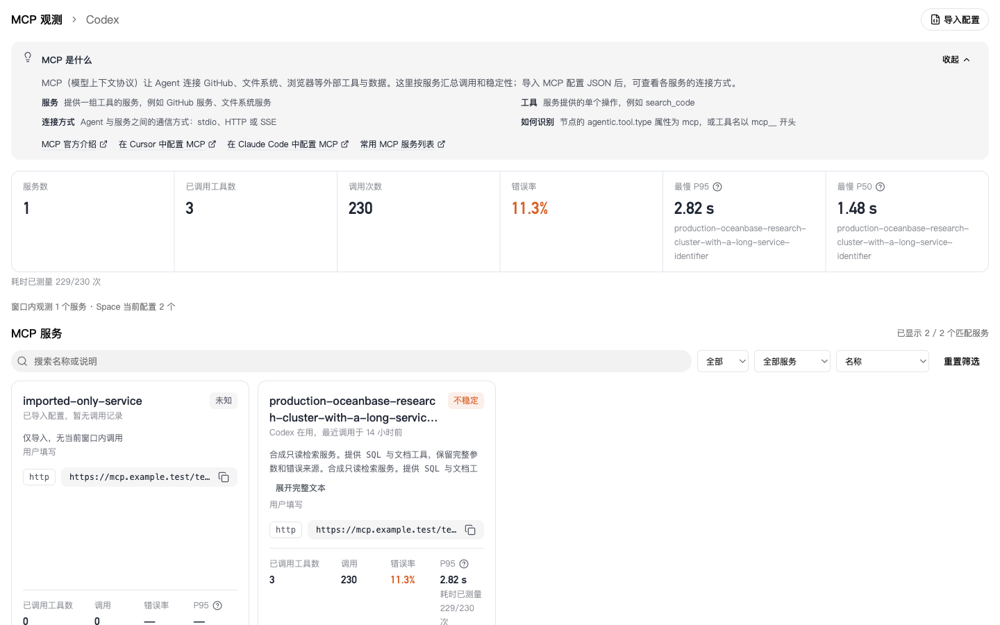
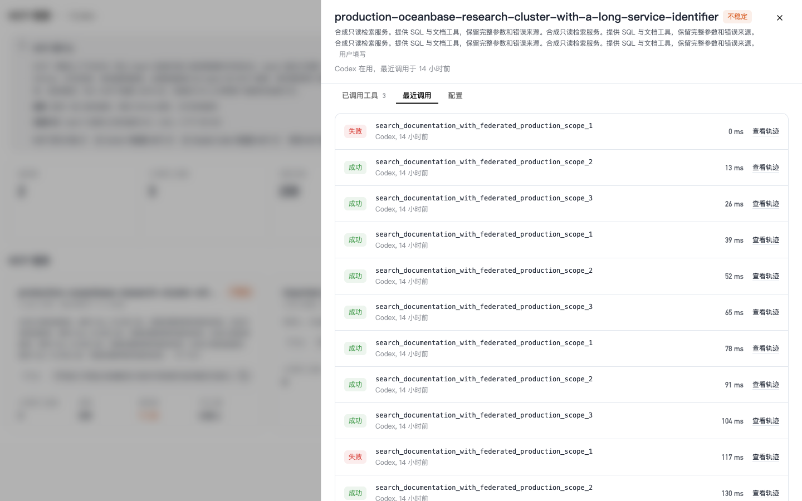
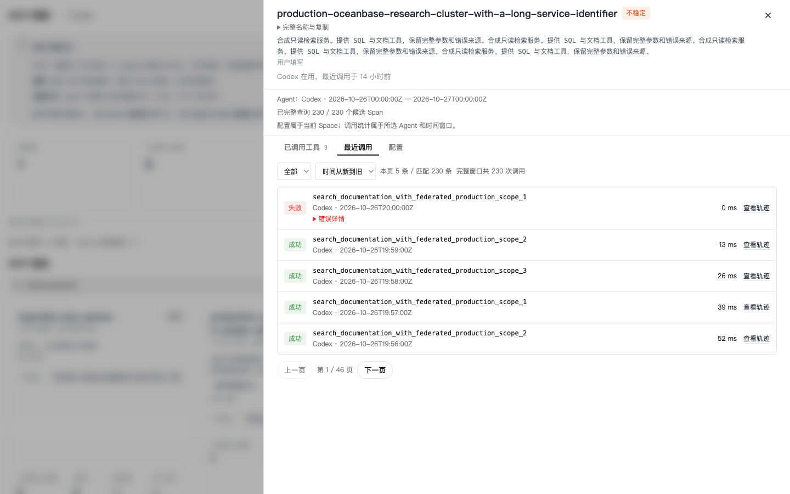
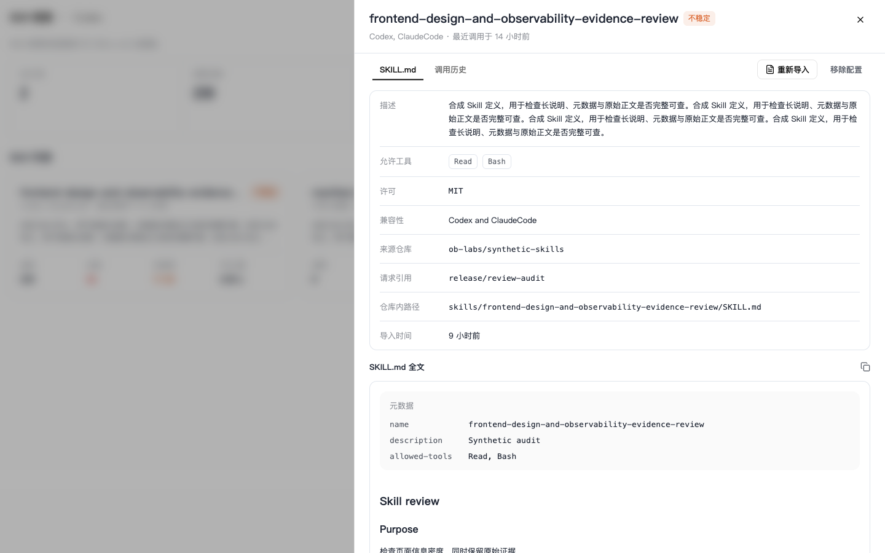
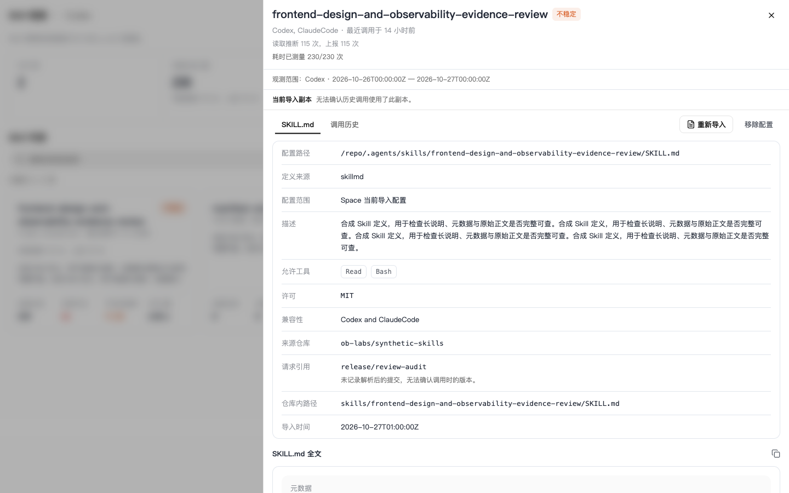

# Compact observability views — cumulative review, 2026-10-27

See the [pre-merge re-review](observability-merge-review-20261027.md) for two subsequent repairs and the latest complete validation. The evidence below retains its original tested source.

This review covers the cumulative enhanced Trace, observability dashboard, MCP and Skill changes. Compact previews retain expansion, exact-content copy and original-record access. Window-wide statistics and histories distinguish missing measurements from reported zero, current configuration from historical observations, and a complete query from a failed or partial scan.

## Review and integration

Three independent scoped reviews covered backend/provider contracts, dashboard/query behavior, and Trace rendering/state. Five confirmed issues were repaired before submission:

1. Skill datasource/routing failures now remain errors instead of successful, complete empty windows. Genuinely empty successful windows remain valid.
2. Explicit trace-input evidence remains independently identifiable when its value equals a derived SDK message projection.
3. A preset refresh can change absolute query bounds without remounting opened dashboard chapters or resetting their controls. Space, product and source changes still reset the scoped layout.
4. Explicit Original mode preserves string escapes, JSON-looking text, scalar values and exact copies. Enhanced and legacy default callers retain one SDK transport decode. The full regression suite caught and corrected an initial compatibility regression in this repair.
5. Enhanced/Original round trips retain selected input sources, filters, sort and expanded windows. Hidden enhancements release media nodes and abort preview requests; identity changes still reset their state.

Tested product commit: `historical-source-revision-redacted`. The branch includes main `historical-source-revision-redacted`. Integration preserves its server-side canonical Session paging, numeric page entry, pricing-compatible metrics and compact snapshot contracts. Original input evidence bypasses summary-only projections. Updated test dependency wiring retains the existing pagination, scope, placeholder and file-preview recovery assertions.

## Validation boundary

The [portable receipt](evidence/observability-view-review-20261027.json) records the tested product-source hashes, commands, results and image hashes. Tests ran against the submitted product sources; the final evidence-only additions do not change runtime behavior.

| Check | Result |
| --- | --- |
| Modified frontend ESLint, zero warnings | Passed; initial complete set and subsequent touched files |
| `npm run typecheck`, then `npm run build`, in `ai-vision/vfe` | Passed |
| Complete `npm test`, in `ai-vision/vfe` | 1,224 passed; zero failures, skips or cancellations |
| Selected actual Django suites, 15 modules | 279 passed |
| `git diff --check` | Passed before submission |

The frontend uses Node 26.10.0 and existing cached dependencies, with no dependency or lockfile changes. Django tests use Python 3.12.14 / Django 6.0.3, in-memory SQLite and locmem cache. Provider calls are mocked or served by local fixtures. The cross-runtime input-evidence test executes the actual Python projection and TypeScript consumer. The Django suite covers Labs scan/history errors and pagination, native query/detail/read-model paths, framework dashboards/snapshots, statistics projections and pricing compatibility. Expected error-response logs, existing startup/SQLite warnings and the production bundle size warning are not test failures.

## Real browser captures and interactions

These are unmodified screenshots of actual application components mounted in an isolated Vite harness. Both sides receive the same synthetic inputs; the before side uses main `historical-source-revision-redacted`, and the after side uses the submitted product source. API responses, authentication/Space contexts and dashboard query hooks are fixture boundaries. These captures demonstrate rendering and interaction, not a deployed end-to-end system or numerical validation of fixture aggregates. No production data or account was used.

The paired viewport is 1440 × 900 in the Codex in-app browser on macOS. Additional after-only checks cover English dark Trace rendering and Japanese MCP rendering at 390 × 844; these are not a cross-browser or full mobile acceptance matrix.

| Surface | Before | After |
| --- | --- | --- |
| Trace overview and compact user input |  |  |
| Space dashboard hierarchy |  |  |
| MCP full-width introduction and measurement coverage |  |  |
| MCP bounded complete history |  |  |
| Skill current imported definition and historical limits |  |  |

Fresh browser actions verified MCP page 2 of 46 for a 230-call fixture, links retaining time/Agent/Trace/Span scope, the selected Calls tab surviving reload, the complete Skill raw definition and its final marker, and the selected Trace input source surviving Original → Enhanced. Browser pagination uses the mocked HTTP history endpoint; actual backend filtering-before-pagination and scans beyond 200 records are covered separately by Django tests. DOM tests cover retained chapter state across resolved preset refreshes, error/empty/zero states, accessible controls, original copies, query identity, import batching and aborted hidden previews.

## Compatibility and remaining limits

- Frontend and Django changes are delivered together. History query parameters/response metadata and optional native input evidence are additive; there is no schema migration, dependency update or version bump.
- MCP/Skill complete-history scans remain bounded at 10,000 candidate Spans. Over-limit, unstable or incomplete scans produce an explicit failure rather than a complete-looking sample. Narrowing the window is required beyond that bound.
- Skill reads inferred from telemetry remain distinct from collector-reported records. Current Space configuration is not evidence of the definition/version used by a historical call.
- Real SigNoz/Langfuse endpoints, external storage-side Agent-filter enforcement, production authentication, fresh installs, deployments, image publishing, capacity and broad provider compatibility are not established by these local checks. Hosted CI status is reported separately on the PR.
- Substantive AI assistance included implementation, independent scoped reviews, regression repairs, browser verification and preparation of this evidence. Maintainers retain responsibility for review and merge.
