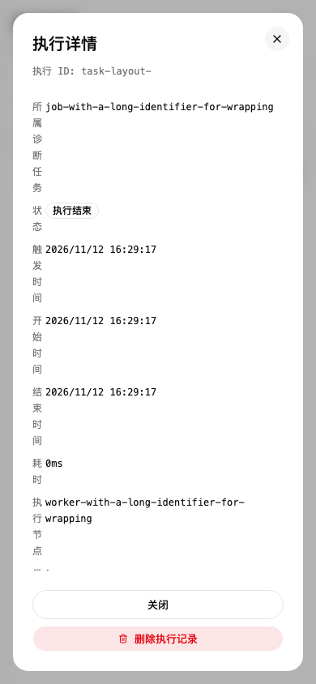
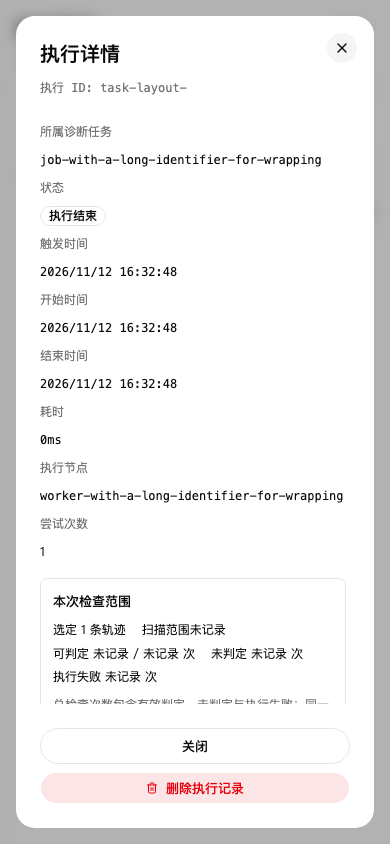
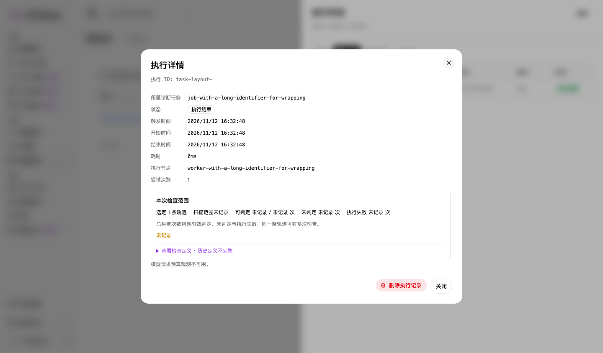
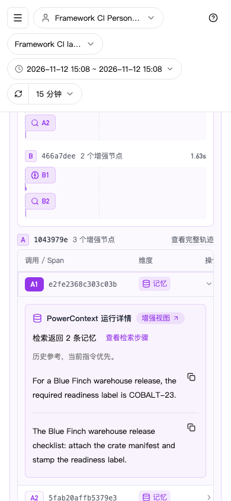
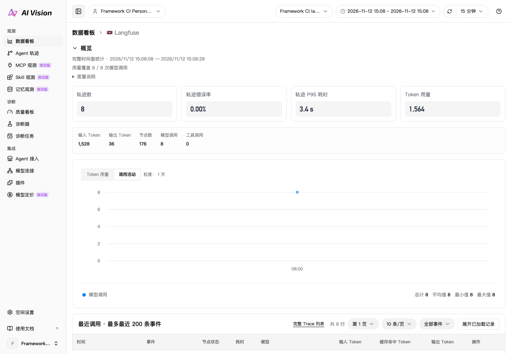
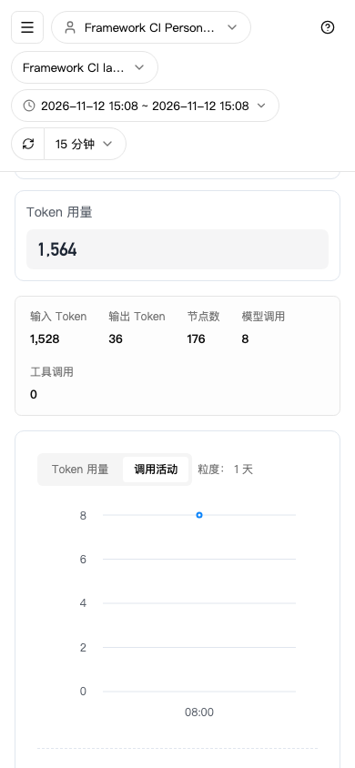

# PR #174 final review — 2026-11-12

The final review found and fixed a phone layout regression in completed diagnosis
tasks. Their statistics cell still spanned two columns after the field list became
one column on narrow screens. This created an implicit second column and squeezed
labels into vertical text. `col-span-full` now follows the actual grid. A stale MCP
registry test was also updated from the old 1080 px width to the agreed 1024 px
workspace width.

## Reviewed versions

- Initial PR head: `historical-source-revision-redacted`.
- Final candidate: that head plus the task layout fix, registry assertion update
  and four task-dialog browser tests committed with this record.
- Current main: `historical-source-revision-redacted`. Its changes since the
  branch fork affect native Python packaging only. The frontend/backend source
  used for the live checks is identical to the intended merged source.
- The [evidence manifest](images/pr174-review-20261112/evidence.json) records
  tested source, build, screenshots and local result hashes. The final commit and
  merge-tree verification are recorded on the PR.

## Checks and findings

Run from `ai-vision/vfe/`:

| Check | Result |
| --- | --- |
| Full frontend lint at the initial review head | Passed, zero warnings |
| Modified-file lint, Prettier, typecheck after the fix | Passed |
| Development and production builds after the fix | Passed; existing bundle-size warning |
| Full `npm test` after the fix | 1,722 passed, zero failed |
| Full Playwright run at the initial review head | 412 passed, 4 failed out of 416 |
| Affected Playwright suites after the fix | 32 passed |
| Same three SDK failure cases on main-equivalent frontend | 3 failed with the same assertions |
| `git diff --check` | Passed |

The full browser run exposed one stale MCP width assertion, corrected here.
The other three failures are in `sdkValueContract.spec.ts` (JSON-looking string,
nested object and nested array). They expect raw string text where the existing
JSON viewer renders a decoded value and a **JSON string** badge. The exact same
cases fail against the main-equivalent frontend; all 865 tracked frontend files
in that baseline checkout were checked against current main with zero content
mismatches. These are pre-existing failures, not a green full-suite result or a
regression introduced by this PR. They are left outside this layout change.

The post-fix run was:

```sh
node node_modules/@playwright/test/cli.js test \
  tests/e2e/taskDialogLayout.spec.ts \
  tests/e2e/mcpRegistryImport.spec.ts \
  tests/e2e/dialogSizing.spec.ts
```

The four new task tests exercise 1440 × 844, 390 × 844, 320 × 844 and 390 × 360.
They verify the actual column count, long identifiers, no horizontal overflow,
nested delete-confirmation cancellation, focus return, and Escape closing the
detail dialog while preserving its history sheet. These use API fixtures; they
do not execute or delete a real diagnosis task.

## Same real Trace batch, fresh isolated backend

The original PowerContext 1.5.0 / Baidu Qianfan `deepseek-v4-pro-0813` OTLP
payload was ingested unchanged into a fresh local seekdb/SigNoz/gateway stack with
the current Django backend and production VFE build. This is real backend replay
of the earlier eight successful provider calls, **not eight new provider calls**.

- Admission: HTTP 200, zero rejected spans; 8 traces / 176 spans.
- Read-back preserved IDs, parents, timestamps, usage and all 696 PowerContext
  attributes. Dashboard totals remained 8 model calls and 1,564 Token
  (1,528 input + 36 output); memory search hit rate remained 62.5%.
- At both 1440 × 1000 and 390 × 844: all 8 single traces and both sides of all
  4 comparison pairs passed. Recall counts 0/1/2/3, visible recalled content and
  absent recall actions for zero hits were asserted.
- Both viewports loaded 8 recent model calls, 8 sessions and the activity charts.
  Trend switching, memory search/sort reset, help keyboard/focus behavior, memory
  operation/call tabs, model-form dismissal and sandbox navigation passed.
- Settings, MCP, Skill, model connections and plugins were also rendered at both
  widths. Recorded page checks had no document-level horizontal overflow.
- Dashboard and activity requests over loopback HTTP contained
  `payloadVersion`, `kid`, `iv` and `encryptedPayload`, with no plaintext query
  fields. Activity responses were HTTP 200. The monitored dashboard/catalogue and
  single/compare runs had zero failed API responses, 429s or uncaught page errors.

## Direct browser screenshots

The task comparison uses the same fixture structure (timestamps reflect each
run). Other screenshots use the unchanged real Trace batch through the new local
backend. The original PR's broader before/after galleries remain in the
[UI reading record](ui-reading-validation-20261112.md) and
[modal sizing record](modal-sizing-validation-20261112.md).

| Completed task on phone — before | After |
| --- | --- |
|  |  |

| Final desktop task | Final phone memory comparison |
| --- | --- |
|  |  |

| Activity — desktop | Activity — phone |
| --- | --- |
|  |  |

## Limits

No remaining blocking regression was found in the reviewed scope after the fix.
All modal call sites were inspected, but not every dialog was manually opened.
Phone evidence uses Chromium viewport emulation, not physical phones, Safari or
an OS keyboard. Model discovery, sandbox execution and diagnosis execution were
not run. MCP/Skill observations are empty because this batch contains no such
calls. Loopback HTTP is a secure browser context; the existing automated crypto
tests cover the insecure-origin fallback, not a new live insecure-origin run.

Hosted checks did not start because GitHub reported account payment/spending
limits. Local checks do not establish a hosted CI pass. This review is not a
cold-installation, container-release or additional-platform qualification.
