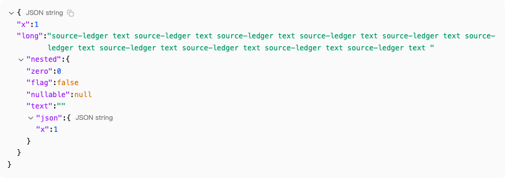
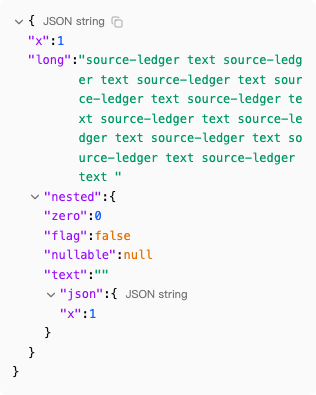

# SDK browser assertion repair — 2026-11-12

## Conclusion and cause

The three failures reported during PR #174 were stale browser assertions, not
incorrect SDK value preservation. The affected cases are **JSON-looking string**,
**nested object** and **nested array** in `sdkValueContract.spec.ts`.

Commit `historical-source-revision-redacted` introduced a display-only
projection for serialized objects/arrays: Original Tree and JSON modes show an
expandable tree with a **JSON string** marker. Its existing DOM tests explicitly
require retaining the received string for copying. The older SDK browser test
still compared the entire tree's text with the literal escaped wire string. It
therefore failed before reaching its Original-copy assertions.

That same display change also added a root copy button. The old unscoped
`getByTitle("Copy")` now matches both the section header and tree root. Merely
changing the expected text would leave that second obsolete assumption intact.

The repair changes browser tests only. Product rendering, JSON parsing,
clipboard implementation, SDK handling and backend behavior are unchanged.

## What the repaired tests enforce

- Independent fixture expectations distinguish the readable tree from the exact
  wire string. Full rendered text and JSON-string marker counts remain strict.
  The test does not import the production parser to calculate its expectations.
- Enhanced copy retains the once-decoded SDK value. Original header and tree-root
  copy both retain the exact recorded attribute string, including its envelope,
  escaping and whitespace. The clipboard is reset to a sentinel before every
  click, so an inactive second button cannot pass using the first button's result.
- Long Original content is expanded and checked for vertical clipping. Keyboard
  collapse/expand remains functional, and copying a collapsed root leaves it
  collapsed while retaining the complete value.
- The original eleven value cases now run at 1440 × 1000 and 390 × 844. Two added
  cases cover whitespace inside a JSON-looking string and the unsafe integer
  `9007199254740993`, whose literal representation must not be rounded into a tree.
- The existing SDK ERROR/filter/Chain/Graph/Timeline case is retained.

## Verification

Baseline: main `historical-source-revision-redacted`. Both before and after
use this unchanged product source; the `ai-vision/vfe/src` Git tree is
`923ac763cc643beb1ce9a9a1f53b324dab5b4019`. The accompanying test revision and
artifact hashes are recorded in the [manifest](images/sdk-contract-20261112/evidence.json).

Commands run from `ai-vision/vfe/`:

| Check | Result |
| --- | --- |
| Original three cases against the baseline build | All 3 reproduced the stale display assertion |
| Modified-file ESLint, Prettier, TypeScript typecheck | Passed |
| Production and development builds | Passed; existing bundle-size warning remains |
| Complete repaired SDK browser suite on production build | 27 passed, zero failed |
| JSON detail / enhanced evidence / session IO DOM tests | 38 passed, zero failed |
| Full browser suite on the development build | 435 passed, zero failed, 6.2 minutes; two workers, no retries |

```sh
node node_modules/eslint/bin/eslint.js tests/e2e/sdkValueContract.spec.ts
npm run typecheck
npm run build
node node_modules/@playwright/test/cli.js test tests/e2e/sdkValueContract.spec.ts

node --experimental-strip-types --test \
  tests/jsonDetailInteractionDom.test.ts \
  tests/enhancedCallEvidenceDom.test.ts tests/sessionIO.test.ts

npm run build -- --mode development
node node_modules/@playwright/test/cli.js test --global-timeout 600000
```

## Existing UI inspected in the production build

These are direct browser captures of the unchanged UI after expanding the full
content. This PR repairs test expectations; it does not introduce a visual
before/after change.

| Desktop, nested object | Phone viewport, same object |
| --- | --- |
|  |  |

## Evidence boundaries

The browser cases use synthetic SDK-shaped API fixtures and the actual compiled
frontend. They establish rendering, keyboard interaction and real browser
clipboard behavior; they do not establish fresh SDK ingestion, provider calls or
backend/database acceptance. No PowerContext/Baidu requests were made for this
test-only repair. Phone checks use Chromium viewport emulation, not a physical
device, Safari or an OS keyboard. Hosted checks are reported separately on the PR.
