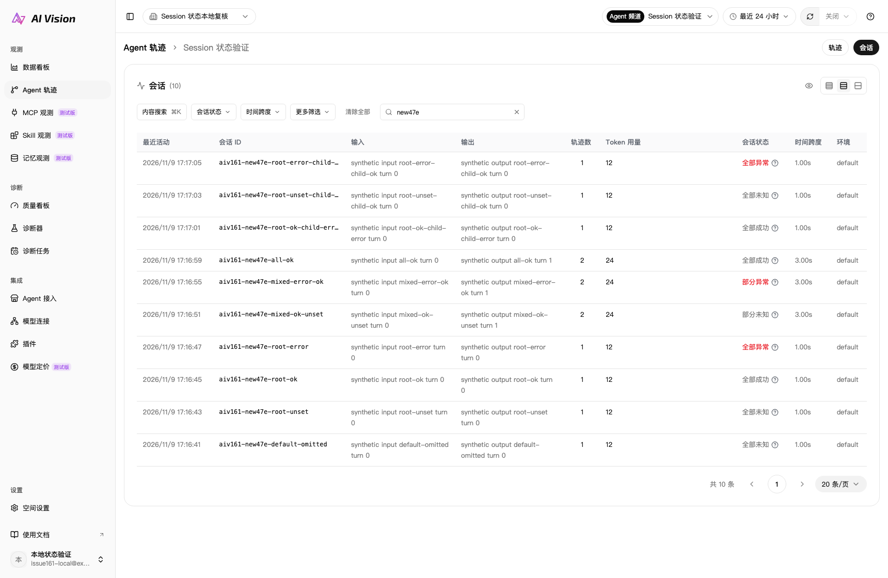
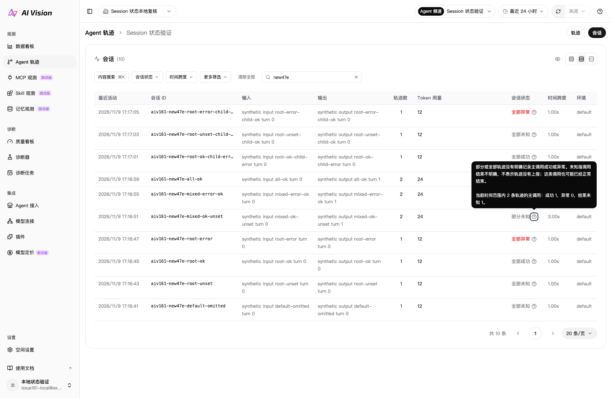

# Session status validation

## Scope and source identity

This local validation covers issue `#161` in the former development repository. Valid default outcomes were displayed as incomplete reporting, and absent Session-status fields were silently treated as defaults.

The original runs used baseline `historical-source-revision-redacted` plus the local changes bound by SHA-256 in [the evidence receipt](evidence/session-status-20261109.json). These pre-commit runs are not relabelled as hosted CI or testing of a different commit. The final PR records its exact head separately.

## Expected and observed behavior

| Complete Session root evidence in the selected window | Chinese display |
|---|---|
| All roots explicitly report success | 全部成功 |
| Some roots report an error | 部分异常 |
| Every root reports an error, including a one-Trace Session | 全部异常 |
| Successful and default/unconfirmed root outcomes are mixed | 部分未知 |
| All root outcomes remain default/unconfirmed | 全部未知 |
| Session-status field is absent, null or empty | 状态未上报 |
| Session-status value is unrecognized | 状态无法识别 |

Unknown describes an unconfirmed outcome, not missing telemetry. The help explains that these calls may have ended normally. Errors retain aggregate precedence. Counts include the complete Session within the time/Agent scope, not just matching turns or loaded child Spans. Older responses without valid counts do not acquire invented all/partial classifications.

## Local checks

From `ai-vision/vfe/`, the following completed successfully:

- Modified-file ESLint and Prettier checks.
- `npm run typecheck` and `npm run build` (the existing large-bundle warning remains).
- `npm test`: 1,701 test executions across 32 script summaries, zero failures. Some script groups overlap; this is not a unique-case count.
- Focused DOM suites for native Session previews, Trace summaries and list filters: 50 tests passed. Added cases exercise missing/invalid statuses, incomplete or contradictory counts, complete Session versus matching subset, mixed outcomes and one-Trace all-error classification.

From `ai-vision/aivision-py-be/`, Python 3.12/Django tests used separate in-memory SQLite settings, not the running platform database. The canonical Session suite passed 20 tests after expected missing-count failures in the initial test-first run. Related Session, read-model, provider, pagination and logging checks passed 138 tests.

The whole-backend attempt was **not green**: 1,773 tests, 51 skipped, two failures and six errors. Local listener restrictions, SQLite transaction/order behavior and a temporary logging override accounted for the environment/harness errors; affected checks passed individually after correcting the harness. Two unrelated assertions also fail on the unchanged baseline:

- `IntegrationLifecycleTests.test_team_source_plugins_can_restore_but_cannot_use_trace_confirmation`
- `AgentDownloadLatestTests.test_hermes_source_guide_does_not_offer_an_unbuilt_cli_installer`

No whole-backend success or hosted-CI success is claimed. Independent read-only source and screenshot reviews found no blocking issue in the change.

## Real-service acceptance

The path was authenticated collector → SigNoz → real local seekdb → Django HTTP → actual Chromium. SigNoz source was `dad3892b00c8b8e06e0b544eb5be82cffcc8337c`; the collector image came from `historical-source-revision-redacted`, with no collector source differences to the product baseline. The control-plane database was isolated SQLite. Cached local dependencies were reused; this was not cold-install or released-artifact qualification.

Two synthetic cohorts each contained 10 Sessions, 13 Traces and 16 Spans. One cohort retained projections produced by backend `historical-source-revision-redacted`; the other represented new arrivals. The latest fixed backend returned matching results in both `read_model/ready` and `raw_snapshot` HTTP modes. All 26 root physical/payload/projection status chains matched the known synthetic source. All 32 raw Spans and 26 persisted projections remained unchanged after this response/display fix; no rebuild was required.

Browser interactions verified:

- Focus opens the mixed-outcome explanation, Escape closes it, and clicking help does not open the Session drawer.
- The mixed Session explains successful 1, error 0, unknown 1 across its two Traces.
- The unknown filter retains wire value `unset` and selects four Sessions: three entirely unknown and one partly unknown.
- Chinese, English and Japanese labels were inspected in light/dark themes at 1720×1120. At 960×1080, actual table scrolling exposed the complete label without clipping.

The missing/unrecognized field fallbacks were covered by rendered DOM tests; they were not injected into the real-service screenshots. These checks do not establish remote EZsell historical data integrity, a data-plane schema upgrade, Linux-VM acceptance for this patch, or live-model behavior.

## Actual screenshots

All content is synthetic. These are original captures of the running product, without response interception, DOM replacement or image annotations. The visible `new47e` search text is the synthetic cohort name.

Before: normal default outcomes have output and reported Tokens but appear as incomplete reporting.

After: successful, all/partial error and all/partial unknown outcomes are distinguished.

Mixed-outcome help uses the complete Session's root counts.

