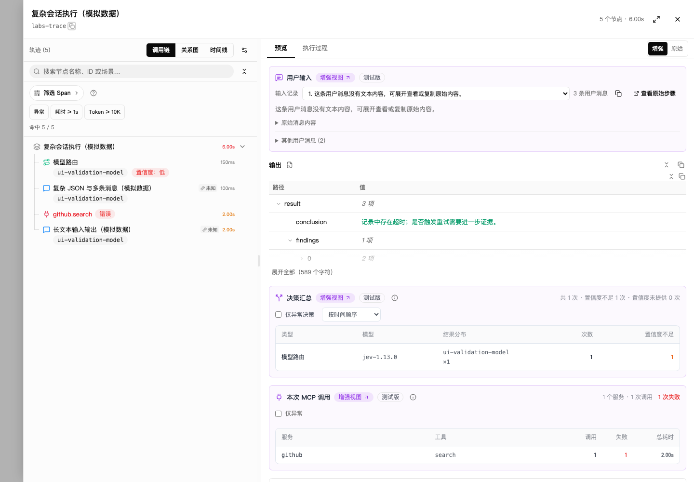
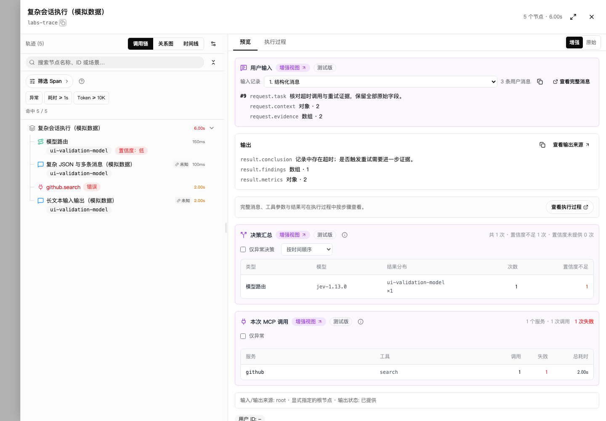
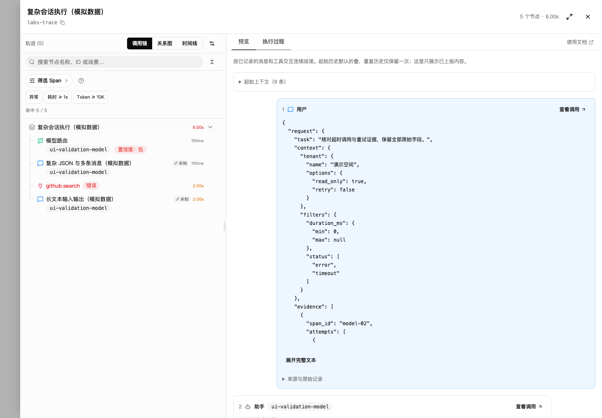
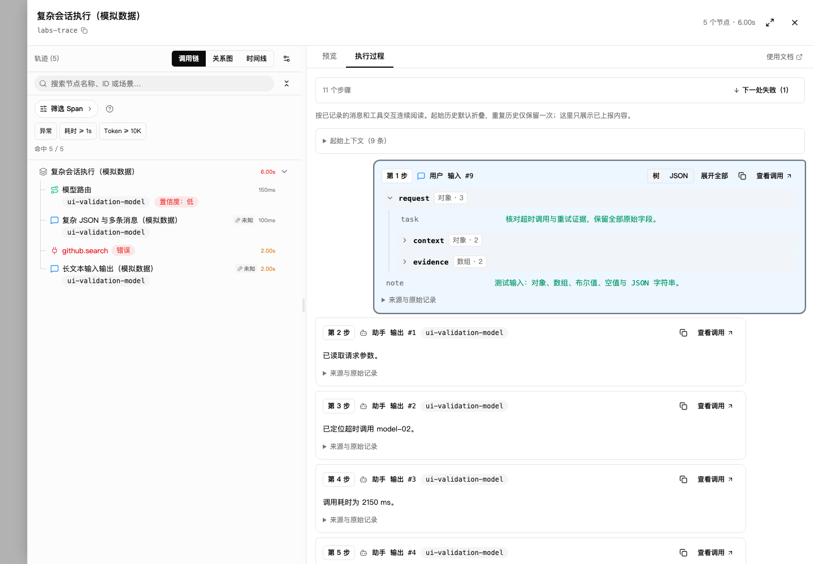
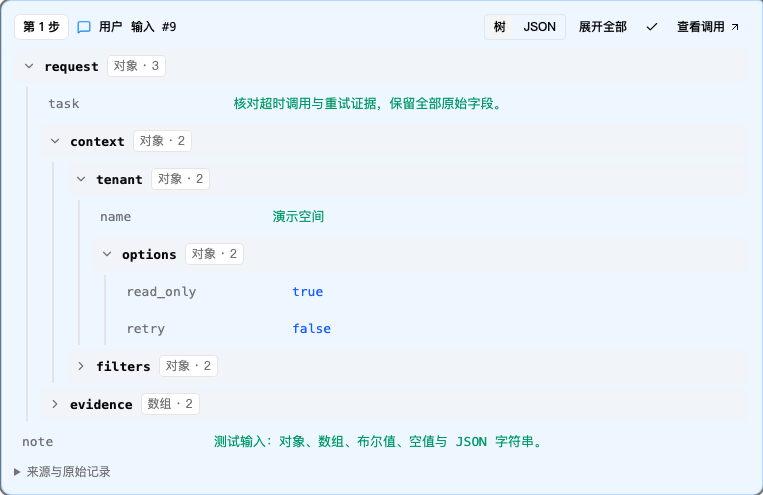
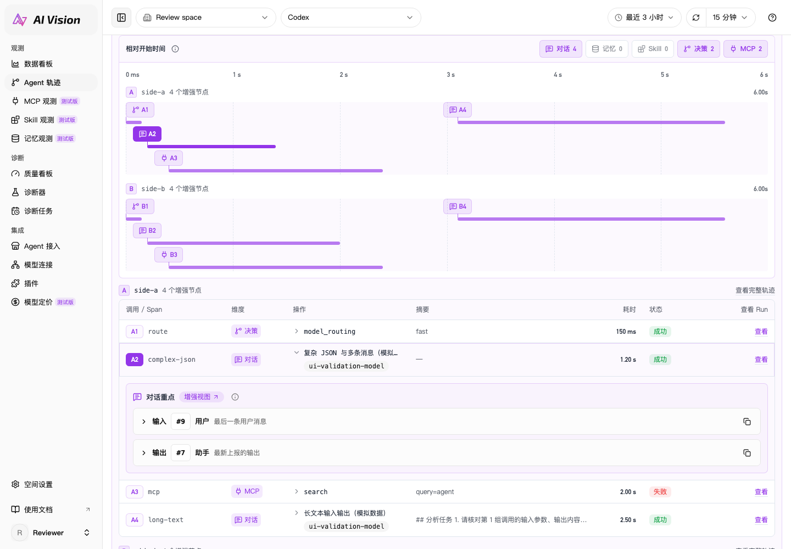
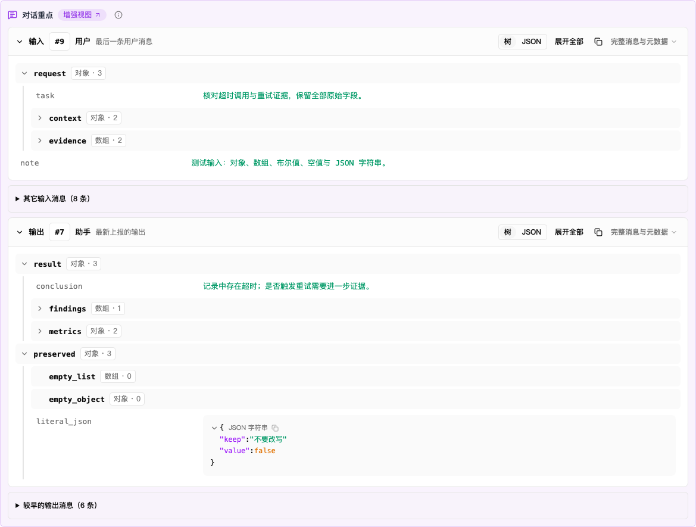

# Trace conversation and execution process review

Local review on 2026-11-17: macOS, Node 26.10.0, pnpm 12.6.0, Playwright Chromium, production Vite bundle. Tested source is `historical-source-revision-redacted` plus this PR's frontend changes, including new files. The adjacent [source manifest](screenshots/trace-conversation-process/source-manifest.json) records the tested file contents. The PR description pins the resulting commit.

## Behavior and review fixes

The root overview retains bounded request/output excerpts and aggregate signals. The execution process owns chronological messages, tool arguments/results and source navigation. Call details retain recorded IO. Message indexes remain distinct from process step numbers; JSON defaults to one expanded container level, with deeper branches on demand. Expanded text and JSON flow through the page without nested vertical payload scrolling. Conversation calls now appear in the Trace comparison timeline and selected rows. Long model-call labels use a single ellipsized line with the full title on hover, followed by the model badge.

Independent read-only review found and resolved these navigation defects:

- Legacy overview output now follows its actual source call. Overview and details share `spanIO` selection, so derived message projections cannot displace original SDK output.
- A fallback to a conversation call opens the requested input/output section. The other section stays folded.
- Canonical output only links to a call when its value matches that call's recorded output. Unproven provenance keeps the complete value readable and copyable in the overview.
- Root-detail shortcuts focus their destination tab. Normal returns restore the source control, or fall back to the active tab if that source is no longer available.

Browser assertions cover exact source targeting, ambiguous fallback, repeated navigation, JSON expansion, selected input source, filters, scroll position and keyboard focus across overview/process/call-detail round trips. Original mode copies complete transport strings including whitespace/newlines; structured copies retain false, zero, null, empty values, literal JSON strings and extra message/block metadata. Unknown output remains distinct from an explicitly recorded null.

## Validation

Run from `ai-vision/vfe`:

- Modified TypeScript files: ESLint passed; `pnpm run typecheck` and `pnpm run build` passed. Existing bundle-size and outDir warnings remain.
- Node tests from `test:trace-evidence`, `test:trace-filters`, `test:trace-process`, `test:traceCompare`, `test:session-io`, and `test:i18n`, deduplicated into one `node --experimental-strip-types --test ...` invocation: **608 passed**.
- **83 browser tests passed** across `traceConversation`, `traceConversationComplex`, `traceCompareDecisions`, `traceCompareEvidence`, `traceRootProcess`, `traceRootProcessReview`, `relayTraceProcess`, and `traceUserInput`. The production preview ran on port 41967; a temporary config inherited `playwright.config.ts`, disabled its automatic server, and set the matching base URL.
- `git diff --check` passed. No dependency, API, storage or version changes.

The root-process fixture includes nine input messages, seven output messages, nested JSON, 16-section input text, 18-section output text, a decision and a failed MCP call. Coverage includes Chinese/English/Japanese, light/dark themes, desktop and narrow layouts. These are synthetic API fixtures, not real provider responses, SDK ingestion or backend integration acceptance. Hosted CI is reported separately on the PR. No production deployment was performed.

## Runtime screenshots

These seven curated screenshots are intentionally versioned review evidence (under 1 MB), not generated application assets. Before images come from the earlier 2026-11-17 inspection on `historical-source-revision-redacted` plus the compact-conversation work in progress, **before the root/process changes**. They are not screenshots of pristine main. After images use this PR's final production build and the same root/process fixture, at 1440 × 1000. JSON/expanded-detail images are element captures; the test temporarily removes the outer scrollport clipping for the capture, after separately asserting normal page-flow behavior.

| State | Before root/process optimization | After |
| --- | --- | --- |
| Root overview |  |  |
| Execution process |  |  |

Expanded nested JSON, retaining message #9 and its source action:

Trace comparison timeline and compact selected conversation; input/output expand independently:

