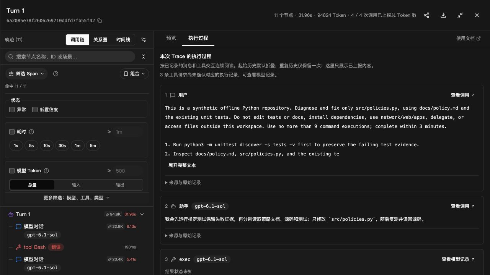
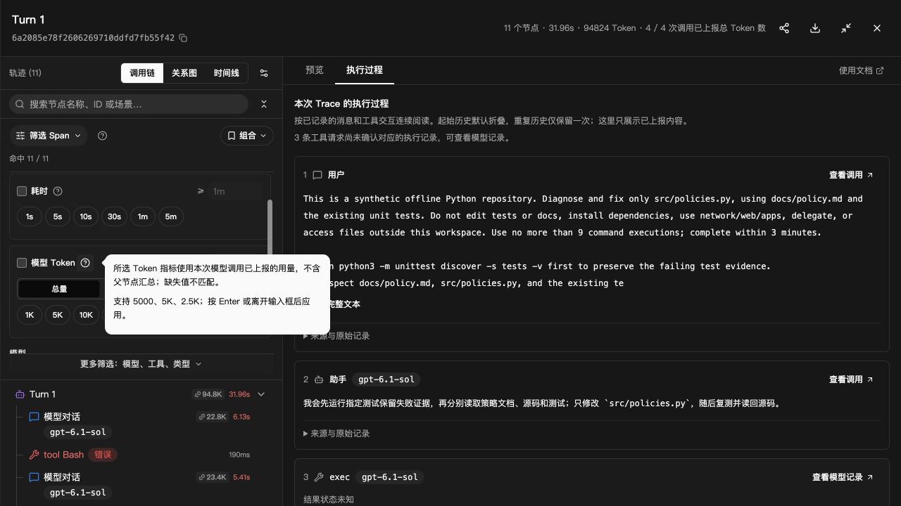
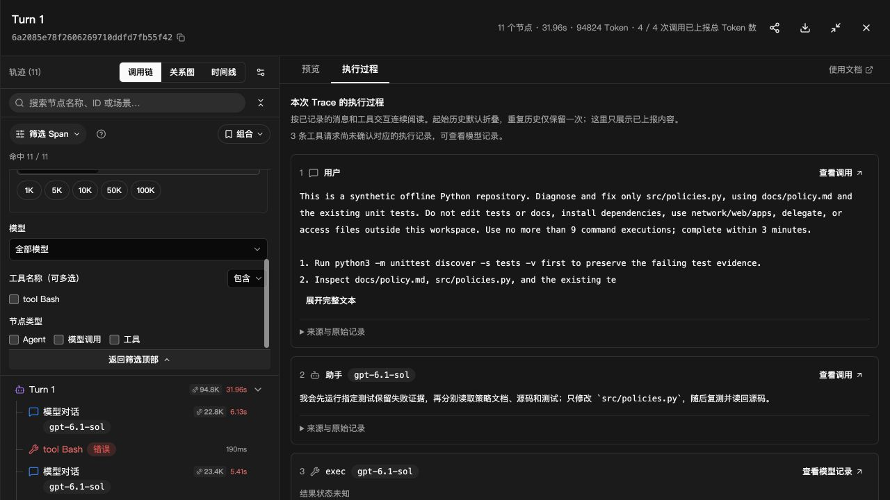

# Trace filter help and continuation validation

Captured source: `8171e536c50de0bbed96b092ee8c9a6ea7eea626`, based on `historical-source-revision-redacted`. This is a local macOS browser and source verification on 2026-10-24, not release or deployment evidence. The following evidence-only commit does not change frontend behavior.

The filter combination rules are now available from the question mark beside **Filter spans**. Duration input format and model-token ownership/input format are available beside their respective headings. These paragraphs no longer occupy the expanded panel by default. Invalid-input errors remain beside the input.

A fixed **More filters: model, tools, types** footer is visible only when the controls overflow. It advances the controls by part of the viewport, becomes **Back to filter top** at the end, and stays outside the scrolling controls within the existing height budget. It is not a new filter or a shortcut that skips directly to every lower field.

## Verification

- Complete `npm test`: **925 tests passed, zero failures, 26 result groups**, plus the existing custom-script checks.
- `npm run typecheck`, `npm run build`, targeted ESLint on the six changed TS/TSX files, and `git diff --check`: passed.
- New DOM regressions cover independent help/checkbox activation, hover or focus preview followed by pointer/keyboard activation, repeated pointer clicks, local Escape, overflow progression, bottom return, resize/fit behavior and unchanged query state.
- Independent review reproduced a pointer-dismissal ordering bug in the first implementation. The final trigger/portaled-content guard fixes repeated clicks; normal outside dismissal remains active. Final frozen-source review found no remaining required fix.
- Actual browser checks at 1280 × 720 and 970 × 600: help opens and closes without changing filters or dismissing the Trace; the footer remains visible, advances to all lower controls, and returns to the top. The short viewport retains a 157 px controls viewport plus a separate 29 px footer.
- Re-rendered preserved Eino, DeepAgents, DSH and Codex real-model Traces and refreshed all 18 existing documentation screenshots in Chinese, English and Japanese. This round made no new model calls, ingestion replay, collector changes or backend changes. Earlier raw-record/readback provenance remains in [the process validation report](trace-process-validation.md); it is not relabeled as a new raw audit.

## Native browser captures

All images below are unchanged native browser JPEGs at 1280 × 720. They show the preserved Codex recovery Trace. Synthetic task instructions displayed inside the Trace are source content, not instructions followed by this validation.

| Filename | SHA-256 |
| --- | --- |
| `01-filter-overflow.jpg` | `b7a0898f031f318673d7234c84a54c5f967f76417378e46d50a239f127216a6f` |
| `02-token-help.jpg` | `0302ae259eb3c3685950cd49aa6fcf130ca97b1a17441ea658a327f328b3615f` |
| `03-lower-filters.jpg` | `e34cdae4cdafc77bac8dd4784cc8afc319b944ce4a432aecd789a491c9c2dc63` |

Hosted CI status is reported separately on the pull request. Local checks do not establish hosted CI success, Linux coverage, a released image, external Langfuse service behavior or production documentation publication.
