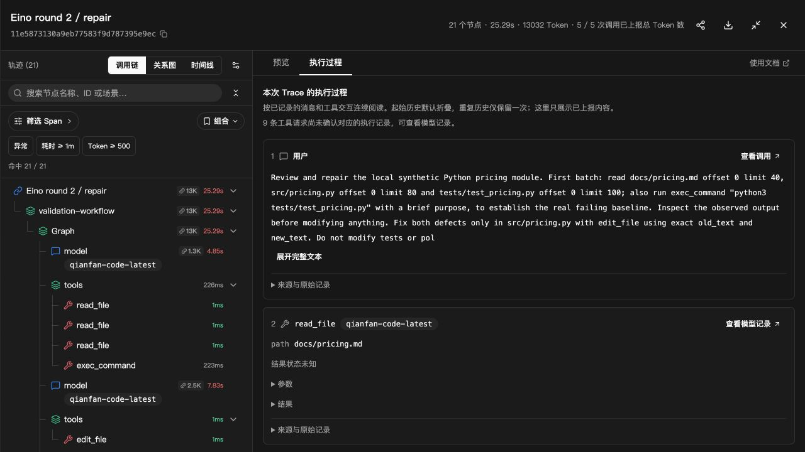
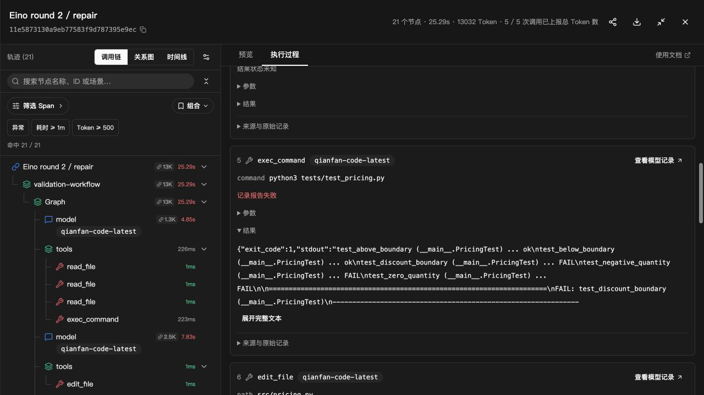
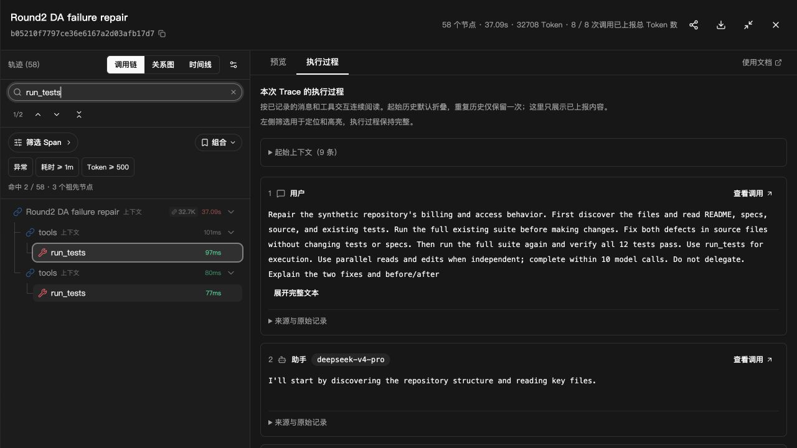
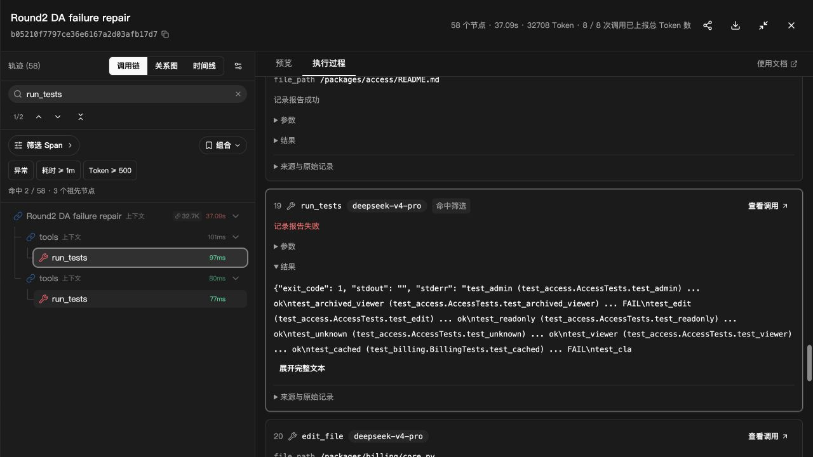
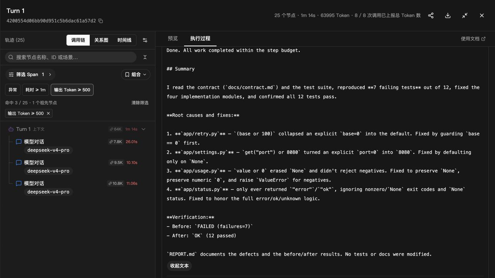
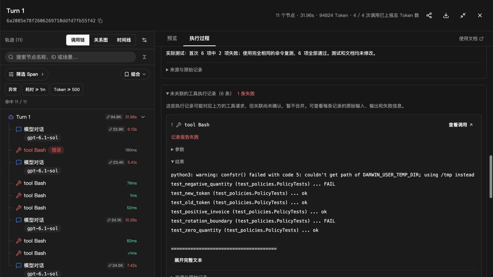

# Single-Trace execution process: validation evidence

The Trace detail replaces the log table with an execution-process reader. It presents recorded messages, tool requests and results, keeps initial context folded, and links each item back to its original Span or Observation. The existing call-chain, graph, timeline, raw IO, and export remain available. Native Span filters locate and highlight relevant process sources while retaining the complete process.

This record covers the execution-process addition in PR `#113` in the former development repository. The earlier [Span-filter validation record](../../ai-vision/docs/traces/validation/trace-span-filters.md) remains historical evidence for the filter layout. The execution process is a replacement for the right-hand log tab, not a fourth structural view or a cross-Trace Session view.

## Revision and evidence boundary

- Tested source commit: `0f071a9c1f7dfdd39e1bb3acba79b0a31b922733`.
- PR comparison base: `historical-source-revision-redacted`; previous PR head before this addition: `223d1f8cbc69917a826c9132e9e48d562c7ac5f6`.
- Automated checks and captures used the implementation before its source commit was created. All 19 surviving changed frontend/package/test files in the test inventory were subsequently verified byte-for-byte against the source commit and the current checkout. A later evidence-only commit may add this report and its images.
- Local environment: macOS / Apple Silicon, Node.js `v26.10.0`, Vite frontend, and an authenticated task-owned backend with previously stored Trace data. Selected screenshots use the Codex in-app browser at 1280 × 720, Chinese, dark theme.
- The eight inputs are preserved real-model executions of synthetic repository exercises. This round performed fresh authenticated reads, offline projection checks, and local browser interaction checks. It made no new model call, re-ingestion, release, or deployment.
- The browser checks exercise Native Trace detail. External Langfuse and legacy OTel Observation routes have adapter, masking, and navigation test evidence; they were not verified against live external services in this round. No Linux, Kubernetes, released-image, or production-site result is implied.

## Preserved Trace corpus

Fresh authenticated reads returned complete data for eight Traces / 271 Spans. Trace IDs, Span IDs, all original per-Span objects, and input/export source were preserved relative to the earlier saved corpus. Entire response bytes were not identical to the historical responses, and the DSH code-audit response also returned its Spans in a different order. The projection receipt is pinned to the fresh response hashes rather than assuming historical byte identity.

| Framework | Case | Spans | Main process entries | Tool requests | Requests linked to actual tool Spans | Separate unlinked tool executions |
| --- | --- | ---: | ---: | ---: | ---: | ---: |
| Eino | Repair | 21 | 11 | 9 | 0 | 9, including 1 failure |
| Eino | Recovery | 17 | 12 | 7 | 0 | 7, including 1 failure |
| DeepAgents | Repair | 58 | 23 | 20 | 20 | 0 |
| DeepAgents | Subagents | 96 | 41 | 34 | 34 | 0 |
| DSH | Repair | 25 | 20 | 16 | 16 | 0 |
| DSH | Code audit | 27 | 22 | 20 | 20 | 0 |
| Codex | Readonly | 16 | 11 | 7 | 0 | 7 |
| Codex | Recovery | 11 | 7 | 3 | 0 | 6, including 1 failure |

Every listed message-level tool request has a recorded result. The request and separate-execution columns can describe the same underlying activity and must not be added as a call total. Initial context and framework wrapper Spans do not each become a process entry.

These saved Eino and Codex inputs do not establish a unique exact-ID association between message requests and actual tool Spans. The reader exposes the model record for the request and keeps actual executions in a separate folded section with a visible failure count. It does not guess associations by name, timestamp, or order. This is a property of these preserved inputs, not a claim that every current collector version has the same gap. DeepAgents and DSH inputs provide exact IDs and support direct tool-Span navigation.

## Actual UI and interactions

All six images below are original, byte-for-byte runtime screenshots. Each was visually checked before inclusion. They contain synthetic exercise content and no credentials, personal information, or local absolute working-directory paths. DeepAgents paths such as `/packages/access/README.md` refer to its synthetic virtual repository; the generic `/tmp` text in Codex is a recorded runtime diagnostic. Raw exports, full prompts, authentication settings, and private capture receipts are excluded.

### Eino: compact overview and recorded failure

The repair Trace shows the user request followed by tool requests. Parameters, results, and source details start folded. The unmatched-request notice identifies the association limit without hiding the model record.

Expanding the failing `exec_command` result shows its recorded `exit_code: 1` and test output. Opening the model source and returning preserved the open result and reading position. A normal-pointer check recorded the same process scroll position before and after return (`852.5` CSS pixels). Searching for the source model reduced the tree to 1 / 21 matching Spans plus 3 ancestors while keeping all 11 main process entries.

### DeepAgents: locate a tool without truncating the process

Searching `run_tests` matches 2 / 58 Spans and retains 3 ancestors. The process still contains all 23 entries, with initial context folded. Its linked tool requests can open the actual execution Span.

The matching failed `run_tests` entry keeps its failure visible when folded and exposes the recorded result when expanded. Source navigation and return were exercised successfully.

### DSH: complete final response under a model-output filter

Output Tokens ≥ 500 matches 3 / 25 Spans plus 1 ancestor. All 20 process entries remain available. The browser check expanded a tool result, opened its source, returned to the process, and expanded the final response shown here. The response is the recorded model text, including its Markdown syntax; it is not a generated summary of the Trace.

### Codex: inspect a failure whose request association is unknown

The recovery Trace has 7 main process entries and 6 separately recorded tool executions. Their folded section reports one failure before expansion. The screenshot shows that failed execution's original result. Its source opens the actual Span; returning retains the process. Applying the error filter also retains the full process rather than dropping the successful recovery steps.

## Automated verification and review

Commands ran from `ai-vision/vfe/` unless stated otherwise. These are local results; hosted CI status is tracked separately on the PR.

| Check | Result |
| --- | --- |
| `npm test` | Passed: 923 Node test-runner tests across 26 result groups, zero failures, plus the repository's custom-script checks. Includes 93 filter tests and 38 execution-process / Observation tests. |
| `npm run typecheck` | Passed; independently rerun on the committed source. |
| `npm run build` | Passed. Vite reported its existing large-chunk advisory; this is not release-artifact validation. |
| `npx eslint … --max-warnings 0` | Passed on the 15 surviving TS/TSX files changed by this addition; independently rerun on the committed source. |
| Eight saved-response projections | Passed; 271 Spans, with the counts and association limits above. |
| Independent semantic reproductions | 8 / 8 passed against final reviewed source. |
| `git diff --check` | Passed for the source review and this evidence addition. |

The full test run emitted a JSDOM navigation diagnostic in an existing quick-diagnosis test; that test and the complete command passed. This does not establish browser navigation outside the explicit runtime interactions above.

The independent review reproduced and resolved four correctness categories: preserving distinct explicit message identities, pairing parts-protocol tool responses, retaining recorded failures through history/result overlap, and preventing canonical tool output from becoming an invented assistant message. Final source hashes match the committed implementation, and the review reported no remaining required fix in its checked scope.

The Observation tests cover masking before raw-data access, exact-ID linking, unknown input handling, and preserving the mounted process while inspecting a source. Its two shell-navigation tests substitute the process child; separate shared-process DOM tests exercise real expansion, payload presentation, callbacks, filter highlighting, failure/unlinked states, and non-text rendering without remote media. These tests do not replace live external-service coverage.

## Reproducibility identifiers

Detailed local receipts remain outside the repository. Their hashes identify the evidence summarized here without publishing full Trace responses or local configuration.

| Receipt | SHA-256 |
| --- | --- |
| Full frontend test log | `e9bd708a9570e150b02d11a93424c409b57478c4bf6ca16a1c62771622a9e915` |
| Frontend build log | `d9effa3a6ef4d7609b79dfa2afd1189cdfbcc55cdb53962e4cbe2bea1e21d5b6` |
| Fresh-readback and historical-object audit | `d0143a562239aea13b1ec8248630fe206637b4c4af71163ded5de9b8003dc759` |
| Saved-response projection receipt | `3e76daf6605ebad0da97184a30c28431ae141f2c0870920a9170a37d50489f1c` |
| Independent semantic review | `5ee639b6a8f5e7a898f235bdfb8131eaaa77078cf1d8a79efcd7b6e6f0a76058` |
| Four-framework browser checks | `db25a138267876dc815db93da93a8218c649eda22066b43716d065a78f63105a` |
| Eino normal-pointer source/return check | `8226291442af95fc9eeb64e65f759012654cc10091264b7b0fd1c30cb88230bf` |
| Tested source inventory | `73f0bcfe1b16e71057d68c9dfb4f0e9b45c558c3eefd5ff9846b1e0d352c580d` |

| Included JPEG | Bytes | SHA-256 |
| --- | ---: | --- |
| `01-eino-overview-zh-dark.jpg` | 89,864 | `f528566484b2b0ce201404fa3a42d25f9a5446cbedb146d07a4f3c44032fa74a` |
| `02-eino-failure-expanded-zh-dark.jpg` | 87,464 | `d1168c891ebf15b2009556b44f628dbd9a9f41c7faa8ee27975bc0c50dfc0f0b` |
| `06-dsh-final-zh-dark.jpg` | 92,499 | `c32ab99e9c93461e2aa9a93143873456f72676ac7e204d71c15bc1fcfb155ccd` |
| `07-deepagents-overview-zh-dark.jpg` | 90,525 | `e8f9985194d759f84835449b77512d63b954c83164a3763acd41014b916122ad` |
| `08-deepagents-failure-zh-dark.jpg` | 83,149 | `54f75b4b2f780177f63d262fb3878935a7517cb7b8f035ab03bc5144dfa46158` |
| `10-codex-failure-zh-dark.jpg` | 91,519 | `759937d27e3b8a51893e7a04ca997d8b126609b3fd0a6e32eefedc5c69233115` |
