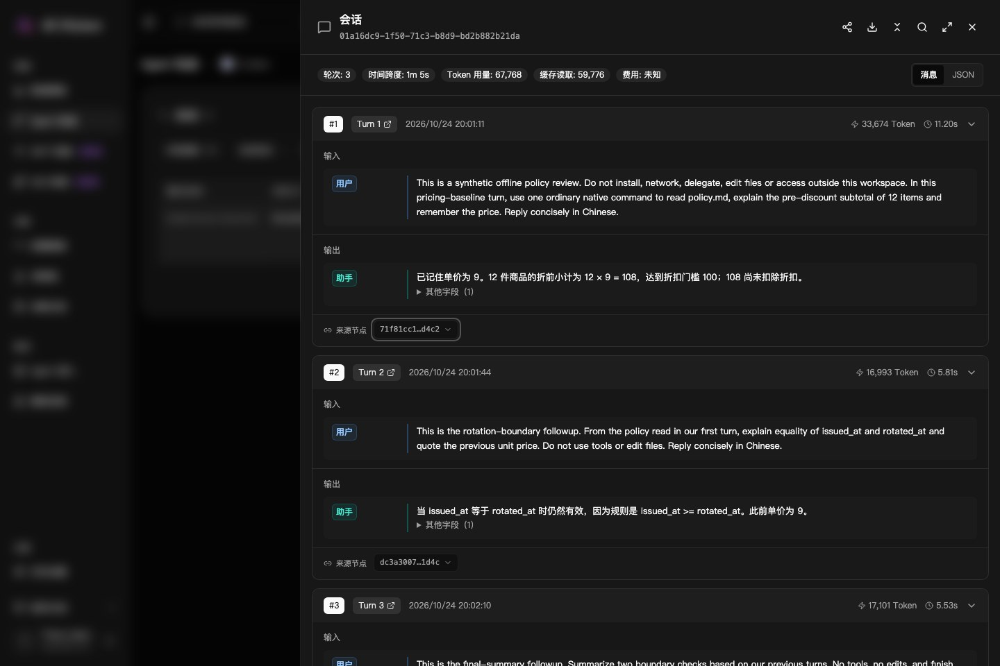
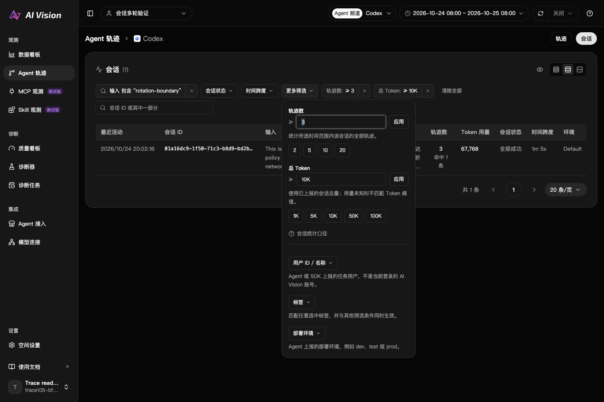

# Trace and Session query validation — 2026-10-25

This is the initial release review. It recorded a sustained 10k-session slowdown on the retained candidate; those adverse observations remain unchanged below. The [follow-up recovery report](session-query-recovery-20261025.md) adds actual SQL attribution, isolated seekdb / OceanBase CE copies, current-source paired timings and tested query/storage rollback. The new strategies remain opt-in: no service, image or default mode has been promoted.

## Functional scope

- Native Trace and Session lists share explicit content/identity/filter semantics. Session matching retains every authorized turn inside the selected range, complete statistics and matching-turn IDs.
- URL restoration, pagination, instance/source/time/query cache separation, display-safe list previews and legacy hydration are covered by focused regressions. Unsupported source/view conditions are cleared with a notice instead of silently ignored.
- Optional revision-checked Trace/Session read models keep legacy/shadow/prefer modes and explicit capability fallbacks. The independent Session Token strategy defaults off, including the zero-threshold case.
- Session contents use one Messages/JSON switch for all turns. Role colors identify speakers; identical provenance coalesces only when Trace ID, Span ID and selection rule all agree. Full values remain accessible.

## Fresh checks

| Check | Result |
| --- | --- |
| Modified frontend files: ESLint → TypeScript → production build | Passed in order; 28 TS/TSX paths |
| Frontend filter/session/evidence/process/i18n/source tests | 352 passed |
| Backend native query, scope, facets, summary, pagination, previews, read model, session and OpenAPI tests | 143 passed |
| Go modules/aivision, ingest, OceanBase store and API server packages | 71 top-level tests passed; 6 SQL integration tests skipped without a DSN |
| Fixed-data differential/correctness reads | 52 passed |
| Current Python boundary-fix API smoke | 16 passed; separate temporary backend stopped afterward |
| Native browser behavior | Three locales × two themes, 6 JSON fields, Messages restoration, keyboard source disclosure, full-session statistics |

Cross-review fixed conflicting Trace aliases, literal SDK/session/tag whitespace, legal Unicode values beyond the optional wire byte limits, hidden unsupported Langfuse filters and a Japanese role-label wrap. The current Python smoke includes Eino, DeepAgents, DeepSeekHarness and Codex (three-turn synthetic tasks previously run with real models). This review did not call a model or ingest new telemetry. Go padded tags have parser-unit evidence, not a new live padded-tag fixture.

## Performance

The 220 read requests comprise 52 correctness checks, 8 warmups and 160 formal observations. Each formal cell has n=20; percentiles use linear interpolation at `(n-1)*q`. HTTP timing includes server processing, full download and JSON parsing; authentication/oracle checks are outside the timer. Keep warmups, correctness, errors and later smoke reads separate. [Sanitized samples and source hashes](evidence/trace-session-query-20261025.json) preserve all formal values. Root independently recomputed the eight distributions.

| Sessions × Traces | Query | Current P50 / P95 ms | Previous candidate P95 ms (n=30) |
| --- | --- | --- | --- |
| scale-10000x3 | Content + metadata | 3,199.0 / 4,973.4 | 1,226.4 |
| scale-10000x3 | List | 3,215.0 / 5,256.1 | 1,181.1 |
| scale-10000x3 | Total Tokens ≥ 100 | 7,140.9 / 9,489.7 | 4,680.4 |
| scale-10000x3 | Total Tokens ≥ 0 | 7,250.5 / 9,332.1 | 4,746.5 |
| scale-1000x3 | Content + metadata | 310.3 / 355.1 | 315.1 |
| scale-1000x3 | List | 308.7 / 350.5 | 446.7 |
| scale-1000x3 | Total Tokens ≥ 100 | 683.5 / 751.9 | 812.9 |
| scale-1000x3 | Total Tokens ≥ 0 | 694.2 / 794.1 | 796.9 |

All timed and correctness reads passed their result oracles with zero errors. This does not establish acceptable latency. At 10k, Token 100 P95 is 9.49s and zero-threshold P95 is 9.33s; ordinary list P95 is 5.26s. A separate Token 0 + content correctness observation took 14.25s (n=1, not a percentile). The historical ordinary 1k list regression, 171.77 → 446.67ms, remains recorded even though this retest observed 350.52ms. Cross-time comparisons do not isolate causality.

The running binary, PIDs and modes stayed unchanged. Exact six-scope raw/projection counts and complete result hashes matched archived evidence. Two read-only EXPLAIN plans still show range scans and hash grouping, with different estimates; estimates are not measured rows or time and do not explain the slowdown. No statistics, index, hint, timeout or feature flag was changed.

Formal timings bind the retained pre-boundary-fix runtime, whose source was verified before measurement. Later Python alias/literal/Unicode fixes and the Go tag-parser fix are source deltas, not silently relabeled benchmark code. The current Python API smoke separately verifies those Python fixes on the same data-plane binary. This is local prepared-environment evidence, not cold-start, Linux, production, WAN or sustained-capacity proof.

## Screenshots

Unmodified native dev-browser captures of dedicated synthetic tasks; role/message text is telemetry, not setup instructions. All twelve session documentation captures were visually reviewed in their locale/theme.

## Rollback and dependencies

See [rollout and rollback](../deployment/en/trace-read-model.md) for operator gates. The product remains usable with the old SigNoz APIs by default. Optimized endpoints need the companion ob-labs/signoz read-model change, authoritative tracked ingestion, valid coverage and the canonical projector. Legacy mode preserves the new filter semantics; disabling the Token strategy separately restores its original query without deleting data. No merge/deployment is part of this validation.
